# Лабораторная 5. Пространственная и частотная фильтрация

Код: [KZ_Lab5.py](../KZ_Lab5.py) (marimo, открывать `marimo edit KZ_Lab5.py` из папки `Lab5`).
Лекция: «Лекция 5. Пространственная обработка изображений».

## Карта темы

**Какую задачу решаем.** В лабе 4 мы меняли каждый пиксель отдельно: квантование, порог Оцу. Новый пиксель зависел только от старого значения этого же пикселя. Так нельзя ни размыть картинку, ни сделать её резче: чтобы понять, что пиксель лежит на границе или в шуме, нужно смотреть на его **соседей**. Эта лаба про операции над окрестностью пикселя.

На одну и ту же операцию можно смотреть двумя способами, и лаба показывает оба:

1. **Пространственный.** Берём маленькую матрицу весов (ядро), прикладываем к каждому пикселю и считаем взвешенную сумму соседей.
2. **Частотный.** Раскладываем картинку на волны разной частоты, часть волн ослабляем, часть усиливаем, собираем картинку обратно.

Главный вывод лабы: это **один и тот же** фильтр, записанный двумя способами. В ноутбуке это видно на числах: частотный фильтр из задания 6 дал ровно ту же картинку, что ядро резкости из задания 3 (разница 0 во всех внутренних пикселях).

**Порядок разбора:**

```
Часть 1
  изображение = таблица чисел
    → свёртка в одной позиции
    → ядро Гаусса (зад. 1) → filter2D по всей картинке (зад. 2)
    → ядро резкости = «единица минус лапласиан» (зад. 3)
  изображение = сумма волн
    → ДПФ на четырёх числах → спектр, log, fftshift (зад. 4)
    → теорема о свёртке: свёртка = умножение спектров
    → гауссов LPF (зад. 5) → HFE (зад. 6) = то же ядро резкости

Часть 2 (Гонсалес, скелет)
  1-я и 2-я производные → лапласиан → градиент Собела
    → маска «резкость там, где края» → гамма-коррекция
```

**Что нужно из прошлого:** изображение как массив яркостей 0–255 (лаба 1), гамма-преобразование $s = c \cdot r^{\gamma}$ (лекция 2), фильтры min/max как морфология (лекция 4).

**Что на этом строится дальше:** детекторы границ (Canny), пирамиды изображений и свёрточные нейросети. Первый слой CNN — это набор ядер $3 \times 3$ или $7 \times 7$, которые сеть подбирает сама. Обученные ядра ResNet очень похожи на Собела и Гаусса из этой лабы (лекция 5, слайды 94–95).

---

# Часть 1. Пространственная фильтрация

## 1. Свёртка в одной позиции

*Место на карте: базовая операция, из которой собраны все фильтры части 1.*

### Смысл

Фильтр берёт пиксель вместе с соседями, умножает каждого на свой вес и складывает. Результат записывается на место центрального пикселя. Матрица весов называется **ядром** (в лекции также маска, окно, шаблон, оператор). Окно сдвигается на следующий пиксель, и всё повторяется.

### Пример

Возьмём кусок картинки с вертикальной границей: слева тёмное (10), справа светлое (50).

$$
f =
\begin{bmatrix}
10 & 10 & 10 & 50 & 50 & 50 \\
10 & 10 & 10 & 50 & 50 & 50 \\
10 & 10 & 10 & 50 & 50 & 50
\end{bmatrix}
$$

И ядро «взвешенное среднее» со слайда 33 (дискретный Гаусс $3 \times 3$):

$$
w = \frac{1}{16}
\begin{bmatrix}
1 & 2 & 1 \\
2 & 4 & 2 \\
1 & 2 & 1
\end{bmatrix}
$$

Поставим центр окна на пиксель из средней строки, третий столбец (значение 10, справа от него уже 50). Окно накрывает столбцы 2, 3, 4:

$$
\begin{bmatrix}
10 & 10 & 50 \\
10 & 10 & 50 \\
10 & 10 & 50
\end{bmatrix}
$$

Перемножаем поэлементно с весами и складываем:

$$
\frac{1}{16}\big(1\cdot10 + 2\cdot10 + 1\cdot50 \;+\; 2\cdot10 + 4\cdot10 + 2\cdot50 \;+\; 1\cdot10 + 2\cdot10 + 1\cdot50\big) = \frac{320}{16} = 20
$$

Для соседнего пикселя (столбец 4, значение 50) получится $\frac{640}{16} = 40$. Средняя строка была $[10, 10, 10, 50, 50, 50]$, стала $[10, 10, 20, 40, 50, 50]$. Резкий скачок превратился в плавную лесенку: так выглядит размытие.

### Запись в общем виде

Для ядра $3 \times 3$ с весами $w(s, t)$, где $s, t \in \{-1, 0, 1\}$ — сдвиг от центра:

$$
g(x, y) = w(-1,-1) f(x-1, y-1) + w(-1,0) f(x-1, y) + \dots + w(1,1) f(x+1, y+1)
$$

То есть девять слагаемых, по одному на каждую клетку окна. Компактно (слайд 21):

$$
g(x, y) = \sum_{s=-a}^{a} \sum_{t=-b}^{b} w(s, t)\, f(x+s,\; y+t)
$$

- $a, b$ — полуразмеры ядра: для $3 \times 3$ это $a = b = 1$, для $7 \times 7$ это $3$;
- внутренняя сумма по $t$ проходит по одной строке окна, внешняя по $s$ перебирает строки;
- $f(x+s, y+t)$ — сосед, сдвинутый на $(s, t)$ от центра.

Это **корреляция**. У **свёртки** стоит $f(x-s, y-t)$, то есть ядро переворачивается на 180°. Для симметричных ядер (Гаусс, лапласиан, ядро резкости) разницы нет. `cv2.filter2D` на самом деле считает корреляцию, а в CNN её по привычке называют свёрткой (слайд 21).

**Что делать на краю.** У пикселя в углу нет соседей сверху и слева. `cv2.filter2D` по умолчанию зеркально отражает картинку за край (`BORDER_REFLECT_101`). Варианты перечислены на слайде 20.

---

## 2. Задание 1. Ядро Гаусса

*Место на карте: первое конкретное ядро. Оно размывает картинку и убирает шум.*

### Смысл

Простое среднее (box-фильтр, все веса равны) даёт «квадратные» артефакты (слайды 30–31). Расфокусированная точка света выглядит как размытый кружок, яркий в центре и тусклый к краям. Гауссово ядро делает то же самое: близкие соседи получают большой вес, дальние маленький.

### Формула

$$
G(x, y) = e^{-\frac{x^2 + y^2}{2\sigma^2}}
$$

- $x, y$ — сдвиг от центра ядра в пикселях;
- $x^2 + y^2$ — квадрат расстояния до центра; чем дальше сосед, тем меньше вес;
- $\sigma$ (сигма) — ширина колокола: чем она больше, тем дальше «дотягивается» ядро и тем сильнее размытие.

Пример для $\sigma = 1$, сосед справа от центра ($x = 1, y = 0$): $e^{-1/2} \approx 0.61$. Сосед по диагонали ($x = y = 1$): $e^{-2/2} = e^{-1} \approx 0.37$. Центр: $e^{0} = 1$.

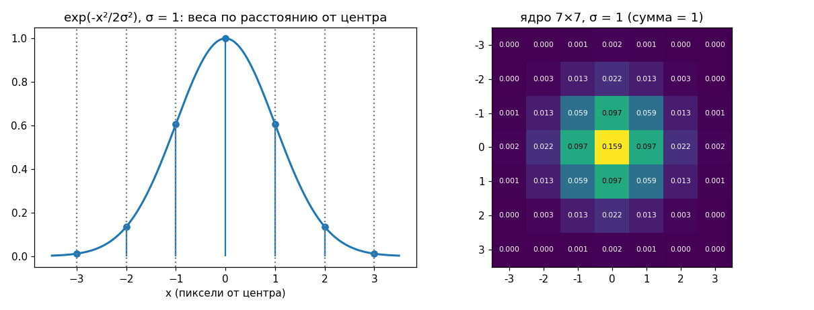

### Что делает код

```python
def gaussian_kernel(sigma):
    r = int(np.ceil(3 * sigma))
    x = np.arange(-r, r + 1)
    X, Y = np.meshgrid(x, x)
    G = np.exp(-(X**2 + Y**2) / (2 * sigma**2))
    return G / G.sum()
```

1. **Размер.** `r = ceil(3σ)` — полуразмер. Правило трёх сигм (слайд 35): дальше $3\sigma$ лежит 0.3 % «массы» колокола, такие веса почти нулевые. Для $\sigma = 1$ получаем $r = 3$, ядро $7 \times 7$.
2. **Сетка координат.** `meshgrid` делает две матрицы: в `X` номер столбца от центра, в `Y` номер строки. Для $r = 1$:

$$
X =
\begin{bmatrix}
-1 & 0 & 1 \\
-1 & 0 & 1 \\
-1 & 0 & 1
\end{bmatrix},
\quad
Y =
\begin{bmatrix}
-1 & -1 & -1 \\
0 & 0 & 0 \\
1 & 1 & 1
\end{bmatrix}
$$

   Поэтому `X**2 + Y**2` сразу даёт квадрат расстояния для каждой клетки.
3. **Нормировка** `G / G.sum()`: сумма весов становится равна 1. Без неё картинка стала бы светлее или темнее. Проверка на однородной области: все пиксели 80, результат $80 \cdot (\text{сумма весов}) = 80$, если сумма равна 1.

В ноутбуке ядро сравнивается с `cv2.getGaussianKernel(7, 1)`. OpenCV отдаёт одномерный столбец $g$, а двумерное ядро получается как $g \cdot g^T$ (столбец на строку). `np.allclose` вернул `True`: ядра совпали. Это свойство **сепарабельности** (слайд 40): двумерный Гаусс = одномерный по строкам, потом одномерный по столбцам. Так считать быстрее: для $15 \times 15$ нужно 30 умножений на пиксель вместо 225.

---

## 3. Задание 2. Применение через `cv2.filter2D`

*Место на карте: та же операция из раздела 1, но во всех позициях сразу.*

```python
blurred = {s: cv2.filter2D(gray, -1, gaussian_kernel(s)) for s in [1, 3, 7]}
```

- `-1` (ddepth) значит «результат того же типа, что вход», то есть `uint8`. Значения за пределами 0–255 OpenCV обрезает до границы (насыщение), а не «прокручивает».
- `filter2D` прикладывает ядро к каждому пикселю, как в примере раздела 1.

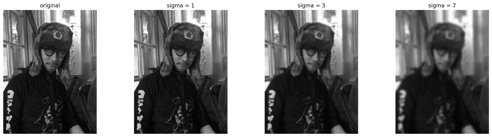

При $\sigma = 1$ исчезают зерно и мелкая фактура меха. При $\sigma = 3$ пропадает текст на рукаве. При $\sigma = 7$ остаются только крупные пятна. Чем больше $\sigma$, тем больше соседей участвует в среднем и тем крупнее детали, которые сглаживаются.

---

## 4. Задание 3. Ядро повышения резкости

*Место на карте: обратная задача к размытию. Это ядро потом встретится ещё раз в задании 6.*

### Смысл

Размытие усредняет пиксель с соседями и тем самым уменьшает разницу между ними. Повышение резкости делает обратное: **увеличивает разницу между пикселем и его соседями**. На границе тёмная сторона становится темнее, светлая светлее.

### Ядро

```python
sharpen = np.array([
    [0, -1, 0],
    [-1, 5, -1],
    [0, -1, 0],
])
```

Применим его к той же границе $[10, 10, 10, 50, 50, 50]$. Сосед сверху и снизу у каждого пикселя такой же, как он сам.

- Пиксель 10 вдали от границы: $5 \cdot 10 - 10 - 10 - 10 - 10 = 10$. На ровном месте ничего не меняется.
- Последний тёмный (10, справа 50): $5 \cdot 10 - 10 - 50 - 10 - 10 = -30$, обрезается до $0$.
- Первый светлый (50, слева 10): $5 \cdot 50 - 10 - 50 - 50 - 50 = 90$.

Строка стала $[10, 10, 0, 90, 50, 50]$. Перепад $10 \to 50$ превратился в $0 \to 90$: граница стала контрастнее, это и воспринимается как резкость.

### Откуда это ядро

Это «единичное ядро минус лапласиан»:

$$
\underbrace{\begin{bmatrix}
0 & 0 & 0 \\
0 & 1 & 0 \\
0 & 0 & 0
\end{bmatrix}}_{\text{ничего не меняет}}
-
\underbrace{\begin{bmatrix}
0 & 1 & 0 \\
1 & -4 & 1 \\
0 & 1 & 0
\end{bmatrix}}_{\text{лапласиан}}
=
\begin{bmatrix}
0 & -1 & 0 \\
-1 & 5 & -1 \\
0 & -1 & 0
\end{bmatrix}
$$

Лапласиан (подробно в части 2) — это «сумма соседей минус четыре центра». На ровном месте он равен 0, на деталях и границах большой. Вычитая его из картинки, мы добавляем к ней её же мелкие детали. Это составная маска со слайда 74: одна свёртка вместо двух. Сумма элементов ядра $5 - 4 = 1$, поэтому средняя яркость не меняется.

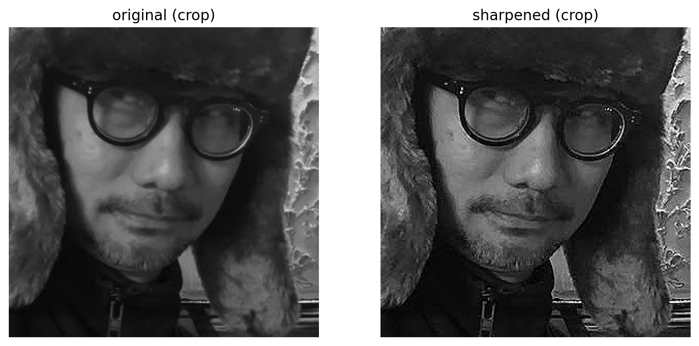

На фрагменте видно, что оправа очков, щетина и узор на стене стали чётче. Заодно усилился шум и артефакты JPEG (мелкие квадраты на коже): фильтр не отличает полезную мелкую деталь от шума. Эту проблему решает часть 2.

---

# Часть 1. Частотная фильтрация

## 5. Изображение как сумма волн

*Место на карте: второй взгляд на картинку. Без него непонятно, что рисует спектр.*

### Смысл

Любую строку яркостей можно представить как сумму волн (синусоид): постоянный уровень, медленная волна, побыстрее, ещё быстрее. Медленные волны отвечают за плавные перепады освещения, быстрые — за резкие границы, мелкие детали и шум. Двумерная картинка раскладывается на «полосатые» волны разной частоты и направления.

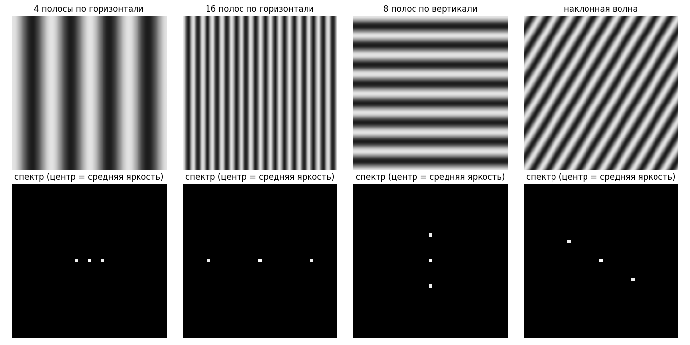

Каждая чистая волна даёт в спектре **пару симметричных точек** плюс точку в центре (средняя яркость 128). Чем чаще полосы, тем дальше точки от центра (4 полосы против 16). Направление тоже видно: вертикальные полосы дают точки на горизонтальной оси, горизонтальные на вертикальной, наклонная волна на наклонной прямой. Спектр отвечает на вопрос: **какие волны и с какой силой есть в картинке**.

### ДПФ на четырёх числах

Возьмём строку из четырёх пикселей $f = [3, 1, 3, 1]$. На глаз это среднее $2$ плюс «пила» с амплитудой $1$: $2+1, 2-1, 2+1, 2-1$.

Дискретное преобразование Фурье (ДПФ) для одной строки длины $N$:

$$
F(u) = \sum_{x=0}^{N-1} f(x)\, e^{-j 2\pi u x / N}
$$

Множитель $e^{-j 2\pi u x / N}$ — это волна, которая делает $u$ колебаний на всю строку. Сумма «примеряет» волну к сигналу: если они похожи, слагаемые складываются, если нет, гасят друг друга. Посчитаем.

- $u = 0$: волна $e^{0} = 1$ (константа). $F(0) = 3 + 1 + 3 + 1 = 8 = N \cdot \text{среднее}$.
- $u = 2$: $e^{-j\pi x} = (-1)^x$, то есть $+1, -1, +1, -1$. $F(2) = 3 - 1 + 3 - 1 = 4 = N \cdot \text{амплитуда пилы}$.
- $u = 1$: $e^{-j\pi x/2}$ даёт $1, -j, -1, j$. $F(1) = 3 - j - 3 + j = 0$. Такой волны в сигнале нет.

ДПФ нашло ровно то, что мы видели на глаз: среднее и одну быструю волну. В двумерном случае (слайд 6) то же самое, но волна идёт по двум осям сразу:

$$
F(u, v) = \sum_{x=0}^{M-1} \sum_{y=0}^{N-1} f(x, y)\, e^{-j 2\pi \left(\frac{u x}{M} + \frac{v y}{N}\right)}
$$

Обратное ДПФ (`np.fft.ifft2`) собирает картинку обратно из волн без потерь.

---

## 6. Задание 4. Спектр, логарифм и `fftshift`

*Место на карте: смотрим на спектр нашей фотографии, чтобы потом его менять.*

```python
F = np.fft.fft2(gray)
F_shift = np.fft.fftshift(F)
log_spectrum(F_shift)   # 20 * np.log10(1 + np.abs(F_shift))
```

**`np.abs`.** $F(u, v)$ — комплексное число. Его модуль $|F|$ показывает силу волны (амплитуду), угол показывает её сдвиг (фазу). Рисуем только амплитуду.

**Зачем логарифм.** $F(0, 0)$ равно сумме всех пикселей: $981 \cdot 736 \cdot (\text{средняя яркость около } 80) \approx 6 \cdot 10^7$. Высокие частоты в сотни и тысячи раз слабее. На обычной шкале был бы один белый пиксель в центре и чёрный фон. Логарифм сжимает диапазон: $\log_{10}(10^7) = 7$, $\log_{10}(10^3) = 3$, и оба видны. Единица в `1 + |F|` защищает от $\log(0)$. Множитель 20 переводит в децибелы, на картинку он не влияет.

**Зачем `fftshift`.** NumPy кладёт частоты в порядке $0, 1, 2, \dots, $ затем отрицательные $\dots, -2, -1$. Нулевая частота оказывается в левом верхнем углу, а низкие частоты разбросаны по четырём углам. `fftshift` меняет местами четверти по диагонали, и нулевая частота уезжает в центр. Перед обратным ДПФ нужно вернуть порядок через `ifftshift`, это делает функция `apply_filter`.

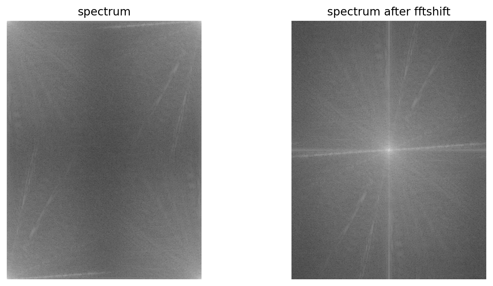

Как читать спектр после сдвига:

- центр — средняя яркость и плавные перепады; там энергии больше всего, поэтому он самый яркий;
- чем дальше от центра, тем мельче детали; на краях спектра шум и самые тонкие линии;
- светлый «крест» — это резкие скачки на краях картинки: ДПФ считает изображение периодическим, а верхний край не похож на нижний;
- наклонные светлые полосы — это длинные прямые границы на фото (рамы окна, спинка кресла). Полоса в спектре перпендикулярна линии на картинке.

---

## 7. Мост: теорема о свёртке

*Место на карте: объясняет, почему фильтрация спектра — это та же фильтрация, что в разделах 2–4.*

Теорема о свёртке:

$$
f * h \;\Longleftrightarrow\; F \cdot H
$$

Свернуть картинку $f$ с ядром $h$ — это то же самое, что **поэлементно умножить** спектр картинки $F$ на спектр ядра $H$ и сделать обратное ДПФ. $H(u, v)$ — это число, на которое умножается волна частоты $(u, v)$. Если $H < 1$, волна ослабляется, если $H > 1$, усиливается, если $H = 0$, вырезается.

Поэтому частотная фильтрация в коде всегда одна и та же:

```python
def apply_filter(F_shift, H):
    G_shift = F_shift * H                               # умножили спектр на маску
    g = np.fft.ifft2(np.fft.ifftshift(G_shift)).real    # вернули порядок, обратное ДПФ
    return G_shift, np.clip(np.round(g), 0, 255).astype(np.uint8)
```

После обратного ДПФ получаются комплексные числа с мнимой частью около $10^{-12}$ (ошибка округления), поэтому берём `.real`. Затем обрезаем до 0–255, как это делал `filter2D`.

**Координаты частот.** Маске нужно знать, какая частота в какой клетке спектра. `freq_grid` берёт `np.fft.fftfreq(M)` — частоты в **колебаниях на пиксель**, от $-0.5$ до $0.5$. Значение $0.5$ — самая быстрая возможная волна: пиксели чередуются светлый-тёмный-светлый. Это важно для задания 6.

---

## 8. Задание 5. Гауссов низкочастотный фильтр (LPF)

*Место на карте: размытие из задания 2, сделанное через спектр.*

### Смысл

Low-Pass Filter пропускает низкие частоты (центр спектра) и гасит высокие (края). Высокие частоты — это мелкие детали, поэтому без них картинка становится размытой.

### Маска

$$
H(u, v) = e^{-\frac{u^2 + v^2}{2 D_0^2}}
$$

Та же формула колокола, только теперь по частотам. В центре $H(0, 0) = 1$: средняя яркость сохраняется. $D_0$ — ширина колокола в частотах: волны дальше $D_0$ от центра сильно ослабляются.

Гаусс замечателен тем, что его спектр — тоже Гаусс. Пространственное ядро с шириной $\sigma$ соответствует частотной маске с шириной

$$
D_0 = \frac{1}{2\pi\sigma}
$$

Поэтому в ноутбуке $D_0$ подбирается из тех же $\sigma = 1, 3, 7$, что в задании 2. Чем шире ядро в пространстве, тем уже маска в спектре: $\sigma = 1 \to D_0 = 0.159$, $\sigma = 7 \to D_0 = 0.023$.

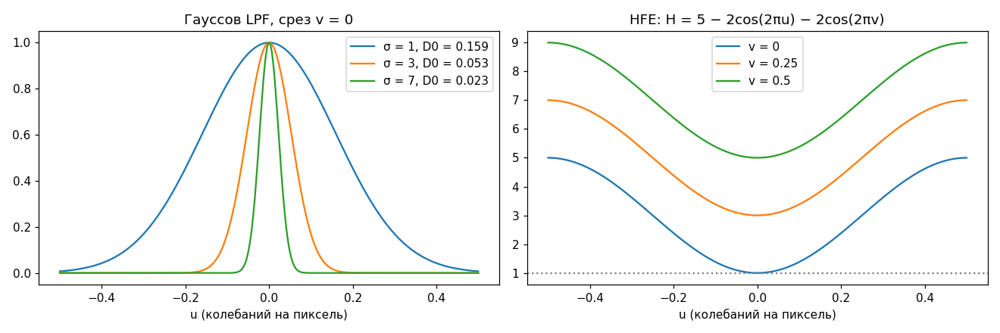

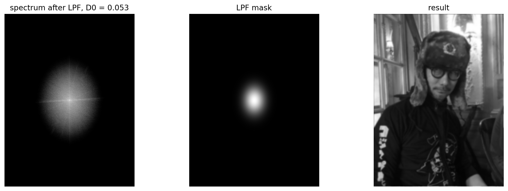

Слева спектр после умножения: всё, что дальше от центра, погашено. В центре маска (белое — 1, чёрное — 0). Маска на картинке вытянута по вертикали, хотя по частотам это круг: фото выше, чем шире (981 строка против 736 столбцов), и одна и та же частота по вертикали занимает больше пикселей спектра. Справа результат: размытие.

**Проверка в ноутбуке.** Результат для $\sigma = 3$ сравнивается с `filter2D` из задания 2 (без полосы 30 пикселей у краев): средняя разница $0.024$ уровня яркости, максимум $1$ (округление). Две картинки совпали. У самого края они различаются: `filter2D` отражает картинку за край, а ДПФ считает её периодической и подмешивает к верхнему краю нижний.

---

## 9. Задание 6. Фильтр усиления высоких частот (HFE)

*Место на карте: резкость из задания 3, сделанная через спектр. Здесь сходятся обе половины части 1.*

### Маска

$$
H(u, v) = 5 - 2\cos(2\pi u) - 2\cos(2\pi v)
$$

Посчитаем в нескольких точках ($u, v$ в колебаниях на пиксель):

| Где | $u$ | $v$ | $H$ | Что это значит |
|---|---|---|---|---|
| центр | $0$ | $0$ | $5 - 2 - 2 = 1$ | средняя яркость не меняется |
| самая быстрая волна по одной оси | $0.5$ | $0$ | $5 + 2 - 2 = 5$ | усиление в 5 раз |
| угол спектра | $0.5$ | $0.5$ | $5 + 2 + 2 = 9$ | мельчайшие детали усилены в 9 раз |

Маска — «чаша»: $1$ в центре, растёт к краям. Низкие частоты проходят как есть, высокие усиливаются. В ноутбуке напечатано `1.0 8.99...`, то есть минимум и максимум маски.

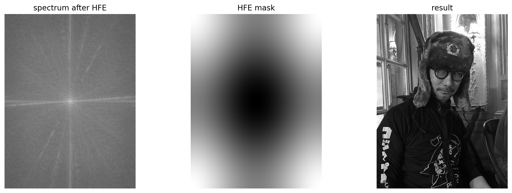

### Почему это то же самое, что ядро резкости

Найдём спектр ядра из задания 3 по формуле ДПФ. Ненулевые элементы ядра: центр $5$ и четыре соседа $-1$ со сдвигами $(\pm1, 0)$ и $(0, \pm1)$:

$$
H(u, v) = 5 \cdot e^{0} \;-\; e^{-j2\pi u} - e^{+j2\pi u} \;-\; e^{-j2\pi v} - e^{+j2\pi v}
$$

По формуле Эйлера $e^{j\theta} + e^{-j\theta} = 2\cos\theta$, поэтому

$$
H(u, v) = 5 - 2\cos(2\pi u) - 2\cos(2\pi v)
$$

Это ровно формула из задания. **Маска HFE — это спектр ядра резкости.** По теореме о свёртке умножение на неё равносильно свёртке с этим ядром. Ноутбук это подтверждает: разница между результатом HFE и результатом `filter2D` из задания 3 во внутренних пикселях равна `0.0 0`, то есть картинки совпали до пикселя.

---

# Часть 2. Улучшение снимка скелета (Гонсалес, п. 3.8)

*Место на карте: собираем несколько фильтров в одну цепочку, где каждый закрывает слабость другого.*

### Задача

Снимок — сканирование всего тела (радиоизотопное). Он тёмный, шумный, с узким диапазоном яркостей. Хотим сделать кости чётче и светлее. Простое повышение резкости из задания 3 здесь плохо подходит: оно усилит и края костей, и шум, а шума на снимке много.

Идея Гонсалеса: резкость нужна **только там, где есть края**, а на ровных шумных участках её нужно гасить. Для этого понадобятся два инструмента: вторая производная (лапласиан) для деталей и первая производная (градиент) для поиска краёв.

## 10. Первая и вторая производная

Производная показывает, как быстро меняется яркость. Для пикселей производная — это разность соседей (слайд 62):

- первая: $f(x+1) - f(x-1)$, ядро $[-1, 0, 1]$;
- вторая: $f(x+1) + f(x-1) - 2f(x)$, ядро $[1, -2, 1]$.

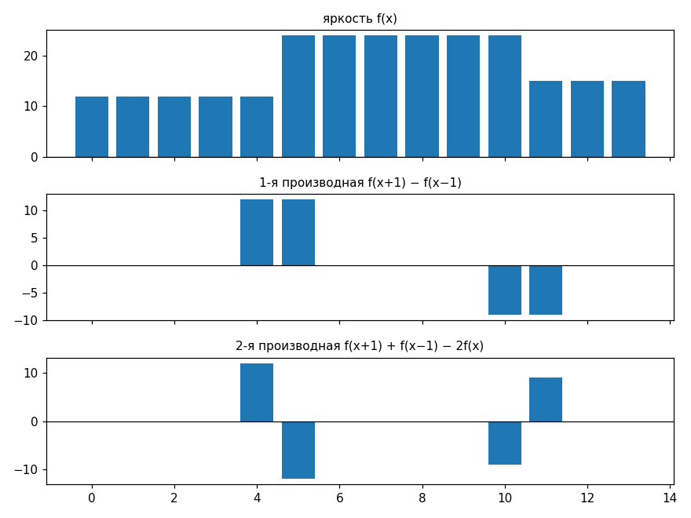

Из графика:

- на ровных участках обе производные равны 0;
- первая производная даёт **толстый** отклик (два пикселя подряд) на любом перепаде. Она хорошо **находит края**;
- вторая даёт **двойной** отклик $+12, -12$ с переходом через ноль ровно на границе. Она реагирует на мелкие детали, тонкие линии и точки, и поэтому хорошо **усиливает детали**, но так же сильно реагирует на шум (слайды 66–67).

## 11. (b), (c) Лапласиан и резкость

Лапласиан — вторая производная по обеим осям сразу. Ядро с диагоналями (слайд 71):

$$
\begin{bmatrix}
1 & 1 & 1 \\
1 & -8 & 1 \\
1 & 1 & 1
\end{bmatrix}
$$

«Сумма восьми соседей минус восемь центров». На той же границе $[10, 10, 10, 50, 50, 50]$ он даст $[0, 0, 120, -120, 0, 0]$: ноль на ровных местах и пара $+/-$ на границе. Проверка для третьего пикселя: соседи $3\cdot10 + 3\cdot50 + 2\cdot10 = 200$, минус $8 \cdot 10 = 80$, итого $120$.

Центр ядра отрицательный, поэтому лапласиан **вычитают** (слайд 72): $c = f - \nabla^2 f$. На границе получится $[10, 10, -110 \to 0, 170, 50, 50]$: тот же эффект, что у ядра резкости.

Два момента в коде:

- картинка переводится в `float64` (`f = skeleton.astype(np.float64)`). В `uint8` арифметика «прокручивается»: `np.uint8(200) + np.uint8(100)` даёт 44, а отрицательные значения лапласиана вообще не помещаются. Все промежуточные шаги считаются в float, в `uint8` переводим только для показа;
- у лапласиана есть отрицательные значения, поэтому для картинки (b) он растягивается в 0–255 функцией `scale` (минимум → 0, максимум → 255). Серый фон на (b) — это ноль.

## 12. (d), (e) Градиент Собела и его сглаживание

Градиент — это первая производная по двум осям. Оператор Собела (слайд 83) берёт разность не двух пикселей, а двух столбцов (строк) с весами $1, 2, 1$, что делает его устойчивее к шуму:

$$
G_x =
\begin{bmatrix}
-1 & 0 & 1 \\
-2 & 0 & 2 \\
-1 & 0 & 1
\end{bmatrix},
\quad
G_y =
\begin{bmatrix}
-1 & -2 & -1 \\
0 & 0 & 0 \\
1 & 2 & 1
\end{bmatrix}
$$

На нашей границе для третьего пикселя: $G_x$ даёт $(1+2+1)\cdot 50 - (1+2+1)\cdot 10 = 160$, $G_y = 0$ (строки одинаковые). Сила края $|G_x| + |G_y|$ (быстрая замена корню $\sqrt{G_x^2 + G_y^2}$, слайд 81) равна $160$.

Затем градиент сглаживается средним $5 \times 5$ (`cv2.blur`). На краях костей градиент большой на целой полосе, и после усреднения он остаётся большим. Шум даёт отдельные случайные всплески, после усреднения они почти исчезают. Картинка (e) — **карта «здесь край»**: светлая вдоль костей, тёмная на фоне и внутри мягких тканей.

## 13. (f), (g) Маска и сложение

```python
mask = c * grad_smooth / grad_smooth.max()
g = np.clip(f + mask, 0, 255)
```

- `grad_smooth / grad_smooth.max()` — вес от 0 до 1: около 1 на сильных краях, около 0 на ровном фоне;
- `c * вес` — картинка с резкостью (c), но только там, где края. На ровных шумных участках она почти погашена;
- `f + mask` — добавляем эту «резкость по краям» к исходному снимку.

Нормировку на максимум Гонсалес явно не пишет. Без неё произведение $c \cdot e$ достигает десятков тысяч и после обрезки всё станет белым, поэтому вес приводится к диапазону 0–1.

## 14. (h) Гамма-коррекция

Снимок (g) стал чётче, но остался тёмным. Степенное преобразование из лекции 2:

$$
s = 255 \cdot \left(\frac{r}{255}\right)^{0.5}
$$

Для $\gamma = 0.5$ это квадратный корень, он сильнее всего поднимает тёмные значения: $r = 10 \to 50$, $r = 64 \to 128$, $r = 255 \to 255$. Резкость здесь ни при чём: преобразование работает с каждым пикселем отдельно и только растягивает тёмный диапазон, чтобы стали видны детали в тенях.

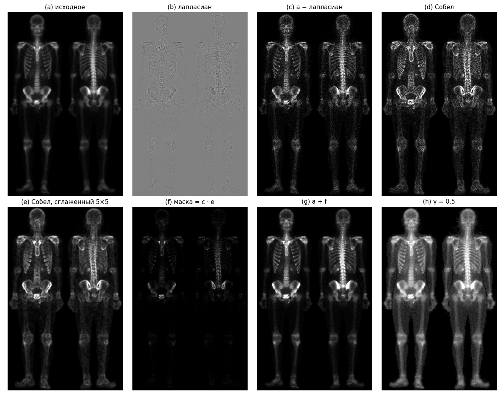

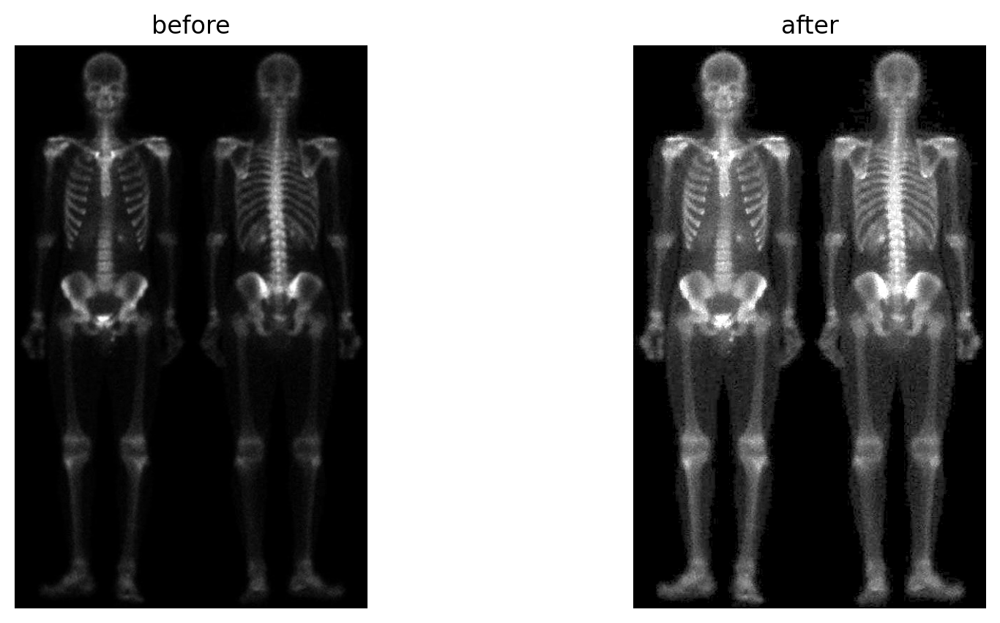

На результате видны рёбра, позвонки, контуры таза и костей ног, которых на исходнике почти не было видно. Шум на фоне усилился меньше, чем было бы при простом повышении резкости, потому что там маска близка к нулю.

---

## Как всё складывается

Пройдём по карте ещё раз на одном примере: граница $[10, 10, 10, 50, 50, 50]$.

1. **Свёртка** — взвешенная сумма соседей. Гаусс $\frac{1}{16}[1\,2\,1; \dots]$ превращает границу в $[10, 10, 20, 40, 50, 50]$: размытие.
2. **Ядро резкости** $= $ единица $-$ лапласиан превращает ту же границу в $[10, 10, 0, 90, 50, 50]$: перепад вырос.
3. **Спектр.** Резкая граница состоит из многих волн, в том числе быстрых. Размытая лесенка — в основном из медленных.
4. **LPF** гасит быстрые волны, и граница становится лесенкой. Это тот же Гаусс, что в пункте 1, при $D_0 = \frac{1}{2\pi\sigma}$.
5. **HFE** умножает быстрые волны на число до 9, а медленные оставляет как есть. По формуле Эйлера маска HFE равна спектру ядра из пункта 2, и ноутбук это подтвердил: разница 0.
6. **Часть 2** разделяет работу: вторая производная (лапласиан) усиливает детали, первая (Собел, сглаженный) решает, **где** их усиливать, гамма вытаскивает тёмный диапазон.

Каждый пункт карты теперь — конкретная операция с понятным результатом.

Что дальше. Свёрточная нейросеть — это много ядер $3 \times 3$ подряд, только веса не записаны руками, а подобраны обучением. Первый слой обычной сети сам приходит к ядрам, похожим на Гаусса и Собела. Частотный взгляд пригодится для быстрых свёрток большими ядрами (через FFT) и для понимания, почему перед уменьшением картинки её нужно размыть (иначе появляется алиасинг).

## Что сказать на защите (коротко)

- **Зад. 1.** Ядро Гаусса строю по формуле $e^{-(x^2+y^2)/2\sigma^2}$ на сетке $(2r+1) \times (2r+1)$, $r = \lceil 3\sigma \rceil$, нормирую на сумму, чтобы не менялась яркость. Совпадает с OpenCV.
- **Зад. 2.** `filter2D` прикладывает ядро к каждому пикселю. Больше $\sigma$ — сильнее размытие.
- **Зад. 3.** Ядро $[0,-1,0; -1,5,-1; 0,-1,0]$ = единица минус лапласиан. Сумма весов 1, на ровных местах ничего не меняет, на границах увеличивает перепад.
- **Зад. 4.** `fft2` раскладывает картинку на волны, `fftshift` ставит нулевую частоту в центр, логарифм сжимает огромный диапазон амплитуд. Центр — плавные перепады, края — мелкие детали.
- **Зад. 5.** Умножаю спектр на гауссов колокол и делаю обратное ДПФ. Это то же размытие, что в задании 2, при $D_0 = 1/(2\pi\sigma)$; результаты совпали.
- **Зад. 6.** Маска $5 - 2\cos 2\pi u - 2\cos 2\pi v$ равна 1 в центре и 9 в углах, усиливает высокие частоты. Это ДПФ ядра из задания 3, и результаты совпали до пикселя.
- **Часть 2.** Лапласиан даёт резкость, но шумит. Сглаженный Собел показывает, где края. Их произведение — резкость только по краям. Добавляю к исходнику и поднимаю тёмные тона гаммой 0.5.

## Проверь себя

**1. Что будет, если в `gaussian_kernel` убрать деление на `G.sum()`?**

<details>
<summary>Ответ</summary>

Сумма весов для $\sigma = 1$ станет $2\pi\sigma^2 \approx 6.3$ вместо 1. Каждый пиксель умножится примерно на 6.3, и почти вся картинка обрежется до 255 (белая). Нормировка нужна, чтобы на однородной области результат равнялся исходной яркости.

</details>

**2. Посчитай ядро резкости в центре одиночной яркой точки: точка 100, все соседи 10.**

<details>
<summary>Ответ</summary>

$5 \cdot 100 - 4 \cdot 10 = 460$, после обрезки $255$. А у соседа справа: $5 \cdot 10 - 100 - 10 - 10 - 10 = -80 \to 0$. Точка стала ярче, вокруг неё появилось тёмное кольцо: контраст точки с фоном вырос.

</details>

**3. Если в формулу HFE подставить номера пикселей спектра $u = 0, 1, 2, \dots$ вместо `fftfreq`, что получится?**

<details>
<summary>Ответ</summary>

Для целого $u$ $\cos(2\pi u) = 1$, поэтому $H = 5 - 2 - 2 = 1$ во всех клетках. Спектр умножится на единицу, и картинка не изменится. Формула рассчитана на частоты в колебаниях на пиксель, от $-0.5$ до $0.5$.

</details>

**4. В задании 5 увеличили $\sigma$ с 3 до 7. Маска в спектре станет шире или уже, картинка резче или мутнее?**

<details>
<summary>Ответ</summary>

$D_0 = 1/(2\pi\sigma)$ уменьшится с $0.053$ до $0.023$: маска станет уже и пропустит меньше частот. Останутся только самые медленные волны, картинка станет мутнее. Широкое ядро в пространстве = узкая маска в спектре.

</details>

**5. Зачем в части 2 умножать картинку (c) на сглаженный градиент, а не просто сложить (a) и (c)?**

<details>
<summary>Ответ</summary>

(c) содержит лапласиан, а он сильно реагирует на шум, которого на снимке много. Сложение (a) и (c) усилило бы шум по всему снимку. Сглаженный градиент близок к нулю на ровных шумных участках и велик на краях костей, поэтому произведение оставляет резкость только на краях.

</details>
