# Лабораторная работа №2: метод наискорейшего градиентного спуск

## Часть 1. Зачем это нужно

### Задача оптимизации

Представь, что функция — это рельеф местности. Точка $(x, y)$ — это где ты стоишь, а значение $f(x, y)$ — высота в этой точке.

**Задача минимизации** — найти точку, в которой значение функции наименьшее. То есть найти самое низкое место на карте.

Почему это важно? В машинном обучении $f$ — это ошибка модели, а $x, y$ — её параметры. Модель делает предсказания, функция потерь измеряет, насколько они плохие. Обучить модель значит подобрать параметры, при которых ошибка минимальна. В нейросети параметров может быть миллион, но идея та же, что у нас с двумя.

Простую функцию можно решить на бумаге. Для сложной общей формулы нет. Поэтому ищем минимум **численно**: стартуем из какой-то точки и шаг за шагом спускаемся вниз.

Представь, что ты стоишь на горе в густом тумане. Карты нет, видно только землю под ногами. Что ты сделаешь? Нащупаешь, где склон идёт вниз, и шагнёшь туда. Потом ещё раз. Весь метод из этой лабораторной — это такая прогулка, записанная формулами.

Нам нужно разобрать три вопроса:

1. Как понять, куда склон идёт вниз? Ответ: градиент.
2. Как далеко шагать? Ответ: одномерный поиск шага.
3. Когда остановиться? Ответ: критерии остановки.

---

## Часть 2. Производная и экстремумы

### Производная: куда меняется функция

Начнём с одной переменной. **Производная** показывает, как быстро меняется функция в данной точке. На графике это наклон касательной: прямой, которая прикасается к кривой в этой точке.

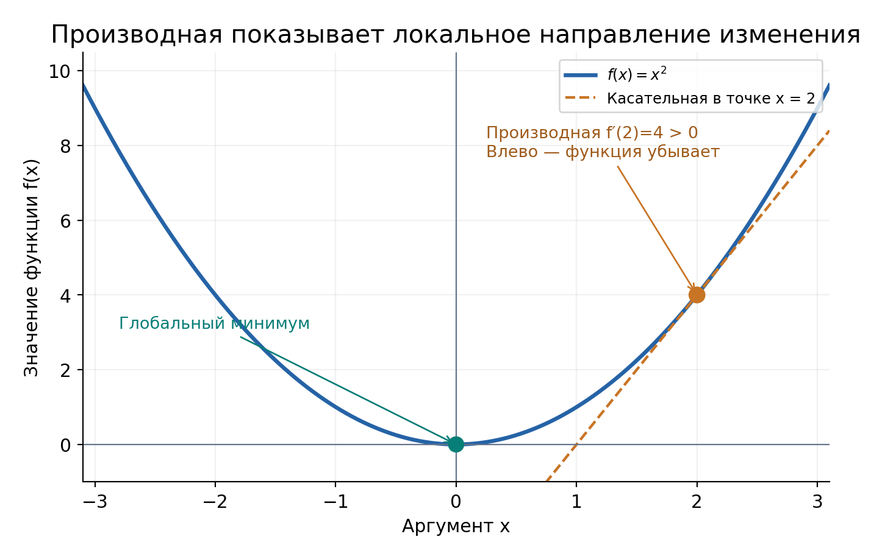

Для $f(x)=x^2$ производная равна:

$$
f'(x)=2x
$$

Эту формулу просто берём как готовое правило. Посмотрим, что она говорит:

- В точке $x=2$ получаем $f'(2)=4>0$. Наклон положительный: идём вправо, функция растёт. Значит, чтобы спуститься, надо идти влево.
- В точке $x=-2$ получаем $f'(-2)=-4<0$. Идём вправо, функция падает. Значит, спускаться надо вправо.
- В точке $x=0$ получаем $f'(0)=0$. Касательная горизонтальна, склона нет.

<mark>Запомни главное: чтобы спуститься, идём в сторону, противоположную знаку производной.</mark>

**Спроси:** в точке $x=5$ производная $x^2$ равна 10. Куда идти, чтобы функция уменьшилась?

**Ответ:** влево, потому что производная положительная.

### Точки экстремума

**Экстремум** — это точка минимума или максимума функции.

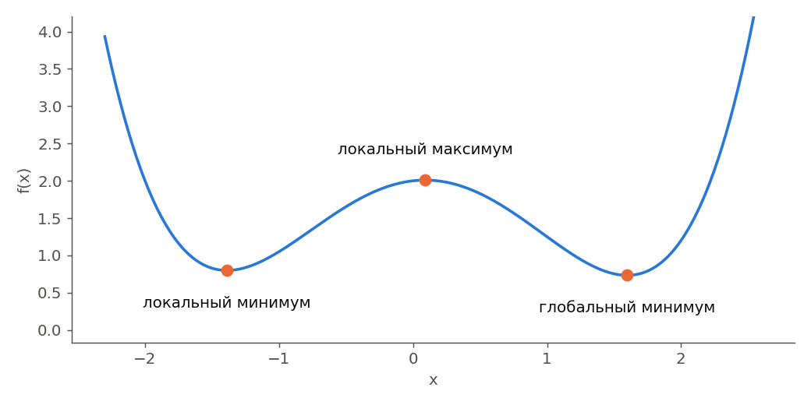

- **Локальный минимум** — точка ниже всех своих соседей. Где-то дальше может быть ещё ниже.
- **Глобальный минимум** — самая низкая точка на всей области.

На картинке две ямы. В левой мы окажемся на дне и решим, что всё нашли, хотя правая яма глубже. Человек в тумане этого не узнает. Запомни этот момент, он вернётся в конце.

Здесь важно различать две вещи:

- Точка минимума — где достигается минимум, например $(3, 0.5)$.
- Значение минимума — чему равна функция в этой точке, например $0$.

##### Как найти экстремум

На дне ямы и на вершине холма склона нет, поэтому для гладкой функции внутри области все производные там равны нулю. Такая точка называется **стационарной**.

Обратное неверно: нулевая производная ещё не доказывает, что это экстремум. Есть **седло**: в одну сторону функция растёт, в другую падает. Похоже на седло лошади или на горный перевал.

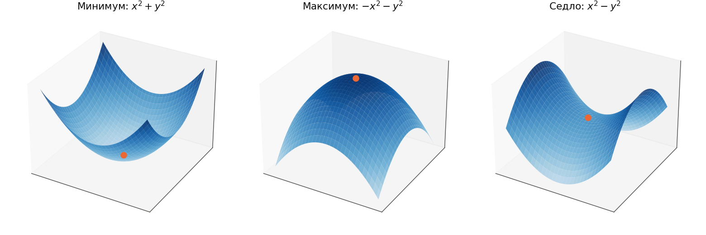

Как отличить одно от другого, разберём в части 8 на твоей функции.

---

## Часть 3. Две переменные и градиент

### Функция двух переменных

В лабораторной функция зависит от двух переменных: $f(x,y)$. Для каждой точки $(x,y)$ на плоскости считаем высоту $z=f(x,y)$ и получаем поверхность.

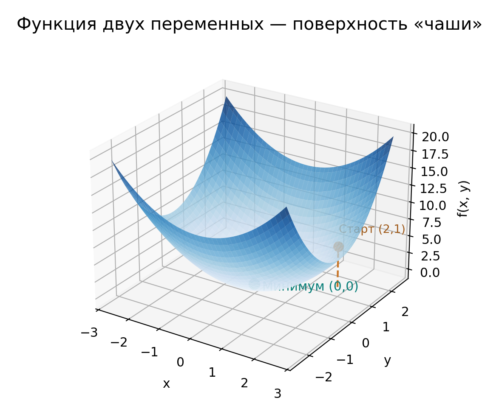

Весь разбор сделаем на одном примере:

$$
\boxed{f(x,y)=x^2+2y^2}
$$

В точке $(2,1)$:

$$
f(2,1)=2^2+2\cdot 1^2=4+2=6
$$

Минимум находится в $(0,0)$: оба слагаемых не меньше нуля и одновременно равны нулю только там. Мы знаем ответ заранее и будем проверять, что метод к нему идёт.

### Частная производная

Обычная производная отвечает на вопрос, как меняется функция, когда меняется $x$. Теперь переменных две, поэтому спрашиваем про каждую отдельно: что будет, если двигать только $x$, а $y$ заморозить? Это и есть **частная производная**.

Для $f(x,y)=x^2+2y^2$ считаем $y$ постоянным числом. Производная $x^2$ равна $2x$, а производная постоянного числа $2y^2$ равна нулю:

$$
\frac{\partial f}{\partial x}=2x
$$

Теперь замораживаем $x$:

$$
\frac{\partial f}{\partial y}=4y
$$

Значок $\partial$ читается как «частная производная». В `lab2.md` и ноутбуке то же самое записано короче: $f'_x$ и $f'_y$.

В точке $(2,1)$ получаем:

$$
\frac{\partial f}{\partial x}(2,1)=4,\qquad
\frac{\partial f}{\partial y}(2,1)=4
$$

Около этой точки увеличение любой координаты поднимает функцию.

**Спроси:** чему равны частные производные $f(x,y)=x^2+y^2$?

**Ответ:** $2x$ и $2y$.

### Градиент

**Градиент** — это вектор из всех частных производных:

$$
\boxed{\nabla f(x,y)=
\left(\frac{\partial f}{\partial x},\frac{\partial f}{\partial y}\right)}
$$

Значок $\nabla$ называется «набла». Вектор здесь — это просто пара чисел, которую можно нарисовать стрелкой: первое число говорит, насколько сдвинуться по $x$, второе — по $y$.

В нашем примере:

$$
\nabla f(x,y)=(2x,4y),\qquad \nabla f(2,1)=(4,4)
$$

<mark>Градиент показывает направление самого быстрого роста функции.</mark> Его длина показывает, насколько крутой склон.

Нам нужно вниз, поэтому идём в обратную сторону. Это **антиградиент**:

$$
-\nabla f(2,1)=(-4,-4)
$$

Значит, сейчас выгодно уменьшать и $x$, и $y$.

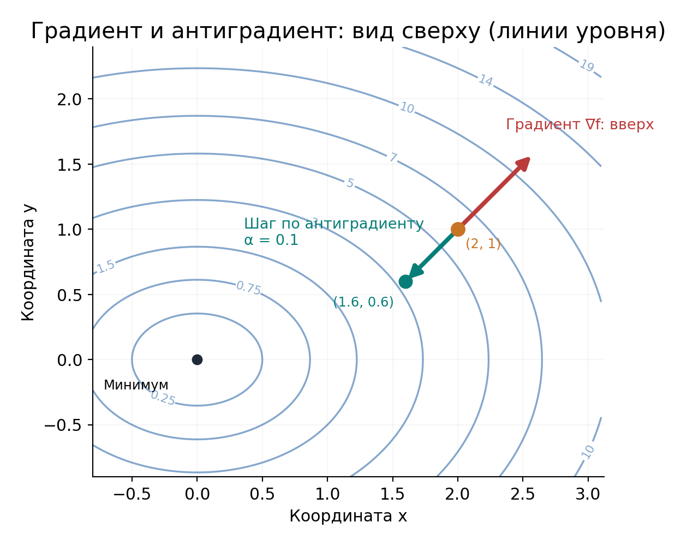

Это вид сверху. Каждая синяя линия — **линия уровня**: все точки на ней одной высоты, как горизонтали на туристической карте. Красная стрелка — градиент, рост. Зелёная — шаг вниз по антиградиенту.

Посмотри внимательно: зелёная стрелка идёт вниз, но смотрит не точно в минимум. Она проходит мимо него. Антиградиент знает только про склон под ногами, а не про то, где лежит дно. Это пригодится в части 5.

Теперь круглая чаша $f=x^2+y^2$. Здесь нарисован антиградиент во многих точках:

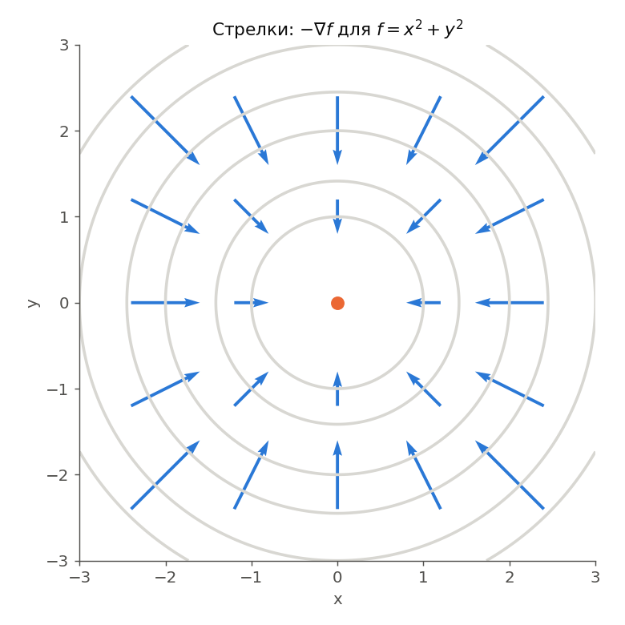

Чем дальше от минимума, тем склон круче и стрелка длиннее. В самом минимуме градиент равен нулю. У круглой чаши все стрелки смотрят точно в центр, а у вытянутой, как мы только что видели, нет.

**Спроси:** что будет с алгоритмом, если градиент равен нулю?

**Ответ:** шагать некуда, склона нет. Это минимум, максимум или седло.

##### Почему именно минус градиент

**Можно пропустить.** Для короткого перемещения на $(\Delta x,\Delta y)$ функция меняется примерно так:

$$
\Delta f\approx
\frac{\partial f}{\partial x}\Delta x+
\frac{\partial f}{\partial y}\Delta y
$$

Подставим шаг против градиента, то есть $\Delta x=-\alpha\frac{\partial f}{\partial x}$ и $\Delta y=-\alpha\frac{\partial f}{\partial y}$, где $\alpha>0$:

$$
\Delta f\approx-\alpha\left(\left(\frac{\partial f}{\partial x}\right)^2+\left(\frac{\partial f}{\partial y}\right)^2\right)\le0
$$

Сумма квадратов не бывает отрицательной. Поэтому при достаточно маленьком шаге функция уменьшается, если градиент не равен нулю.

---

## Часть 4. Градиентный спуск

### Формула

Сначала словами: берём текущую точку, считаем градиент, умножаем его на размер шага и вычитаем из текущей точки.

Формулой:

$$
\boxed{X_{t+1}=X_t-\alpha_t\nabla f(X_t)}
$$

| Обозначение      | Значение                                       |
| ---------------- | ---------------------------------------------- |
| $X_t$            | Где мы сейчас, для двух переменных $(x_t,y_t)$ |
| $X_{t+1}$        | Куда придём                                    |
| $\nabla f(X_t)$  | Градиент в текущей точке                       |
| $-\nabla f(X_t)$ | Направление вниз                               |
| $\alpha_t>0$     | Множитель шага                                 |
| $t$              | Номер шага, он же **итерация**                 |

То же самое по координатам:

$$
x_{t+1}=x_t-\alpha_t\frac{\partial f}{\partial x}(x_t,y_t),\qquad
y_{t+1}=y_t-\alpha_t\frac{\partial f}{\partial y}(x_t,y_t)
$$

Важная деталь: $\alpha$ — это не расстояние, а множитель. Настоящая длина шага равна $\alpha$, умноженному на длину градиента. На крутом склоне даже маленький $\alpha$ даёт длинный прыжок. Это ещё сыграет с нами шутку в части 10.

##### Числовой пример

Старт $X_0=(2,1)$, градиент $(4,4)$, шаг $\alpha=0.1$:

$$
X_1=(2,1)-0.1\cdot(4,4)=(2-0.4,\ 1-0.4)=(1.6,\ 0.6)
$$

Значение функции:

$$
f(2,1)=6,\qquad f(1.6,0.6)=1.6^2+2\cdot0.6^2=2.56+0.72=3.28
$$

Упало с 6 до 3.28, шаг удачный.

**Спроси:** а если взять $\alpha=1$? Посчитай новую точку и значение.

**Ответ:** $(2,1)-(4,4)=(-2,-3)$, и $f(-2,-3)=4+18=22$. Было 6, стало 22. Мы перепрыгнули долину и оказались выше, чем были.

##### Почему размер шага так важен

Вот спуск по параболе с тремя разными шагами:

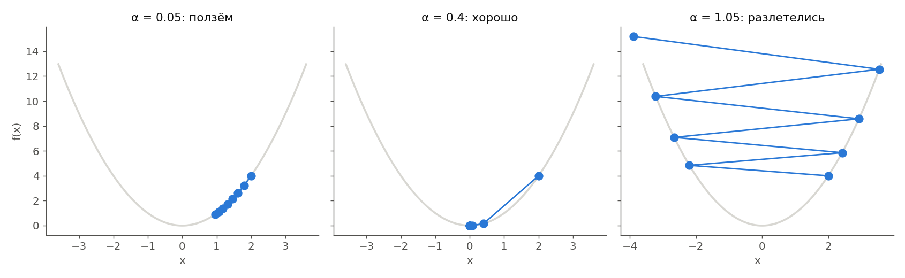

- Шаг маленький: идём в правильную сторону, но очень долго.
- Шаг нормальный: быстро приходим к минимуму.
- Шаг большой: перепрыгиваем минимум, значение растёт, алгоритм разлетается.

Хороший шаг зависит от функции и даже от места на ней. Подбирать его один раз на всю работу неудобно. Отсюда идея следующего метода.

---

## Часть 5. Наискорейший спуск

### В чём разница

<mark>Разница с обычным градиентным спуском одна: шаг $\alpha$ не задан заранее, а заново подбирается на каждой итерации.</mark>

Встали в точку, посмотрели по антиградиенту и спрашиваем: на какое расстояние идти по этой прямой, чтобы оказаться как можно ниже?

Направление уже выбрано, неизвестно только одно число $\alpha$. Значит, у нас появилась функция одной переменной:

$$
\varphi(\alpha)=f(X_t-\alpha\nabla f(X_t))
$$

И мы ищем её минимум:

$$
\boxed{\alpha_t=\arg\min_{\alpha\ge0}\varphi(\alpha)}
$$

$\arg\min$ значит «то значение $\alpha$, при котором $\varphi$ минимальна». Нас интересует само число $\alpha$, а не высота в этой точке.

Получается задача внутри задачи:

- **Внешняя**, многомерная: ищем точку $(x, y)$.
- **Внутренняя**, одномерная: ищем шаг $\alpha$.

Если область ограничена, $\alpha$ ищем только там, где новая точка в неё попадает.

### Находим шаг вручную

Наш пример: $f(x,y)=x^2+2y^2$, $X_0=(2,1)$, $\nabla f(X_0)=(4,4)$.

После шага с множителем $\alpha$ координаты будут:

$$
x=2-4\alpha,\qquad y=1-4\alpha
$$

Подставим их в функцию:

$$
\varphi(\alpha)=(2-4\alpha)^2+2(1-4\alpha)^2
$$

Раскроем скобки:

$$
\varphi(\alpha)=(4-16\alpha+16\alpha^2)+2(1-8\alpha+16\alpha^2)
$$

Соберём одинаковые слагаемые:

$$
\boxed{\varphi(\alpha)=6-32\alpha+48\alpha^2}
$$

Мы превратили задачу с двумя переменными в задачу с одной. Это обычная парабола. Ищем её минимум, как в части 2, через производную:

$$
\varphi'(\alpha)=-32+96\alpha=0
\quad\Rightarrow\quad
\boxed{\alpha^*=\frac13}
$$

Вторая производная $\varphi''(\alpha)=96>0$, поэтому это минимум, а не максимум.

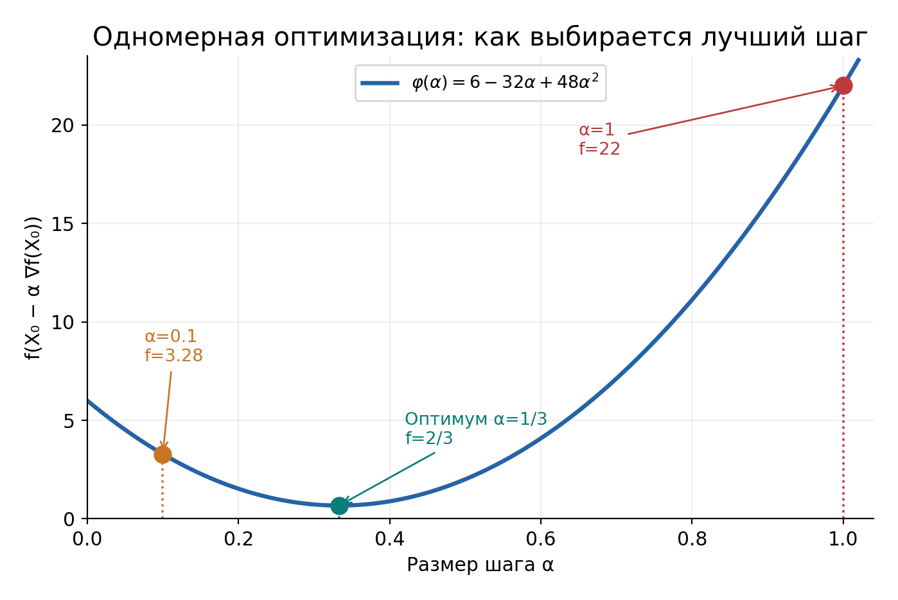

На графике все три наших шага на одной прямой: $\alpha=0.1$ дал $3.28$, $\alpha=1$ дал $22$, а оптимальный $\alpha=1/3$ даёт минимум.

Делаем шаг:

$$
X_1=(2,1)-\frac13(4,4)=\left(\frac23,-\frac13\right)
$$

Проверяем:

$$
f(X_1)=\frac49+2\cdot\frac19=\boxed{\frac23}
$$

За один шаг значение упало с $6$ до $2/3$. С обычным шагом $0.1$ было только $3.28$.

Дальше всё повторяется: новый градиент, новая прямая, новый шаг.

| Итерация | Точка              | $f$    | $\alpha$ |
| -------- | ------------------ | ------ | -------- |
| 0        | $(2,\ 1)$          | 6      | 1/3      |
| 1        | $(0.667,\ -0.333)$ | 0.667  | 1/3      |
| 2        | $(0.222,\ 0.111)$  | 0.074  | 1/3      |
| 3        | $(0.074,\ -0.037)$ | 0.0082 | 1/3      |

Здесь $\alpha$ каждый раз совпадает, и это случайность удачного старта. На твоей функции первые шаги будут $0.0595$, $0.0972$, $0.3038$.

##### Круглая чаша

Сравним с $f(x,y)=x^2+y^2$, тот же старт $(2,1)$, градиент $(4,2)$. Выразим значение через $\alpha$:

$$
\varphi(\alpha)=(2-4\alpha)^2+(1-2\alpha)^2=5(1-2\alpha)^2
$$

Минимум при $\alpha=0.5$, и мы за один шаг приходим в точку:

$$
(2,1)-0.5\cdot(4,2)=(0,0)
$$

На круглой чаше антиградиент смотрит точно в минимум, поэтому хватает одного шага. На реальных функциях так не бывает.

##### Почему траектория идёт зигзагом

На вытянутой функции наискорейший спуск движется ступеньками:

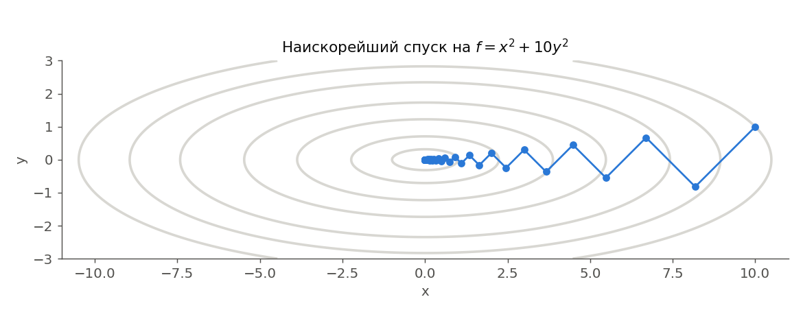

Мы идём по прямой, пока функция падает, и останавливаемся там, где падать перестала. В этой точке наша прямая касается линии уровня, а градиент всегда перпендикулярен линии уровня. Поэтому новый градиент перпендикулярен прошлому:

$$
\boxed{\nabla f(X_{t+1})\cdot\nabla f(X_t)=0}
$$

Точка здесь — скалярное произведение: перемножаем координаты попарно и складываем. Ноль означает прямой угол.

Проверим на нашем примере. Было $\nabla f(X_0)=(4,4)$, стало $\nabla f(X_1)=\left(\frac43,-\frac43\right)$:

$$
4\cdot\frac43+4\cdot\left(-\frac43\right)=0
$$

<mark>Если шаг найден точно, соседние шаги наискорейшего спуска идут под прямым углом.</mark>

Функция при этом всё время уменьшается. Зигзаг не значит, что мы мечемся без толку, просто прямо к минимуму идти метод не умеет.

**Спроси:** чем наискорейший спуск отличается от обычного?

**Ответ:** направление то же, антиградиент. Разница в шаге: он не постоянный, а заново подбирается на каждой итерации как минимум функции вдоль этого направления.

---

## Часть 6. Дихотомия и критерии остановки

### Метод дихотомии

Руками мы нашли $\alpha$ через производную. На сложной функции $\varphi(\alpha)$ так не получится, поэтому компьютер ищет минимум численно. Для этого есть методы одномерной оптимизации. В лабе используем **дихотомию** — деление отрезка пополам.

Похоже на игру «угадай число»: каждый вопрос отбрасывает половину вариантов.

Берём отрезок $[a,b]$, в котором лежит минимум. Находим середину и смотрим две точки рядом с ней:

$$
c=\frac{a+b}{2}-\delta,\qquad d=\frac{a+b}{2}+\delta
$$

- Если $\varphi(c)<\varphi(d)$, функция около середины растёт, минимум левее. Выбрасываем правую часть: $b=d$.
- Иначе минимум правее: $a=c$.

Каждый раз отрезок становится почти вдвое короче. Повторяем, пока он не станет меньше $\varepsilon$.

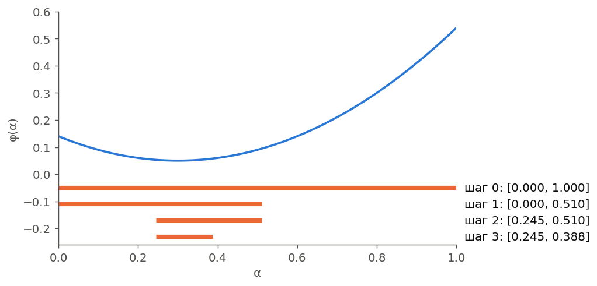

На картинке $\delta=0.01$, чтобы было видно. Минимум лежит в $\alpha=0.3$, и отрезок сжимается вокруг него.

Метод работает, если на отрезке у функции один минимум. Такая функция называется **унимодальной**. Если минимумов несколько, дихотомия найдёт один из них, не обязательно лучший.

Кроме дихотомии есть перебор по сетке, метод золотого сечения и метод Брента. Последний вызывается в Python как `scipy.optimize.minimize_scalar`. Подробный список лежит в `answers.md`, вопрос 6.

### Критерии остановки

Алгоритм не знает, где настоящий минимум. Он останавливается, когда двигаться дальше нет смысла:

| Критерий                                         | Смысл                        |
| ------------------------------------------------ | ---------------------------- |
| $\lVert X_{t+1}-X_t\rVert\le\varepsilon_1$       | Точка почти не сдвинулась    |
| $\lvert f(X_{t+1})-f(X_t)\rvert\le\varepsilon_2$ | Значение почти не изменилось |
| $\lVert\nabla f(X_t)\rVert\le\varepsilon_3$      | Склон почти плоский          |

По методичке алгоритм останавливается, если выполняется любой из критериев.

$\varepsilon$ («эпсилон») — маленькое число, которое мы выбираем сами. $\lvert\cdot\rvert$ — модуль: важна величина изменения, а не знак. $\lVert v\rVert$ — норма, то есть длина вектора, считается по теореме Пифагора:

$$
\lVert(3,4)\rVert=\sqrt{3^2+4^2}=5
$$

**Спроси:** градиент равен $(0.003,\ 0.004)$. Чему равна его норма?

**Ответ:** $\sqrt{0.003^2+0.004^2}=0.005$.

На практике один критерий может сработать слишком рано: крошечный шаг ещё не значит, что мы рядом с минимумом. Поэтому всегда задают предел числа итераций `max_iter`, а часто проверяют несколько признаков вместе. В лабе делаем как в методичке, плюс добавляем свою проверку выхода за границы области.

---

## Часть 7. Весь алгоритм и разминка

### Алгоритм целиком

Теперь у нас есть все детали. Соберём их:

1. Выбираем начальную точку $X_0$ из области.
2. Считаем градиент $\nabla f(X_t)$ в текущей точке.
3. Определяем направление вниз: $-\nabla f(X_t)$.
4. Находим шаг $\alpha_t$: минимум функции вдоль этого направления.
5. Перемещаемся: $X_{t+1}=X_t-\alpha_t\nabla f(X_t)$.
6. Сохраняем точку и значение функции для графиков.
7. Проверяем критерии остановки и число итераций.
8. Если не остановились, возвращаемся к пункту 2.

### Что мы настраиваем сами

**Гиперпараметры** — настройки, которые задаём мы, а не находит сам алгоритм.

| Гиперпараметр        | Что задаёт                    | В лабе     |
| -------------------- | ----------------------------- | ---------- |
| Начальная точка      | Откуда стартуем               | $(-1,-1)$  |
| $\varepsilon_1$      | Минимальный сдвиг точки       | $10^{-8}$  |
| $\varepsilon_2$      | Минимальное изменение функции | $10^{-14}$ |
| $\varepsilon_3$      | Минимальная норма градиента   | $10^{-6}$  |
| Отрезок для $\alpha$ | Где ищем шаг                  | $[0,1]$    |
| Точность дихотомии   | Насколько точно ищем шаг      | $10^{-8}$  |
| `max_iter`           | Предел числа итераций         | 10 000     |

Сам шаг $\alpha$ здесь не гиперпараметр: он считается на каждой итерации. Подбирают эти настройки опытным путём: запускают с разными значениями и смотрят на результат.

### Разминка: функция Бута

**Можно пропустить.** Это чужой вариант из методички, но на нём удобно увидеть, как выглядит хороший запуск.

$$
\boxed{f(x,y)=(x+2y-7)^2+(2x+y-5)^2},\quad -10\le x,y\le10
$$

Сумма двух квадратов равна нулю, только когда обе скобки равны нулю:

$$
x+2y-7=0,\qquad 2x+y-5=0
$$

Решение системы: $\boxed{x=1,\ y=3}$, и $\boxed{f(1,3)=0}$.

Частные производные. Производная квадрата скобки равна двум скобкам, умноженным на производную того, что внутри:

$$
\frac{\partial f}{\partial x}=2(x+2y-7)+4(2x+y-5)=\boxed{10x+8y-34}
$$

$$
\frac{\partial f}{\partial y}=4(x+2y-7)+2(2x+y-5)=\boxed{8x+10y-38}
$$

Запуск из точки $(-4,4)$ доходит до $(1,3)$ за 23 итерации. Методичка просит графики, вот как они выглядят.

Изменение значения функции по шагам:

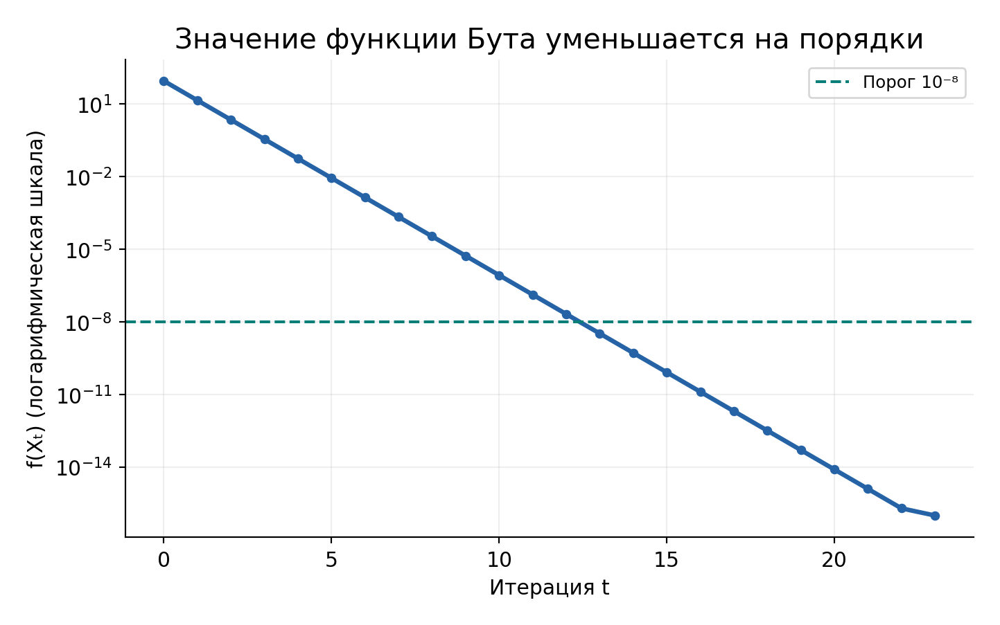

Шкала по вертикали логарифмическая: каждая следующая подпись на оси в 1000 раз меньше предыдущей. Обычная шкала тут не подойдёт, потому что значения меняются от 90 до почти нуля. Прямая линия на такой шкале значит, что значение каждый шаг падает в одно и то же число раз.

Поверхность и траектория:

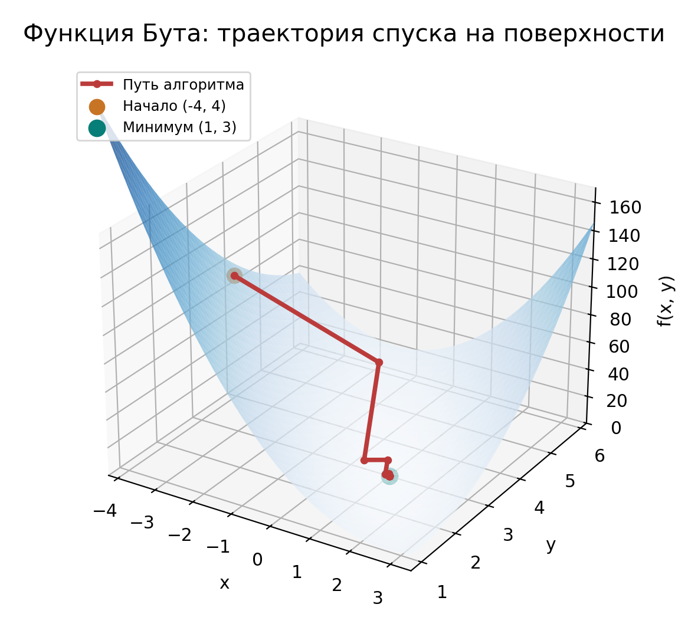

Красная линия соединяет точки алгоритма, зелёная точка — глобальный минимум. Поверхность показывает все значения $f(x,y)$, а линия — где побывал алгоритм.

Та же траектория сверху:

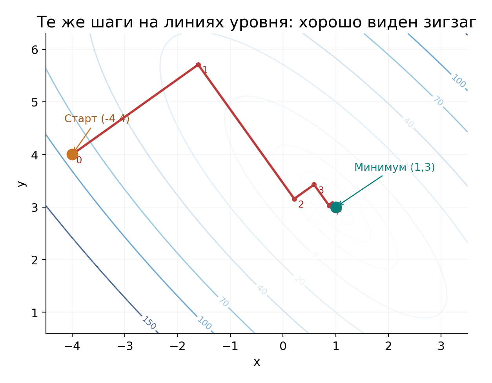

Видно зигзаг с прямыми углами, хотя функция всё время падает. Код этих графиков лежит в приложении в конце файла. Твой код будет другим, мы напишем его в ноутбуке.

---

## Часть 8. Функция Била

### Твой вариант

$$
\boxed{f(x,y)=(1.5-x+xy)^2+(2.25-x+xy^2)^2+(2.625-x+xy^3)^2}
$$

Область: $x,y\in[-4.5,4.5]$.

Это классическая тестовая функция, на ней проверяют алгоритмы оптимизации. Все три скобки в квадрате, поэтому $f\ge0$. Ноль достигается, когда все скобки равны нулю одновременно, и это точка:

$$
\boxed{f(3,0.5)=0}
$$

Проверим:

$$
1.5-3+3\cdot0.5=0,\quad
2.25-3+3\cdot0.25=0,\quad
2.625-3+3\cdot0.125=0
$$

Ответ известен заранее, потому что функция тестовая. Это удобно: можно проверить, дошёл ли алгоритм. Но сам алгоритм ответа не знает, он честно идёт вниз из точки старта.

##### Считаем градиент

Обозначим скобки:

$$
a=1.5-x+xy,\quad b=2.25-x+xy^2,\quad c=2.625-x+xy^3
$$

Тогда $f=a^2+b^2+c^2$. Производная сложной функции: производная квадрата равна удвоенной скобке, умноженной на производную скобки:

$$
(a^2)'=2a\cdot a'
$$

Производные скобок по $x$ (считаем $y$ числом):

$$
a'_x=y-1,\quad b'_x=y^2-1,\quad c'_x=y^3-1
$$

По $y$ (считаем $x$ числом):

$$
a'_y=x,\quad b'_y=2xy,\quad c'_y=3xy^2
$$

Собираем:

$$
\boxed{f'_x=2a(y-1)+2b(y^2-1)+2c(y^3-1)}
$$

$$
\boxed{f'_y=2ax+2b\cdot2xy+2c\cdot3xy^2}
$$

Обе формулы уже стоят в ноутбуке, в функции `grad`.

##### Как выглядит рельеф

Значения функции в углах области доходят до 181 853, а около минимума близки к нулю. На обычном 3D графике дно выглядит плоским. Поэтому в ноутбуке есть второй график с $\log(1+f)$: логарифм сжимает большие значения, и становится видно дно.

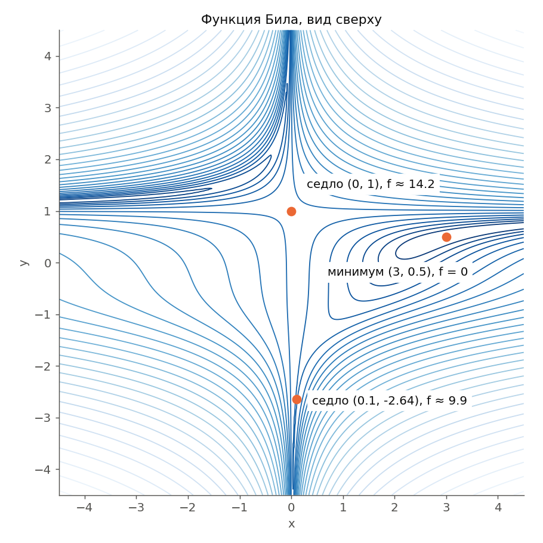

Численный поиск нашёл в области три стационарные точки:

| Точка           | $f$   | Собственные значения Гессе | Тип     |
| --------------- | ----- | -------------------------- | ------- |
| $(3, 0.5)$      | 0     | 0.30 и 48.98               | Минимум |
| $(0, 1)$        | 14.20 | -27.75 и 27.75             | Седло   |
| $(0.10, -2.64)$ | 9.86  | -0.78 и 867.75             | Седло   |

Ещё на карте виден крест. На прямых $x=0$ и $y=1$ функция постоянна и равна 14.20, потому что скобки там становятся числами 1.5, 2.25 и 2.625. Этот крест делит область на четыре части, и минимум лежит только в одной из них: справа снизу от седла.

### Матрица Гессе

**Можно пропустить в эфире, но это нужно для ответа на вопрос 1.** Откуда в таблице третья колонка?

Градиент состоит из первых производных и говорит, куда наклонён склон. **Матрица Гессе (гессиан)** состоит из вторых производных и говорит, как поверхность изгибается: как чаша, как купол или как седло.

$$
\boxed{H=\begin{pmatrix}f''_{xx}&f''_{xy}\\f''_{yx}&f''_{yy}\end{pmatrix}}
$$

Здесь $f''_{xx}$ значит, что мы взяли производную по $x$ два раза, а $f''_{xy}$ — сначала по $x$, потом по $y$.

Для $f(x,y)=x^2+y^2$ первые производные равны $2x$ и $2y$. Берём производные ещё раз:

$$
H=\begin{pmatrix}2&0\\0&2\end{pmatrix}
$$

**Собственные значения** этой матрицы показывают, насколько сильно функция изгибается вдоль двух главных направлений. Плюс значит, что поверхность загибается вверх, минус — вниз. У такой простой матрицы они стоят на диагонали: 2 и 2. Оба положительные, поверхность загибается вверх во все стороны, значит, $(0,0)$ — минимум.

Для $f(x,y)=x^2-y^2$ получаем:

$$
H=\begin{pmatrix}2&0\\0&-2\end{pmatrix}
$$

Значения 2 и -2: вдоль $x$ загибается вверх, вдоль $y$ вниз. Это седло.

| Собственные значения матрицы Гессе | Что за точка |
| ---------------------------------- | ------------ |
| Все положительные                  | Минимум      |
| Все отрицательные                  | Максимум     |
| Разных знаков                      | Седло        |

Важна и разница между значениями. В минимуме функции Била это 0.30 и 48.98, они отличаются в 163 раза. В одну сторону склон пологий, в другую очень крутой. Получается узкий вытянутый овраг, и именно в таком месте спуск идёт мелким зигзагом. Для сравнения, у функции Бута значения 2 и 18, разница всего в 9 раз, и метод дошёл за 23 шага.

---

## Часть 9. Пишем код

**Ноутбук.** Переключись в `lab2_live.ipynb`. Готовое решение лежит в `lesson/lab2_gdz.ipynb`.

| Ячейка            | Что пишем                                   | Что должно получиться                        |
| ----------------- | ------------------------------------------- | -------------------------------------------- |
| `f`, `grad`       | Уже написаны, проговори их по формулам выше | `f(3, 0.5)` даёт 0, `grad(3, 0.5)` даёт нули |
| Дихотомия         | `dichotomy(phi, a, b, eps=1e-8)`            | На $(\alpha-0.3)^2$ получаем примерно 0.3    |
| Спуск             | `steepest_descent(start, ...)`              | Из $(-1,-1)$: 510 шагов, критерий `eps3`     |
| Значение и ошибка | Два графика в логарифмической шкале         | Резкое падение, потом почти прямая           |
| 3D график         | $f$ и $\log(1+f)$                           | Справа видно дно                             |
| Траектория на 3D  | Красная линия на поверхности                | Линия спускается в овраг                     |
| Вид сверху        | Линии уровня и приближение к минимуму       | Зигзаг с прямыми углами                      |
| Старт $(-2,-2)$   | Тот же алгоритм, другая точка               | 5276 шагов и выход из области                |

На что обратить внимание, пока пишем:

- `phi` — это наша $\varphi(\alpha)$. Функция объявлена внутри цикла, потому что на каждой итерации у неё новые `x` и `g`.
- `delta = eps / 3` в дихотомии. Отрезок сжимается примерно до $2\delta$, и $\delta$ должен быть меньше $\varepsilon/2$, иначе цикл никогда не кончится.
- `alpha = dichotomy(phi, 0, 1)` — вот она, задача внутри задачи.
- `if np.abs(x).max() > 4.5` — наша добавка к методичке: останавливаемся, если вышли из области.
- `np.log1p(Z)` считает $\log(1+Z)$.

---

## Часть 10. Результаты и ловушка старта

### Что получилось

Старт $(-1,-1)$, параметры $\varepsilon_1=10^{-8}$, $\varepsilon_2=10^{-14}$, $\varepsilon_3=10^{-6}$, шаг ищем на отрезке $[0,1]$.

| Что               | Результат              |
| ----------------- | ---------------------- |
| Шагов             | 510                    |
| Сработал критерий | $\varepsilon_3$        |
| Найденная точка   | $(2.999997, 0.499999)$ |
| Значение функции  | $1.29\cdot10^{-12}$    |

Вот первый шаг этого запуска. Значение функции вдоль антиградиента, минимум при $\alpha=0.0595$:

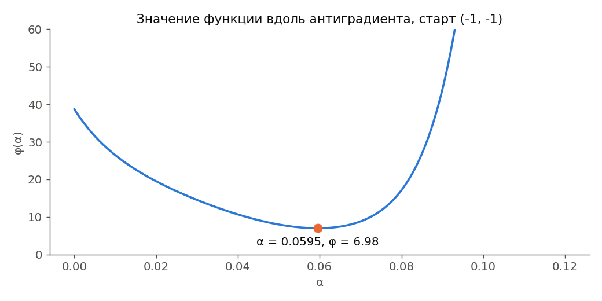

График значения по шагам в логарифмической шкале состоит из двух частей:

- Первые несколько шагов значение падает резко: с 38.70 до 0.22 за три шага. Мы скатываемся с крутого склона в овраг.
- Дальше идёт почти прямая линия: значение уменьшается примерно на 4% за шаг. Это медленное движение по дну оврага.

На графике с приближением видно, что соседние шаги идут под прямым углом: косинус угла между ними на первых 50 шагах меньше $10^{-6}$.

##### Сравнение с постоянным шагом

В `lab2.ipynb` шаг постоянный: $\alpha=0.001$, он только уменьшается, если функция выросла. Строго говоря, это обычный градиентный спуск, а не наискорейший.

| Старт     | Постоянный шаг               | Наискорейший спуск         |
| --------- | ---------------------------- | -------------------------- |
| $(-1,-1)$ | 38 819 шагов                 | 510 шагов                  |
| $(-2,-2)$ | 38 789 шагов                 | Не дошёл, вышел из области |
| $(4,4)$   | Не дошёл за 100 000 итераций | 699 шагов                  |

Наискорейший спуск делает в десятки раз меньше шагов. Но один его шаг дороже: на каждый приходится целая дихотомия, это 29 итераций и 58 вычислений функции.

**Спроси:** посмотри на вторую строку таблицы. Что странного?

**Ответ:** более умный метод не дошёл, а простой дошёл.

### Важная ловушка твоей лабораторной

Старт $(-2,-2)$ выглядит обычной точкой, но наискорейший спуск из неё **не находит** минимум.

Значение в старте большое ($f=495.70$), склон очень крутой: длина градиента около 1166. Метод честно ищет лучший шаг вдоль антиградиента и находит $\alpha=0.0037$. Число маленькое, но мы помним, что длина шага равна $\alpha$, умноженному на длину градиента. За один прыжок мы пролетаем больше 4 единиц, через прямую $y=1$, в точку $(-0.356,2.047)$ с $f=2.52$.

По значению шаг отличный, но мы оказались не в той части карты. Там другая ложбина, она тянется влево, и значение вдоль неё всё время падает. За 5276 шагов метод доползает до границы области в точке $(-4.5,1.19)$ с $f=0.76$.

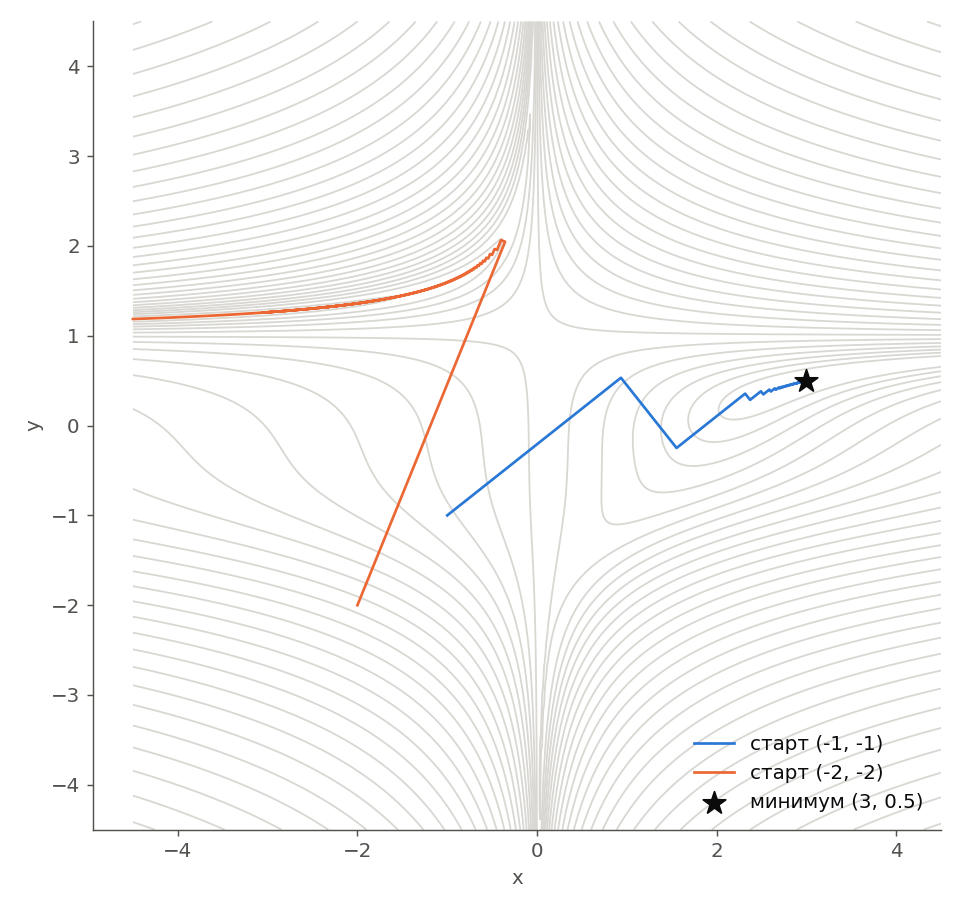

Других стационарных точек, кроме трёх из таблицы, там нет: градиент в этой точке не равен нулю, а ложбина просто уходит за границу. За пределами области значение падает дальше. Внутри нашего квадрата эта точка оказывается ниже соседей только потому, что дальше стена. Алгоритм идёт туда, куда ведёт склон, и не знает, что где-то есть точка ниже.

При постоянном маленьком шаге такого прыжка нет. Алгоритм ползёт по склону и из той же точки доходит до $(3,0.5)$, но за 38 789 шагов.

Проверим, насколько это частая история. Запустим метод из каждой точки сетки с шагом 0.25:

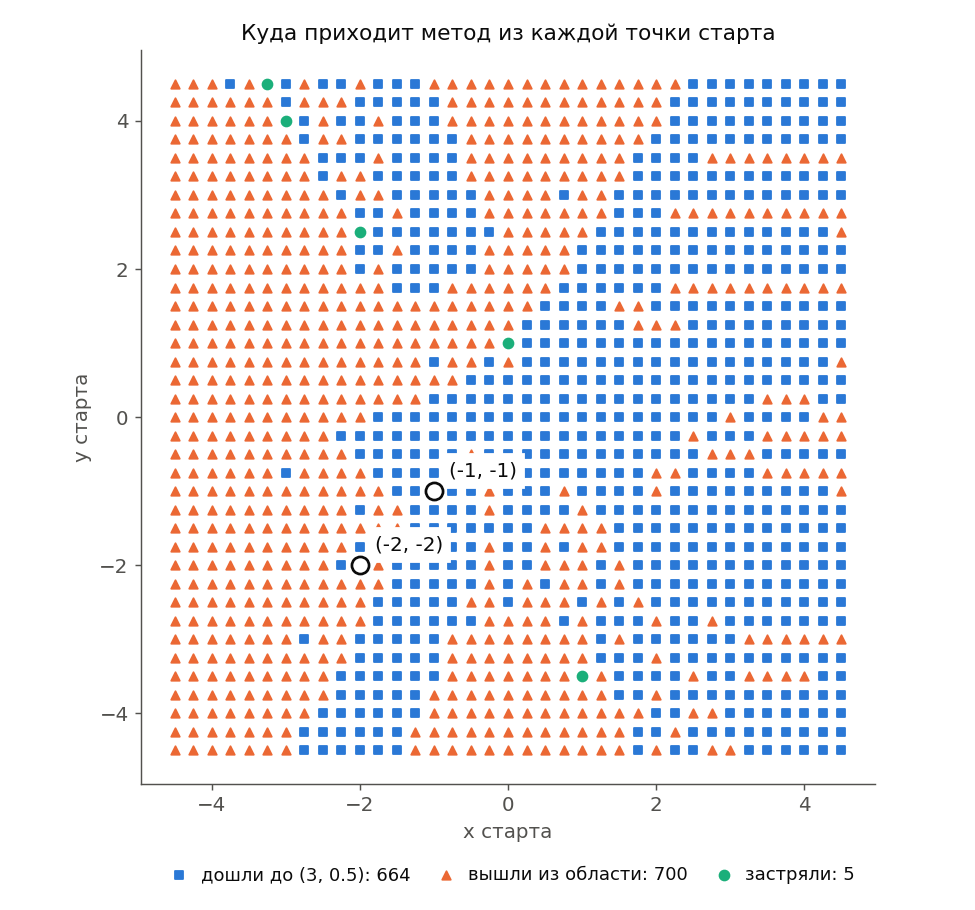

| Что случилось      | Стартов из 1369 |
| ------------------ | --------------- |
| Дошли до $(3,0.5)$ | 664 (48.5%)     |
| Вышли из области   | 700 (51.1%)     |
| Застряли           | 5 (0.4%)        |

Среди застрявших 4 точки не успели за 10 000 шагов, а одна — это седло $(0,1)$: градиент там равен нулю, и алгоритм останавливается сразу, не сделав ни шага.

Граница между цветами рваная: соседние точки могут вести себя по-разному, потому что длинный первый прыжок сильно зависит от старта.

### Локальное и глобальное

Вернёмся к человеку в тумане из части 1. У сложной функции может быть несколько долин. Спуск приходит в ту, что ближе по склону, и самая глубокая ему не гарантирована.

Методичка просит найти глобальный минимум, но в общем случае метод этого не гарантирует. Гарантия появляется только при дополнительных свойствах функции, например при выпуклости, когда у рельефа всего одна чаша.

Поэтому от старта зависит многое. Заранее оптимальную точку обычно не знают, поэтому на сложных функциях алгоритм запускают из нескольких разных точек и выбирают лучший результат.

<mark>Вывод: градиентные методы находят ближайшее по склону, а не глобальное. Результат зависит от точки старта.</mark>

---

## Часть 11. Итоги

### Главное

- **Производная** показывает, как меняется функция по одной переменной.
- **Частные производные** делают то же по каждой координате отдельно.
- **Градиент** собирает их в вектор и показывает направление самого быстрого роста.
- **Антиградиент** показывает направление самого быстрого спуска.
- **Шаг $\alpha$** — множитель: настоящая длина шага равна $\alpha\lVert\nabla f(X_t)\rVert$.
- **Наискорейший спуск** подбирает $\alpha$ заново на каждой итерации, минимизируя функцию вдоль направления.
- **Критерии остановки** говорят, когда закончить.
- **Глобальный минимум** не гарантирован.

### Проверка понимания

Дай решить самостоятельно. Функция $f(x,y)=x^2+y^2$, точка $X=(3,-2)$.

**Спроси:** чему равен градиент $\nabla f(3,-2)$?

**Ответ:** $(6,-4)$.

**Спроси:** куда указывает антиградиент?

**Ответ:** $(-6,4)$, то есть влево и вверх, к минимуму $(0,0)$.

**Спроси:** какой будет новая точка при шаге $\alpha=0.1$?

**Ответ:** $(3,-2)-0.1\cdot(6,-4)=(2.4,-1.6)$.

**Спроси:** почему $\alpha=10$ здесь плохой выбор?

**Ответ:** новая точка $(-57,38)$. Мы перелетаем минимум, и функция растёт с 13 до 4693.

### Ответы на вопросы преподавателя

Полные ответы лежат в `answers.md`. Здесь короткая версия, которую стоит проговорить вслух.

**1. Точки экстремума функции.** Это точки локального минимума или максимума. Для гладкой функции внутри области в них градиент равен нулю. Обратное необязательно: бывает седло. Тип точки определяют по собственным значениям матрицы Гессе. У функции Била один минимум $(3,0.5)$ и два седла.

**2. Одномерная и многомерная оптимизация.** Одномерная ищет минимум функции одной переменной, например $\varphi(\alpha)$. Многомерная ищет сразу несколько координат $x,y,\ldots$. В наискорейшем спуске есть обе: внешняя многомерная и внутренняя одномерная.

**3. Выбор оптимальной точки старта.** Она должна лежать в допустимой области. Заранее лучшую точку обычно не знают, поэтому берут случайную или запускают из нескольких и сравнивают. На функции Била из $(-1,-1)$ метод дошёл за 510 шагов, из $(-2,-2)$ не дошёл, а из 1369 точек сетки дошли 664.

**4. Гиперпараметры и как их подбирать.** Начальная точка, $\varepsilon_1,\varepsilon_2,\varepsilon_3$, `max_iter`, отрезок и точность одномерного поиска. Подбирают запусками с разными значениями. В наискорейшем спуске шаг $\alpha$ не задаётся, а вычисляется на каждой итерации.

**5. Алгоритм работы.** Старт, градиент, антиградиент, поиск шага, новая точка, проверка остановки, повтор.

**6. Алгоритмы одномерной оптимизации.** Перебор по сетке, дихотомия, золотое сечение, метод Брента. Выбор зависит от свойств функции и от того, известны ли производные. В лабе используем дихотомию.

### Что в методичке написано неточно

Это полезно знать, если на защите спросят.

1. В шагах 3 и 4 алгоритма по ошибке повторена формула градиента. По смыслу там выбор шага $\alpha_t=\arg\min_{\alpha\ge0}f(X_t-\alpha\nabla f(X_t))$ и обновление точки $X_{t+1}=X_t-\alpha_t\nabla f(X_t)$.
2. Третья формула остановки повреждена. Правильно: $\lVert\nabla f(X_t)\rVert\le\varepsilon_3$.
3. В цели написано про решение уравнения, а в задании про поиск минимума. Мы решаем задачу минимизации.
4. В задании требуется глобальный минимум, но метод его в общем случае не гарантирует.
5. Формулы вариантов в конце файла повреждены форматированием: степени слиплись с числами. Например, Розенброк обычно записывается как $(1-x)^2+100(y-x^2)^2$, а в методичке первая скобка другая. Перед расчётами формулу своего варианта стоит сверить с преподавателем.
