# Лабораторная работа №3: метод наименьших квадратов и линейная регрессия

## Часть 1. Зачем это нужно

### Задача регрессии

Представь, что мы продаем квартиры. Есть таблица: площадь и цена. Приходит новая квартира, цены пока нет, площадь известна. Хочется по одному числу предсказать другое.

Это **задача регрессии**: по известной величине $X$ предсказать числовую величину $Y$

Если нанести такие данные на график, часто видно облако точек, вытянутое вдоль какой-то линии. Идеально на прямой точки не лежат: на цену влияет ещё сотня причин, которых нет в таблице. Но общая тенденция есть. **Линейная регрессия** описывает её прямой.

В lab2 мы говорили, что обучить модель значит подобрать параметры, при которых ошибка минимальна. Здесь то же самое, только модель самая простая: прямая с двумя параметрами, ответ получится одной формулой.

---

## Часть 2. Прямая и данные

### Уравнение прямой

Прямая задаётся двумя числами:

$$
\boxed{y=\beta_0+\beta_1x}
$$

**Спроси:** цена квартиры считается как $f(x)=500+90x$, где $x$ — площадь, $y$ — цена в тысячах. Что значат 500 и 90?

**Ответ:** каждый квадратный метр добавляет 90 тысяч. 500 — это значение при нулевой площади, то есть просто точка пересечения прямой с осью.

### Откуда берётся шум

В лабораторной данные мы генерируем сами. Это удобно: настоящий ответ известен, и можно проверить, найдёт ли его метод.

$$
\boxed{Y=\beta_0+\beta_1X+E}
$$

Здесь $\beta_0+\beta_1X$ — закономерность, а $E$ — **шум**: случайная добавка, которую нельзя предсказать по $X$. Распределения разбирали в lab1, сейчас они просто пригодятся.

Твой вариант 2:

| Что | Значение                                         |
| --- | ------------------------------------------------ |
| $N$ | 10 000 точек                                     |
| $X$ | Равномерное распределение от 1 до 50             |
| $E$ | Нормальное распределение, центр 1, отклонение 10 |
| $Y$ | $Y=-3+0.5X+E$                                    |

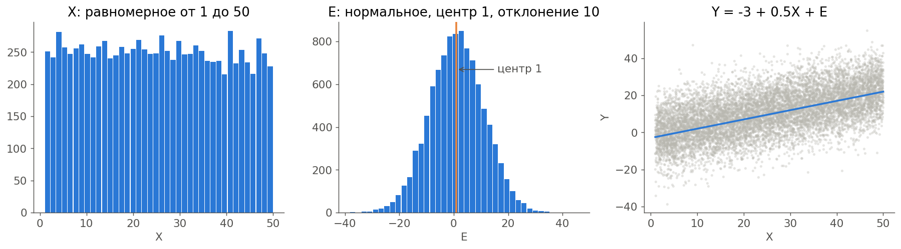

Посмотри на правый график: шум большой, облако широкое, хотя закономерность в нём есть. Это ещё пригодится, когда будем читать метрики.

---

## Часть 3. Какая прямая лучшая

### Маленький пример

Весь разбор сделаем на четырёх точках:

| $x$ | 1   | 2   | 3   | 4   |
| --- | --- | --- | --- | --- |
| $y$ | 2   | 3   | 5   | 6   |

Через четыре такие точки одну прямую провести нельзя. Значит, какая-то ошибка останется. Нужно договориться, как её мерить.

### Остатки

Для каждой точки прямая даёт предсказание $\hat{y}_i=\beta_0+\beta_1x_i$. Шапочка над $y$ значит «предсказанное значение».

**Остаток** — это разница между настоящим значением и предсказанием:

$$
\boxed{e_i=y_i-\hat{y}_i}
$$

На графике это вертикальный отрезок от точки до прямой. Вертикальный, потому что ошибаемся мы именно в $y$.

Возьмём три кандидата:

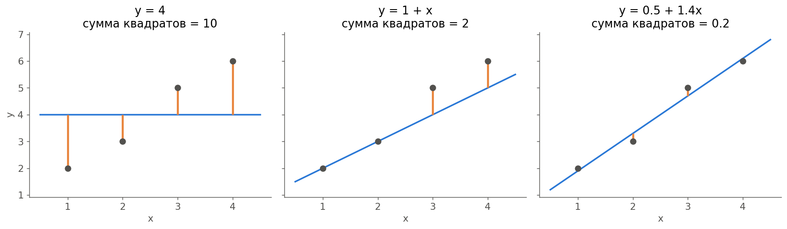

| Прямая       | Остатки                   | Сумма остатков | Сумма квадратов |
| ------------ | ------------------------- | -------------- | --------------- |
| $y=4$        | $-2,\ -1,\ 1,\ 2$         | 0              | 10              |
| $y=1+x$      | $0,\ 0,\ 1,\ 1$           | 2              | 2               |
| $y=0.5+1.4x$ | $0.1,\ -0.3,\ 0.3,\ -0.1$ | 0              | 0.2             |

##### Почему квадраты

Первая мысль: сложить остатки. Но у горизонтальной прямой $y=4$ сумма равна нулю, хотя она явно плохая. Плюсы и минусы взаимно гасятся.

Можно взять модули, а можно квадраты. Квадраты выбирают по двум причинам:

- Большая ошибка штрафуется сильнее: промах на 2 стоит 4, а промах на 1 стоит 1.
- Функция получается гладкой, и её можно дифференцировать. У модуля в нуле излом.

**Спроси:** посчитай сумму квадратов остатков для $y=1+x$.

**Ответ:** предсказания $2,3,4,5$, остатки $0,0,1,1$, сумма квадратов $0+0+1+1=2$.

### Функция ошибки

Запишем сумму квадратов для произвольной прямой:

$$
\boxed{S(\beta_0,\beta_1)=\sum_{i=1}^{N}(y_i-\beta_0-\beta_1x_i)^2}
$$

<mark>Обрати внимание: данные здесь уже известны, а неизвестные — это $\beta_0$ и $\beta_1$. Значит, $S$ — функция двух переменных, такая же, как в lab2.</mark>

Там мы искали минимум $f(x,y)$, здесь ищем минимум $S(\beta_0,\beta_1)$. Поэтому метод и называется **методом наименьших квадратов (МНК)**.

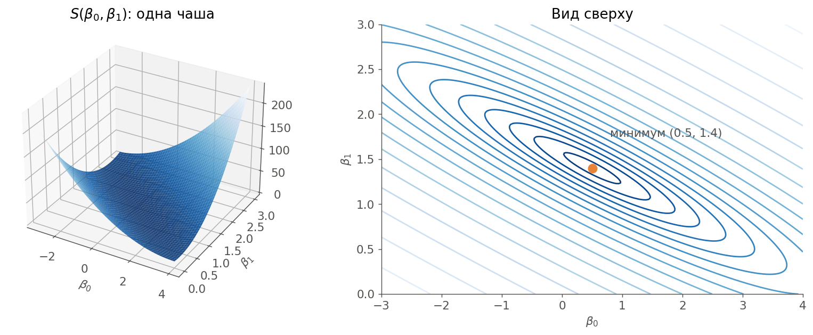

У функции Била были овраги и седла. Здесь рельеф другой: одна гладкая чаша, и у неё одно дно.

---

## Часть 4. Выводим формулы

### Условие минимума

Из lab2 мы знаем: на дне ямы градиент равен нулю. В lab2 приравнять к нулю и решить было нельзя, функция слишком сложная. Здесь можно.

Считаем частную производную по $\beta_0$. Используем то же правило, что и для функции Била: производная квадрата равна удвоенной скобке, умноженной на производную скобки. Производная скобки $(y_i-\beta_0-\beta_1x_i)$ по $\beta_0$ равна $-1$:

$$
\frac{\partial S}{\partial\beta_0}=-2\sum(y_i-\beta_0-\beta_1x_i)
$$

По $\beta_1$ производная скобки равна $-x_i$:

$$
\frac{\partial S}{\partial\beta_1}=-2\sum x_i(y_i-\beta_0-\beta_1x_i)
$$

Приравниваем обе к нулю, двойку сокращаем, суммы раскрываем:

$$
\begin{cases}
\sum y_i-N\beta_0-\beta_1\sum x_i=0\\
\sum x_iy_i-\beta_0\sum x_i-\beta_1\sum x_i^2=0
\end{cases}
$$

Важная деталь: $\beta_0$ складывается $N$ раз, поэтому получается $N\beta_0$.

Это система из двух обычных линейных уравнений с двумя неизвестными.

### Решаем систему

Из первого уравнения выражаем $\beta_0$. Делим всё на $N$, суммы превращаются в средние $\bar{x}$ и $\bar{y}$:

$$
\boxed{\beta_0=\bar{y}-\beta_1\bar{x}}
$$

Подставляем $\beta_0=\frac{\sum y_i-\beta_1\sum x_i}{N}$ во второе уравнение и умножаем его на $N$:

$$
N\sum x_iy_i-\sum x_i\sum y_i+\beta_1\left(\sum x_i\right)^2-\beta_1N\sum x_i^2=0
$$

Собираем $\beta_1$ в одну сторону:

$$
\boxed{\beta_1=\frac{N\sum x_iy_i-\sum x_i\sum y_i}{N\sum x_i^2-\left(\sum x_i\right)^2}}
$$

Это те самые формулы из твоего отчёта. Знаменатель равен нулю, только если все $x_i$ одинаковы. Тогда наклон и правда определить нельзя: все точки стоят на одной вертикали.

### Почему это минимум

<mark>Главное отличие от lab2: у МНК один минимум, и он глобальный. Точка старта, шаг и критерии остановки не нужны.</mark>

| Что               | Lab2: функция Била    | Lab3: МНК                        |
| ----------------- | --------------------- | -------------------------------- |
| Что ищем          | Точку $(x,y)$         | Коэффициенты $(\beta_0,\beta_1)$ |
| Рельеф            | Овраги и седла        | Одна чаша                        |
| Метод             | Шаги по антиградиенту | Одна формула                     |
| Зависит от старта | Да                    | Старта нет                       |

На функцию $S$ можно было бы натравить и спуск из lab2, он пришёл бы к тому же ответу. Так и делают, когда параметров очень много и формула становится слишком тяжёлой.

##### Связь с корреляцией

В lab1 был коэффициент корреляции $r$. Он связан с наклоном:

$$
\beta_1=r\cdot\frac{s_y}{s_x}
$$

где $s_x$ и $s_y$ — стандартные отклонения. Знак наклона всегда совпадает со знаком корреляции.

---

## Часть 5. Метрики качества

Прямую нашли. Теперь надо сказать числом, насколько она хороша.

### MSE

**Среднеквадратичная ошибка** — средний квадрат остатка:

$$
\boxed{MSE=\frac{1}{N}\sum(y_i-\hat{y}_i)^2}
$$

Чем меньше, тем лучше. Минимальное значение 0. Единицы у неё квадратные: если $y$ в рублях, то MSE в рублях в квадрате. Чтобы вернуться к обычным единицам, берут корень: $RMSE=\sqrt{MSE}$.

Сама по себе MSE ничего не говорит: 0.05 — это много или мало? Зависит от масштаба данных. Поэтому нужна метрика без единиц.

### R²

Сравним нашу прямую с самой глупой моделью: всегда отвечать средним $\bar{y}$.

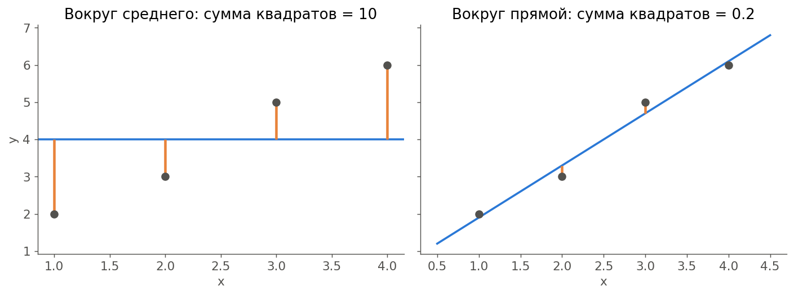

Слева разброс данных вокруг среднего, справа то, что осталось после прямой.

$$
\boxed{R^2=1-\frac{\sum(y_i-\hat{y}_i)^2}{\sum(y_i-\bar{y})^2}}
$$

$$
R^2=1-\frac{0.2}{10}=0.98
$$

Читается так: <mark>прямая объясняет 98% разброса $y$.</mark> Это **коэффициент детерминации**.

| Значение $R^2$ | Что значит                                                   |
| -------------- | ------------------------------------------------------------ |
| 1              | Все точки лежат на прямой                                    |
| 0              | Прямая не лучше простого среднего                            |
| Меньше 0       | Модель хуже среднего, у МНК на своих данных такого не бывает |

Для прямой $R^2$ равен квадрату корреляции: $R^2=r^2$.

### MAPE

**Средняя абсолютная процентная ошибка** — на сколько процентов в среднем мы ошибаемся:

$$
\boxed{MAPE=\frac{100\%}{N}\sum\left|\frac{y_i-\hat{y}_i}{y_i}\right|}
$$

$$
MAPE=\frac{100\%}{4}\left(\frac{0.1}{2}+\frac{0.3}{3}+\frac{0.3}{5}+\frac{0.1}{6}\right)\approx5.67\%
$$

Метрика понятная, её легко объяснить заказчику. Но есть слабое место: мы делим на $y_i$. Запомни этот момент, он вернётся в части 8.

Например: настоящее значение 0.01, предсказание 1.01. Ошибка всего 1. Сколько это процентов?

**Ответ:** $\frac{1}{0.01}\cdot100\%=10\,000\%$.

---

## Часть 6. Аппроксимация, интерполяция, экстраполяция

Три похожих слова, в вопросах к лабе они есть.

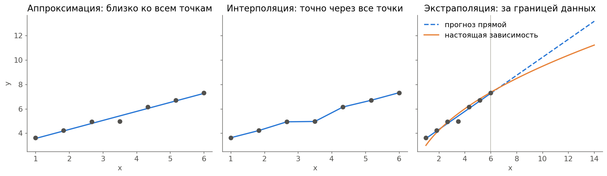

- **Аппроксимация** — приближённое описание данных простой функцией. Линия проходит близко к точкам, но не обязана проходить через них. МНК занимается именно этим.
- **Интерполяция** — поиск значения между известными точками. В строгом смысле кривая проходит точно через все точки. Подходит, когда данные точные и шума нет.
- **Экстраполяция** — прогноз за пределами данных. Самая опасная: мы не знаем, продолжается ли зависимость там.

На правом графике настоящая зависимость изгибается, а прямая этого не знает. Внутри данных она работала хорошо, а за границей ошибка растёт.

---

## Часть 7. Пишем код

**Ноутбук.** Переключись в `lab3_live.ipynb`.

---

## Часть 8. Результаты и ловушки

### Что получилось

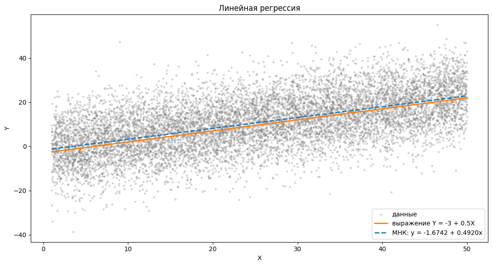

| Что       | Значение |
| --------- | -------- |
| $\beta_0$ | -1.6742  |
| $\beta_1$ | 0.4920   |
| MSE       | 99.93    |
| $R^2$     | 0.3248   |
| MAPE      | 250.97%  |

Результат совпадает с `np.polyfit`, значит, формулы написаны верно.

На первый взгляд таблица пугает: свободный член промахнулся больше чем на единицу, $R^2$ маленький, MAPE огромный. Разберём по очереди. Все три пункта не говорят о том, что метод сработал плохо.

##### Важная ловушка твоей лабораторной: истинный свободный член равен не -3

В условии написано $Y=-3+0.5X+E$. Кажется, что МНК должен найти $-3$. Но центр шума равен 1, а не 0.

Прямая проходит через середину облака. Шум в среднем поднимает каждую точку на 1, поэтому единицу можно перенести в свободный член:

$$
Y=-3+0.5X+E=\underbrace{(-3+1)}_{-2}+0.5X+\underbrace{(E-1)}_{\text{шум с центром }0}
$$

<mark>МНК не может отличить среднее шума от свободного члена. Правильный ориентир: $\beta_0=-2$, а не $-3$.</mark>

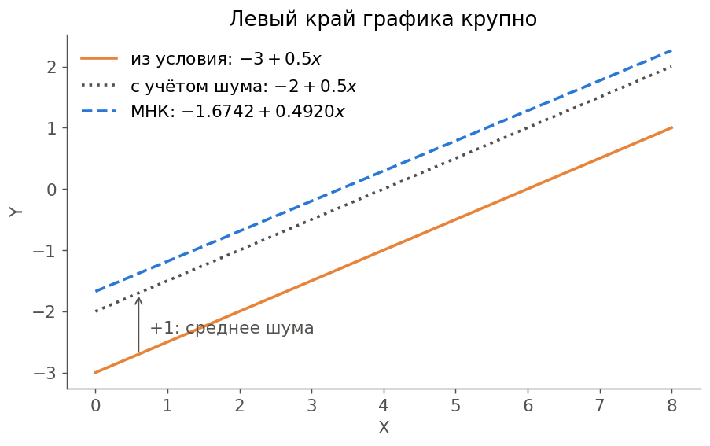

Осталась разница $-1.6742$ и $-2$, то есть 0.33. Она объясняется полностью:

- В этой выборке среднее шума получилось 1.124, а не ровно 1. Это даёт $+0.124$.
- Наклон оказался на 0.00802 меньше 0.5. Прямая проходит через центр $\bar{x}\approx25.21$, поэтому левый конец приподнялся на $0.00802\cdot25.21\approx0.202$.

Вместе $-2+0.124+0.202=-1.674$. Сходится.

Отсюда важное наблюдение: $\beta_0$ — значение при $x=0$, а это край облака. Прямая вращается вокруг центра данных, и любая маленькая ошибка наклона заметно двигает её конец. Поэтому свободный член всегда оценивается хуже наклона.

| Прямая                 | $\beta_0$ | $\beta_1$ | MSE    | $R^2$  | MAPE    |
| ---------------------- | --------- | --------- | ------ | ------ | ------- |
| Выражение $Y$          | -3        | 0.5       | 101.21 | 0.3162 | 222.33% |
| С учётом среднего шума | -2        | 0.5       | 99.96  | 0.3246 | 246.36% |
| МНК                    | -1.6742   | 0.4920    | 99.93  | 0.3248 | 250.97% |

MSE у МНК самая маленькая. Иначе и быть не может: эта прямая по определению минимизирует сумму квадратов на этих данных, даже настоящая прямая проигрывает ей на чуть-чуть.

А вот MAPE у МНК самая большая. Это тоже нормально: МНК минимизирует квадраты, а проценты его не интересуют.

##### Ловушка вторая: маленький R² не значит плохую модель

$R^2=0.3248$: прямая объясняет только треть разброса. <mark>Модель ошибается ровно настолько, насколько шумят данные.</mark> Лучше прямой тут не сделать, в том числе и нелинейной моделью.

Проверим остатки:

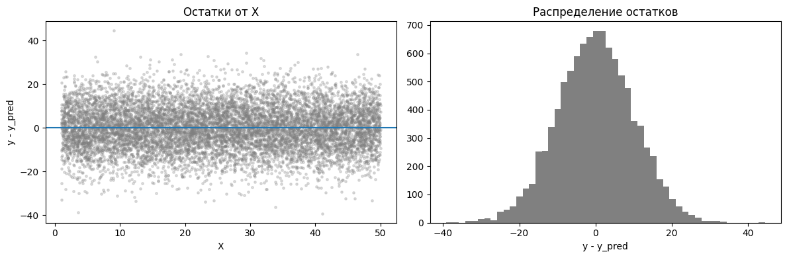

- Среднее остатков равно нулю с точностью до округления.
- Стандартное отклонение остатков 9.9966, у шума 9.9972.
- Остатки ровной полосой лежат вокруг нуля, закономерности в них нет.
- Гистограмма похожа на нормальное распределение.

<mark>Значит, всё, что можно было вытащить из данных, прямая вытащила. Осталась чистая случайность.</mark>

<mark>Вывод для отчёта: коэффициенты найдены точно, а метрики низкие из-за сильного шума.</mark>

##### Ловушка третья: MAPE здесь не работает

MAPE равна 250.97%. Значит ли это, что мы ошибаемся в 2.5 раза? Нет.

В формуле стоит деление на $y_i$, а $Y$ в твоём варианте проходит через ноль: 19.5% значений отрицательные, 4.27% лежат в пределах от -1 до 1.

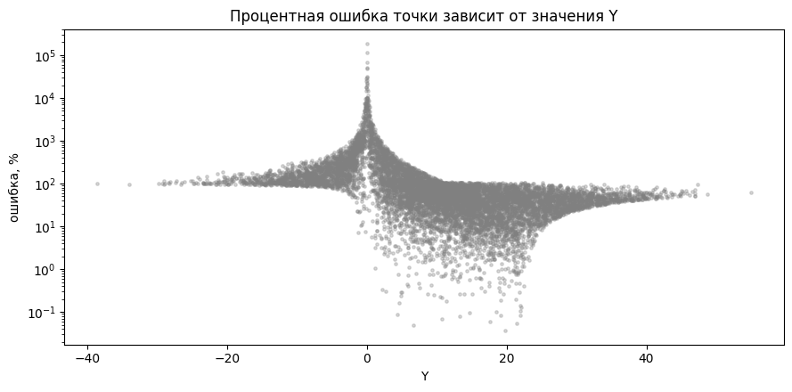

Самая плохая точка: $Y=-0.0034$, ошибка 189 065%. Одна такая точка поднимает MAPE на 19 процентных пунктов.

| Что считаем                         | Значение |
| ----------------------------------- | -------- |
| MAPE по всем точкам                 | 250.97%  |
| MAPE без точек с $\lvert Y\rvert<1$ | 101.62%  |
| MAPE без точек с $\lvert Y\rvert<5$ | 60.36%   |
| Медиана процентной ошибки           | 56.60%   |

Выбрасывать точки ради красивой цифры нельзя, таблица лишь показывает, откуда берётся число.

<mark>Вывод: MAPE бессмысленна, когда $Y$ бывает около нуля.</mark> Здесь лучше смотреть на $RMSE\approx10$: типичная ошибка равна 10 в единицах $Y$, и это ровно отклонение шума.

---

## Часть 9. Эксперименты

Эти ячейки идут в конце ноутбука. Они отвечают на вопросы 5, 6 и 7.

### Нелинейная зависимость

Сгенерируем параболу $y=2+0.5x^2$ и экспоненту $v=2e^{0.5u}$, обе с шумом.

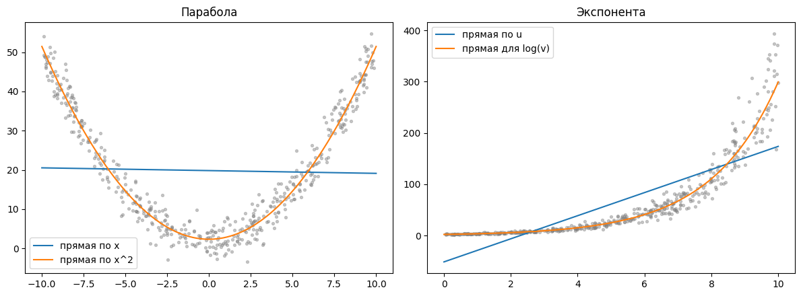

На параболе прямая почти горизонтальна. Левая ветвь падает, правая растёт, в среднем наклона нет.

| Данные     | Что делаем         | $R^2$  | Найдено          |
| ---------- | ------------------ | ------ | ---------------- |
| Парабола   | Прямая по $x$      | 0.0007 |                  |
| Парабола   | Прямая по $x^2$    | 0.9619 | $2.33+0.491x^2$  |
| Экспонента | Прямая по $u$      | 0.6676 |                  |
| Экспонента | Прямая для $\ln v$ | 0.9397 | $2.05e^{0.498u}$ |

МНК послушно выдаст прямую на любых данных, и формула не ругнётся. Но прямая будет систематически ошибаться: в середине всегда выше данных, по краям всегда ниже. У экспоненты $R^2=0.67$ выглядит прилично, хотя модель неверная, и прогноз при малых $u$ вообще отрицательный. Поэтому $R^2$ нужно смотреть вместе с графиком.

Лечится **трансформацией**:

- Парабола: заводим новый признак $z=x^2$. Для него $y=\beta_0+\beta_1z$ уже прямая.
- Экспонента: логарифмируем, $\ln v=\ln2+0.5u$. Это прямая для $\ln v$.

Коэффициенты получились близки к настоящим.

**Спроси:** зависимость $y=3\sqrt{x}$. Какой признак надо завести?

**Ответ:** $z=\sqrt{x}$, тогда $y=3z$.

### Размер выборки

Для каждого $N$ 1000 раз генерируем новые данные и смотрим, как разбегаются коэффициенты.

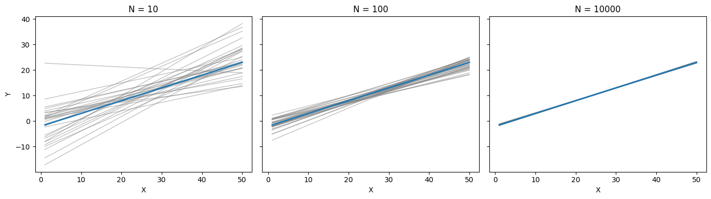

| $N$    | Среднее $\beta_0$ | Разброс $\beta_0$ | Среднее $\beta_1$ | Разброс $\beta_1$ | MSE   | $R^2$ |
| ------ | ----------------- | ----------------- | ----------------- | ----------------- | ----- | ----- |
| 10     | -2.19             | 7.00              | 0.512             | 0.250             | 81.96 | 0.375 |
| 100    | -1.95             | 2.13              | 0.497             | 0.073             | 97.85 | 0.334 |
| 1 000  | -1.98             | 0.65              | 0.499             | 0.022             | 99.93 | 0.332 |
| 10 000 | -2.00             | 0.21              | 0.500             | 0.007             | 99.98 | 0.333 |

Что здесь видно:

- В среднем метод попадает в $-2$ и $0.5$ при любом $N$, а разброс падает.
- $N$ вырос в 100 раз, разброс упал в 10 раз. Точность растёт как $\sqrt{N}$.
- MSE и $R^2$ с ростом $N$ не улучшаются. Больше данных уточняют коэффициенты, но шум никуда не денется.
- При $N=10$ MSE даже меньше. Это обман: прямая подстроилась под случайные точки.

Твой результат теперь можно оценить: отклонения $0.33$ у $\beta_0$ и $0.008$ у $\beta_1$ примерно равны полутора и одному разбросу из последней строки. Обычная случайность.

### Выбросы

**Выброс** — точка, которая сильно отличается от остальных. Добавим три точки с $Y=-100$ на правом краю.

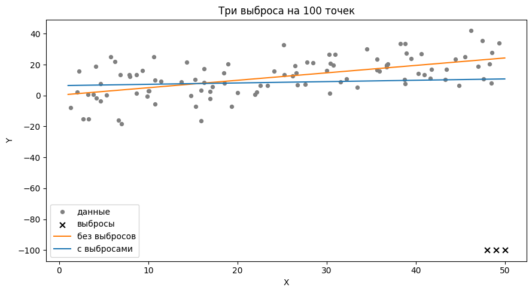

| Выборка                  | $\beta_0$ | $\beta_1$ | MSE    | $R^2$  |
| ------------------------ | --------- | --------- | ------ | ------ |
| 100 точек                | 0.24      | 0.481     | 100.09 | 0.3269 |
| 100 точек + 3 выброса    | 6.39      | 0.087     | 496.16 | 0.0034 |
| 10 000 точек             | -1.67     | 0.492     | 99.93  | 0.3248 |
| 10 000 точек + 3 выброса | -1.60     | 0.488     | 104.39 | 0.3116 |

Три точки из ста убили наклон: он упал с 0.48 до 0.09. Причина в квадратах: промах на 100 стоит 10 000, и прямая изо всех сил тянется к выбросу. Сильнее всего влияют выбросы на краю $X$: они работают как рычаг.

На 10 000 точек те же выбросы почти незаметны.

Что делать с выбросами:

1. Посмотреть на график и остатки.
2. Найти их, например по правилу трёх сигм из lab1.
3. Понять причину. Если это ошибка измерения, точку убирают. Если настоящее редкое событие, оставляют.
4. Использовать устойчивые методы: модуль вместо квадрата, функцию потерь Хьюбера, RANSAC.

---

## Часть 10. Что исправить в отчёте

Код в ноутбуке считает правильно, а вот текст отчёта с ним расходится. Если отчёт сдавать в таком виде, на защите это заметят сразу: числа в тексте не совпадают с рисунком 3.

### Ошибки по существу

| Где                           | Сейчас                                                                                | Должно быть                                                                                        |
| ----------------------------- | ------------------------------------------------------------------------------------- | -------------------------------------------------------------------------------------------------- |
| Цель работы                   | Численное решение уравнения методом наискорейшего градиентного спуска (текст из lab2) | Нахождение коэффициентов линейной регрессии методом наименьших квадратов и оценка качества решения |
| Таблица 1                     | $Y=3+0.5X+E$                                                                          | $Y=-3+0.5X+E$                                                                                      |
| Рисунок 1                     | $y=4.716+1.509x$ (другие данные)                                                      | $y=-1.6742+0.492x$                                                                                 |
| Текст после рисунка 3         | $R^2=0.8584$, 85.84%                                                                  | $R^2=0.3248$, 32.48%                                                                               |
| Текст после рисунка 3         | $MAPE=8.73\%$                                                                         | $MAPE=250.97\%$                                                                                    |
| Текст после рисунка 3 и вывод | Регрессия «достаточно хорошая», метрики показали «хорошие значения»                   | Переписать, см. ниже                                                                               |
| Текст после рисунка 2         | Регрессия «синяя линия»                                                               | Красная пунктирная линия                                                                           |
| Листинг 2 и ноутбук           | $\beta_1$ подписан как свободный член, $\beta_0$ как наклон                           | Наоборот: $\beta_1$ наклон, $\beta_0$ свободный член                                               |
| Вывод                         | Сравнение только с $Y=-3+0.5X$                                                        | Добавить, что с учётом среднего шума ориентир $Y=-2+0.5X$                                          |

Числа 0.8584 и 8.73% взяты не из этой работы. По части 8 ты теперь знаешь, что для варианта 2 такой $R^2$ невозможен: потолок равен одной трети.

Заодно: заголовок «Нахождение уравнения линейной регрессии (MSE)» в ноутбуке надо заменить на МНК. MSE — это метрика, а не метод.

### Как переписать вывод про метрики

> Найденные коэффициенты $\beta_0=-1.6742$, $\beta_1=0.4920$ близки к ожидаемым $-2$ и $0.5$. Ожидаемый свободный член равен $-2$, а не $-3$, так как среднее шума равно 1. Значение $MSE=99.93$ практически совпадает с дисперсией шума, равной 100. $R^2=0.3248$ близок к максимально достижимому значению $1/3$: остальная часть разброса вызвана шумом и не может быть объяснена по $X$. Значение $MAPE=250.97\%$ не отражает качество модели, так как часть значений $Y$ близка к нулю, а метрика делит на $Y$.

### Оформление

- «Листинг А1» в тексте: такого листинга нет, это листинг 3.
- Два листинга с номером 3: вычисление метрик должно быть листингом 4, и подпись к рисунку 3 тоже надо поправить.
- Опечатки: «породности», «Метод неменьших квадратов», «в общем случаи», «Jupiter», «Расчитываем».

---

## Часть 11. Итоги

### Главное

- **Линейная регрессия** описывает зависимость прямой $y=\beta_0+\beta_1x$.
- **Остаток** — разница между настоящим значением и предсказанием.
- **МНК** выбирает прямую с минимальной суммой квадратов остатков.
- **Формулы** получаются из условия: обе частные производные равны нулю.
- **Минимум один и глобальный**, потому что функция ошибки выпуклая.
- **MSE** показывает средний квадрат ошибки, **$R^2$** — долю объяснённого разброса, **MAPE** — ошибку в процентах.
- **Центр шума** уходит в свободный член.
- **Низкий $R^2$** может значить сильный шум, а не плохую модель.
- **MAPE** ломается, когда $Y$ бывает около нуля.

### Ответы на вопросы преподавателя

**1. Оценка качества найденного решения.** Считаем метрики: MSE, $R^2$, MAPE. Смотрим на график и остатки: их среднее должно быть около нуля, закономерности в них быть не должно. Так как данные сгенерированы, сравниваем коэффициенты с настоящими. У нас $\beta_1=0.4920$ при настоящем 0.5, $\beta_0=-1.6742$ при ожидаемом $-2$. $R^2=0.3248$ близок к потолку $1/3$, MSE совпадает с дисперсией шума. На реальных данных качество ещё проверяют на новых точках, которые не участвовали в подборе.

**2. Какой класс задач можно решить с помощью линейной регрессии.** Задачи регрессии: предсказание числовой величины по признакам. Например, цена по площади, спрос по цене, прогноз тренда. Ещё она показывает, как сильно признак влияет на результат: за это отвечает $\beta_1$. Признаков может быть несколько.

**3. Аппроксимация, интерполяция и экстраполяция.** Аппроксимация — приближённое описание данных простой функцией, линия не обязана проходить через точки. Интерполяция — нахождение значений между известными точками, в строгом смысле кривая проходит через все точки. Экстраполяция — прогноз за пределами данных, она самая рискованная.

**4. Зависимость какой формы может аппроксимировать линейная регрессия.** Линейную по коэффициентам. Это прямая, плоскость при нескольких признаках. Сюда же относятся многочлены, $\ln x$, $\sqrt{x}$: сами они кривые, но коэффициенты входят линейно. Экспоненту и степенную функцию можно привести к этому виду логарифмированием.

**5. Почему нельзя использовать линейную регрессию для заведомо нелинейных зависимостей без трансформации.** Формула посчитается, но форма модели неверная. Прямая будет систематически ошибаться, в остатках останется закономерность, а прогноз за пределами данных будет плохим. На параболе у нас вышло $R^2=0.0007$, после замены $x$ на $x^2$ стало $0.9619$.

**6. Как изменится результат, если объём выборки будет очень малым или наоборот очень большим.** При малой выборке коэффициенты сильно зависят от случайных точек: при $N=10$ разброс наклона 0.25. При большой они приближаются к настоящим: при $N=10\,000$ разброс 0.007. Точность растёт как $\sqrt{N}$. Но MSE и $R^2$ не улучшатся: шум останется.

**7. Что будет, если в выборке будут выбросы.** Прямая сдвинется в сторону выбросов, потому что ошибка входит в квадрате. Три выброса на 100 точек уменьшили наклон с 0.48 до 0.09, а $R^2$ упал почти до нуля. На 10 000 точек те же выбросы почти незаметны. Сильнее всего влияют выбросы на краю $X$. Их находят по графику и остаткам, причину проверяют, ошибки убирают или используют устойчивые методы.
