# Лабораторная работа №4: метод главных компонент (PCA)

## Часть 1. Зачем это нужно

### Задача снижения размерности

Представь таблицу про людей: рост в сантиметрах, рост в дюймах, вес, размер обуви. Столбцов четыре, но рост записан дважды, а размер обуви почти повторяет рост. Настоящей информации здесь меньше, чем столбцов.

В таблицах часто так: признаков много, а независимых величин мало. Хочется заменить много столбцов несколькими новыми и потерять как можно меньше.

Это **снижение размерности**. Зачем оно нужно:

- Сжать данные, чтобы их было легче хранить и считать.
- Нарисовать данные: восемь измерений на экран не выведешь, а два выведешь.
- Убрать дубли и часть шума.
- Подготовить признаки для модели.

**PCA** (principal component analysis, метод главных компонент) делает это так: поворачивает оси и оставляет те, вдоль которых данные разбросаны сильнее всего.

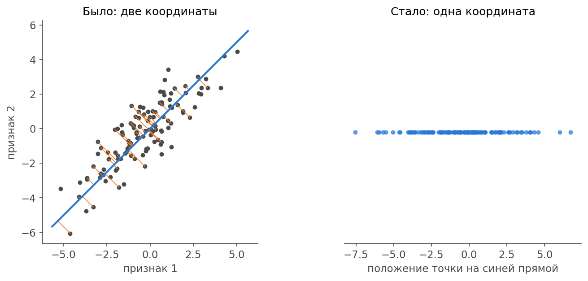

Слева облако точек в двух координатах. Оно вытянуто вдоль синей прямой. Если спроецировать каждую точку на прямую, у точки останется одно число: где она на этой прямой. Справа то же облако, записанное одной координатой. Оранжевые отрезки показывают, что мы выбросили.

В lab3 мы тоже проводили прямую через облако, но задача была другой. Там один столбец предсказывали по другому. Здесь нечего предсказывать: все признаки равноправны, и мы ищем удобные новые оси.

Нам нужно разобрать четыре вопроса:

1. Какое направление лучшее? Ответ: то, вдоль которого дисперсия максимальна.
2. Как его найти? Ответ: это собственный вектор ковариационной матрицы.
3. При чём здесь SVD? Ответ: это разложение сразу даёт все нужные векторы.
4. Как посчитать SVD, если готовые функции запрещены? Ответ: степенным методом.

Для этого понадобится немного линейной алгебры. Начнём с нуля.

---

## Часть 2. Векторы и матрицы

### Вектор

**Вектор** — это упорядоченный набор чисел. Каждая строка таблицы является вектором: $(2,1)$ — точка на плоскости, а строка из восьми признаков — точка в восьмимерном пространстве. Нарисовать её нельзя, но считать можно по тем же правилам.

**Скалярное произведение** двух векторов: перемножаем соответствующие числа и складываем.

$$
\boxed{a\cdot b=a_1b_1+a_2b_2+\dots+a_nb_n}
$$

Например, $(2,1)\cdot(1,1)=2\cdot1+1\cdot1=3$.

Из него получаются три вещи, которые нам нужны:

| Что               | Формула                  | Пример                                   |
| ----------------- | ------------------------ | ---------------------------------------- |
| Длина вектора     | $\lVert a\rVert=\sqrt{a\cdot a}$ | $\lVert(3,4)\rVert=\sqrt{9+16}=5$ |
| Перпендикулярность | $a\cdot b=0$            | $(1,1)\cdot(1,-1)=1-1=0$                 |
| Проекция на единичный вектор $v$ | $a\cdot v$ | Координата точки $a$ вдоль $v$       |

**Единичный вектор** — вектор длины 1. Чтобы его получить, делим вектор на его длину. У $(1,1)$ длина $\sqrt{2}$, значит, единичный вектор того же направления равен $(1,1)/\sqrt{2}\approx(0.71,\ 0.71)$.

**Спроси:** чему равна проекция точки $(2,1)$ на направление $(1,1)/\sqrt{2}$?

**Ответ:** $(2\cdot1+1\cdot1)/\sqrt{2}=3/\sqrt{2}\approx2.12$.

### Матрица как преобразование

**Матрица** — это таблица чисел. Её можно считать просто таблицей, а можно считать машиной: на вход вектор, на выход другой вектор.

Умножение матрицы на вектор: каждая строка матрицы скалярно умножается на вектор.

$$
A=\begin{pmatrix}2&1\\1&2\end{pmatrix},\qquad
A\begin{pmatrix}1\\0\end{pmatrix}=\begin{pmatrix}2\cdot1+1\cdot0\\1\cdot1+2\cdot0\end{pmatrix}=\begin{pmatrix}2\\1\end{pmatrix}
$$

Вектор $(1,0)$ стал вектором $(2,1)$: он повернулся и вытянулся.

**Транспонирование** меняет строки и столбцы местами, обозначается $A^T$. Первая строка становится первым столбцом. Если $v$ и $w$ — столбцы, то $v^Tw$ — это то же скалярное произведение.

Сразу важное наблюдение. Пусть $A$ — наша таблица данных, строки в ней — точки. Тогда $Av$ скалярно умножает каждую точку на $v$.

<mark>Одно умножение $Av$ даёт проекции всех точек сразу. В коде это `A @ v`.</mark>

### Собственные векторы

Большинство векторов матрица поворачивает. Но есть особые направления, которые она только растягивает:

$$
\boxed{Av=\lambda v}
$$

Здесь $v$ — **собственный вектор**, а число $\lambda$ («лямбда») — **собственное значение**. Оно показывает, во сколько раз вектор растянулся.

Для нашей матрицы:

$$
A\begin{pmatrix}1\\1\end{pmatrix}=\begin{pmatrix}3\\3\end{pmatrix}=3\begin{pmatrix}1\\1\end{pmatrix}
$$

Вектор $(1,1)$ собственный, $\lambda=3$.

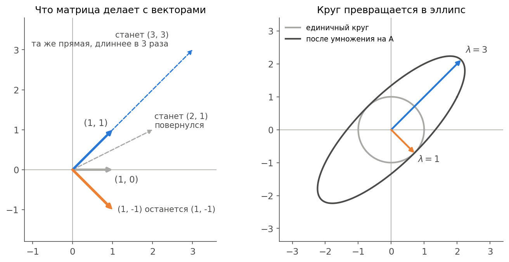

Слева видно разницу: серый вектор поменял направление, синий остался на своей прямой. Справа то же самое для всех векторов сразу: единичный круг превратился в эллипс. Собственные векторы идут вдоль осей эллипса, а собственные значения равны длинам его полуосей.

**Спроси:** проверь, что $(1,-1)$ тоже собственный вектор. Чему равно $\lambda$?

**Ответ:** $A(1,-1)=(2-1,\ 1-2)=(1,-1)$. Вектор не изменился, значит, $\lambda=1$.

##### Как найти руками

Перепишем $Av=\lambda v$ как $(A-\lambda I)v=0$. Здесь $I$ — **единичная матрица**: на диагонали единицы, остальное нули, она ничего не меняет. Ненулевое решение есть, только если определитель равен нулю:

$$
\det\begin{pmatrix}2-\lambda&1\\1&2-\lambda\end{pmatrix}=(2-\lambda)^2-1=0
$$

Отсюда $2-\lambda=\pm1$, то есть $\lambda=3$ и $\lambda=1$. Определитель матрицы $2\times2$ считается как $ad-bc$.

Для восьми признаков получится уравнение восьмой степени, поэтому на практике так не считают. Но для маленьких примеров это удобно.

У **симметричных** матриц, где $A=A^T$, есть два приятных свойства: собственные значения всегда вещественные, а собственные векторы перпендикулярны друг другу. Именно такая матрица нам и встретится.

### Новые оси

Обычные оси $x$ и $y$ — это векторы $(1,0)$ и $(0,1)$. Набор таких векторов называется **базисом**. Базис можно заменить. Возьмём два перпендикулярных единичных вектора:

$$
v_1=\frac{(1,1)}{\sqrt{2}},\qquad v_2=\frac{(1,-1)}{\sqrt{2}}
$$

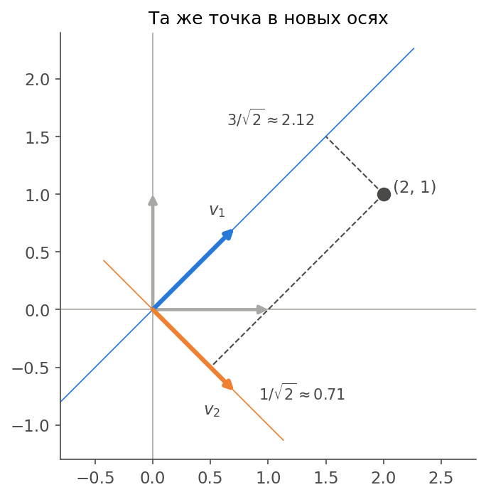

Новые координаты точки — это её проекции на новые оси. Для точки $(2,1)$ получаем $3/\sqrt{2}$ и $1/\sqrt{2}$.

Точка никуда не сдвинулась, поменялось только её описание. Длина тоже прежняя:

$$
2^2+1^2=5,\qquad \left(\frac{3}{\sqrt{2}}\right)^2+\left(\frac{1}{\sqrt{2}}\right)^2=4.5+0.5=5
$$

Если сложить векторы столбцами в матрицу $V$, то новые координаты всех точек считаются одним умножением:

$$
\boxed{P=AV}
$$

<mark>PCA — это поворот осей. Сам поворот ничего не теряет. Потери появляются позже, когда мы выбрасываем часть новых осей.</mark>

---

## Часть 3. Разброс и связь признаков

### Маленький пример

Весь разбор сделаем на четырёх точках:

| $x$ | 5 | 4 | 2 | 1 |
| --- | - | - | - | - |
| $y$ | 5 | 6 | 2 | 3 |

Первый шаг PCA — **центрирование**: вычитаем из каждого столбца его среднее. Здесь средние равны 3 и 4.

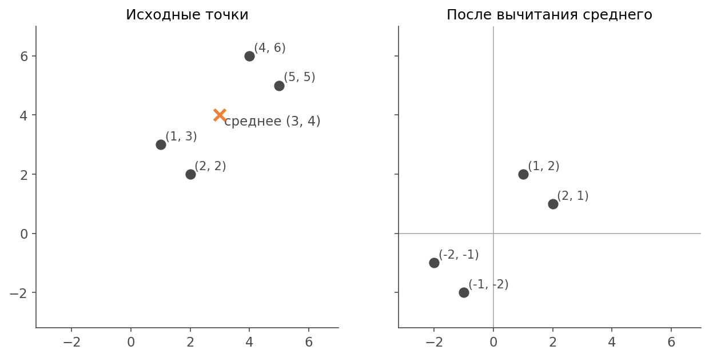

Центрировать нужно, потому что нас интересует разброс вокруг центра, а не положение центра. Без этого первая компонента просто указала бы на центр облака.

Получим таблицу, с которой дальше работаем:

$$
A=\begin{pmatrix}2&1\\1&2\\-1&-2\\-2&-1\end{pmatrix}
$$

### Дисперсия

**Дисперсия** показывает, насколько признак разбросан вокруг среднего:

$$
\boxed{s_x^2=\frac{1}{N-1}\sum_{i=1}^{N}(x_i-\bar{x})^2}
$$

Для нашего $x$: $(4+1+1+4)/3=10/3\approx3.33$. У $y$ столько же.

### Ковариация

**Ковариация** показывает, меняются ли два признака вместе:

$$
\boxed{\mathrm{cov}(x,y)=\frac{1}{N-1}\sum_{i=1}^{N}(x_i-\bar{x})(y_i-\bar{y})}
$$

Если $x$ выше среднего и $y$ выше среднего, произведение положительное. Если они расходятся, отрицательное.

Здесь $(2\cdot1+1\cdot2+1\cdot2+2\cdot1)/3=8/3\approx2.67$. Признаки растут вместе.

### Корреляция

Ковариация зависит от единиц измерения. Рост в сантиметрах даст число в 100 раз больше, чем рост в метрах. Чтобы от этого избавиться, делим на стандартные отклонения. Получаем **коэффициент корреляции** из lab1:

$$
\boxed{r_{xy}=\frac{\mathrm{cov}(x,y)}{s_xs_y}}
$$

Здесь $r=\frac{8/3}{10/3}=0.8$. Значения $r$ всегда лежат от $-1$ до $1$.

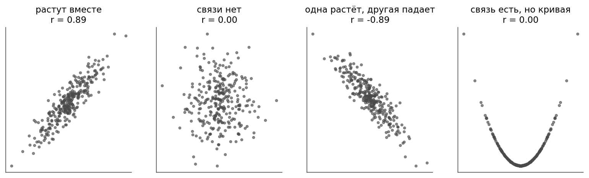

<mark>Корреляция ловит только линейную связь.</mark> На четвёртом графике $y=x^2$: зависимость идеальная, а $r=0$. Левая ветвь падает, правая растёт, и всё гасится.

Если каждый столбец **стандартизировать**, то есть вычесть среднее и поделить на стандартное отклонение, ковариация столбцов станет равна их корреляции:

$$
\boxed{z=\frac{x-\bar{x}}{s}}
$$

После этого у каждого столбца среднее 0 и дисперсия 1. Единицы измерения исчезают. Это нам ещё очень пригодится.

### Ковариационная матрица

Соберём все дисперсии и ковариации в одну таблицу. Благодаря центрированию она считается одним умножением:

$$
\boxed{C=\frac{1}{N-1}A^TA}
$$

Для примера:

$$
A^TA=\begin{pmatrix}10&8\\8&10\end{pmatrix},\qquad
C=\begin{pmatrix}3.33&2.67\\2.67&3.33\end{pmatrix}
$$

На диагонали дисперсии признаков, вне диагонали ковариации. Матрица симметричная, ведь $\mathrm{cov}(x,y)=\mathrm{cov}(y,x)$.

Сумма диагонали $3.33+3.33=6.67$ — это **общая дисперсия**: весь разброс, который есть в данных.

**Спроси:** что значит ноль вне диагонали?

**Ответ:** два признака линейно не связаны.

---

## Часть 4. Главные компоненты

### Какое направление лучшее

Хотим заменить две координаты одной. Выбираем прямую и проецируем на неё точки. Хорошая прямая та, на которой точки остаются разными. Если проекции слиплись, различия между точками потеряны.

Значит, надо искать направление с наибольшей дисперсией проекций.

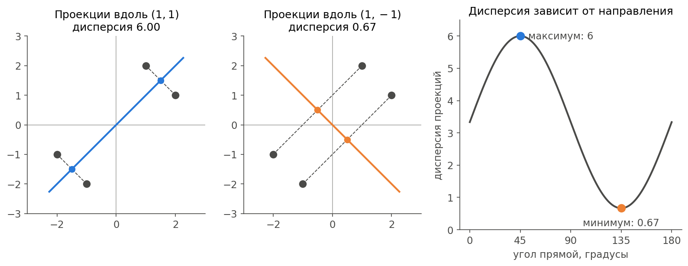

Вдоль $(1,1)$ проекции равны $2.12,\ 2.12,\ -2.12,\ -2.12$, дисперсия 6. Вдоль $(1,-1)$ проекции равны $0.71,\ -0.71,\ 0.71,\ -0.71$, дисперсия 0.67.

Правый график показывает дисперсию для всех направлений подряд. Максимум на 45°, минимум на 135°. Эти углы перпендикулярны.

Дисперсию вдоль единичного вектора $v$ можно записать через матрицу $C$. Проекции равны $Av$, а их среднее равно нулю, потому что данные центрированы:

$$
\boxed{s^2(v)=\frac{(Av)^T(Av)}{N-1}=\frac{v^TA^TAv}{N-1}=v^TCv}
$$

### Почему ответ — собственный вектор

Заметь: $(1,1)$ и $(1,-1)$ — собственные векторы $C$, такие же, как у матрицы из части 2. Собственные значения равны как раз 6 и 0.67. Это не совпадение.

Возьмём любой единичный вектор и запишем его в базисе собственных векторов: $v=av_1+bv_2$, где $a^2+b^2=1$. Тогда:

$$
v^TCv=\lambda_1a^2+\lambda_2b^2
$$

Это взвешенная сумма $\lambda_1$ и $\lambda_2$, а веса в сумме дают единицу. Больше всего она будет при $a=1$ и $b=0$.

<mark>Направление максимальной дисперсии — это собственный вектор $C$ с наибольшим $\lambda$. Собственное значение равно дисперсии вдоль него.</mark>

Этот вектор называется **первой главной компонентой**. Вторая — лучшее направление среди перпендикулярных к первой, то есть следующий собственный вектор. И так далее.

Собственные значения складываются в общую дисперсию: $6+0.67=6.67$. Поворот разброс не меняет, он только перераспределяет его по осям.

### Тот же ответ с другой стороны

Можно спросить иначе: какая прямая ближе всего к точкам, если мерить расстояния по перпендикуляру?

Для каждой точки работает теорема Пифагора: квадрат расстояния до центра равен квадрату проекции плюс квадрат расстояния до прямой. Первое слагаемое у точки не меняется. Значит, чем больше проекции, тем меньше расстояния.

<mark>Максимизировать дисперсию проекций и минимизировать ошибку проекции — одна и та же задача.</mark>

И вот теперь хорошо видна разница с lab3:

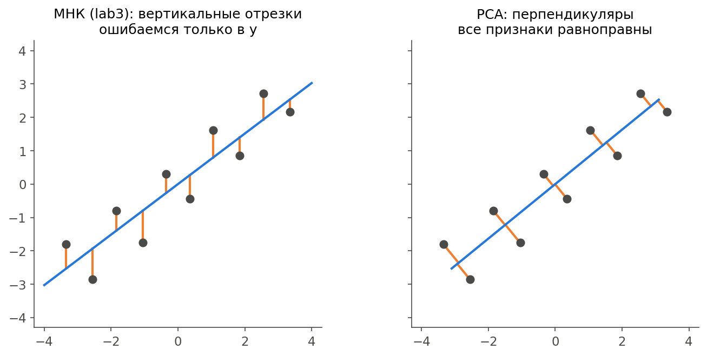

| Что          | МНК (lab3)                 | PCA (lab4)                |
| ------------ | -------------------------- | ------------------------- |
| Признаки     | $y$ особый, его предсказываем | Все равноправны        |
| Что минимизируем | Вертикальные отрезки   | Перпендикуляры к прямой   |
| Результат    | Формула для предсказания   | Новые оси                 |

### Объяснённая дисперсия и ошибка

**Доля объяснённой дисперсии** $i$-й компоненты показывает, сколько разброса на неё пришлось:

$$
\boxed{\frac{\lambda_i}{\lambda_1+\lambda_2+\dots+\lambda_n}}
$$

В примере: $6/6.67=90\%$ и $0.67/6.67=10\%$.

Оставим $k$ компонент. Из проекции можно приближённо восстановить данные:

$$
\boxed{\hat{A}=P_kV_k^T}
$$

**Ошибка проекции** — доля разброса, которую восстановить не удалось:

$$
\boxed{error=\frac{\sum(A-\hat{A})^2}{\sum A^2}=\frac{\lambda_{k+1}+\dots+\lambda_n}{\lambda_1+\dots+\lambda_n}}
$$

Считаем для примера при $k=1$. Восстановленные точки: $(1.5,\ 1.5)$, $(1.5,\ 1.5)$, $(-1.5,\ -1.5)$, $(-1.5,\ -1.5)$. Каждая отличается от настоящей на $0.5$ по каждой координате, поэтому сумма квадратов равна $8\cdot0.25=2$. Всего $\sum A^2=20$. Ошибка $2/20=10\%$, ровно столько, сколько выброшенная компонента.

**Спроси:** первая компонента объясняет 70%, вторая 20%, остальные 10%. Какая ошибка при двух компонентах?

**Ответ:** 10%: всё, что не вошло.

### Алгоритм целиком

1. Центрировать данные, при необходимости стандартизировать.
2. Найти собственные векторы и значения ковариационной матрицы.
3. Отсортировать их по убыванию $\lambda$.
4. Оставить первые $k$ векторов.
5. Спроецировать: $P=AV_k$.

---

## Часть 5. SVD

### Что это такое

В задании просят PCA на основе **сингулярного разложения** (SVD, singular value decomposition). Это разложение любой матрицы на три:

$$
\boxed{A=U\Sigma V^T}
$$

| Обозначение | Что это                  | Размер для нашей таблицы |
| ----------- | ------------------------ | ------------------------ |
| $V$         | Новые оси в пространстве признаков | Признаки × признаки |
| $\Sigma$    | Диагональная матрица сингулярных чисел $\sigma_1\ge\sigma_2\ge\dots$ | Признаки × признаки |
| $U$         | Нормированные координаты точек | Точки × признаки   |

Столбцы $U$ перпендикулярны друг другу и единичны, столбцы $V$ тоже. Значок $\sigma$ читается «сигма».

Геометрический смысл: любая матрица — это поворот, растяжение вдоль осей и ещё один поворот.

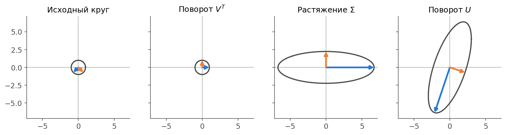

Здесь круг проходит через матрицу $\begin{pmatrix}3&0\\4&5\end{pmatrix}$. Сначала $V^T$ поворачивает синий и оранжевый векторы на оси координат. Потом $\Sigma$ растягивает. Потом $U$ поворачивает результат на место.

### Связь с PCA

Подставим разложение в матрицу $A^TA$:

$$
A^TA=V\Sigma U^TU\Sigma V^T=V\Sigma^2V^T
$$

Средняя часть сократилась, потому что $U^TU=I$. Умножим обе части на $V$ и увидим $A^TAV=V\Sigma^2$. Это определение собственных векторов.

Значит:

- Столбцы $V$ — собственные векторы $A^TA$, то есть главные компоненты.
- Сингулярные числа связаны с собственными значениями ковариационной матрицы:

$$
\boxed{\lambda_i=\frac{\sigma_i^2}{N-1}}
$$

- Проекции получаются сразу: $P=AV=U\Sigma$.

<mark>PCA — это SVD центрированной матрицы данных.</mark>

### Считаем руками

Возьмём наш пример. Собственные векторы $A^TA$ мы знаем, собственные значения равны 18 и 2.

$$
\sigma_1=\sqrt{18}\approx4.24,\qquad \sigma_2=\sqrt{2}\approx1.41
$$

Проверка: $\lambda_1=18/3=6$, $\lambda_2=2/3=0.67$. Сходится.

Столбцы $U$ считаем по формуле $u=Av/\sigma$:

$$
u_1=\frac{Av_1}{\sigma_1}=\frac{1}{2}\begin{pmatrix}1\\1\\-1\\-1\end{pmatrix},\qquad
u_2=\frac{Av_2}{\sigma_2}=\frac{1}{2}\begin{pmatrix}1\\-1\\1\\-1\end{pmatrix}
$$

### Разложение на слои

$U\Sigma V^T$ можно записать как сумму простых матриц:

$$
\boxed{A=\sigma_1u_1v_1^T+\sigma_2u_2v_2^T+\dots}
$$

Каждое слагаемое — отдельный **слой**. Проверим первую строку примера. Первый слой даёт $(1.5,\ 1.5)$, второй даёт $(0.5,\ -0.5)$, вместе получается $(2,\ 1)$. Сходится.

Первый слой — это как раз наши восстановленные точки из части 4. Оставить $k$ слоёв значит оставить $k$ компонент. Теорема Эккарта — Янга говорит, что лучшего приближения из $k$ таких слоёв не существует.

---

## Часть 6. Степенной метод

### Что запрещено

В задании нельзя использовать готовый SVD и любые методы работы с матрицами, кроме сложения, умножения и создания единичной матрицы. Значит, нельзя `np.linalg.svd`, `np.linalg.eig`, `np.linalg.norm`, `np.trace`. Можно только `@`, `+`, `-`, `np.eye` и случайные числа. `np.outer` в коде тоже разрешён: это умножение столбца на строку.

Среднее и отклонение столбца — это статистика, а не работа с матрицами, поэтому `np.mean` и `np.std` оставляем. Библиотечные функции в проверочных строках, например `np.linalg.svd` рядом с нашим результатом, в решении не участвуют.

### Идея

Вот удивительный факт: если много раз умножать вектор на матрицу, он сам повернётся к главному собственному вектору.

Посмотрим на нашу $A=\begin{pmatrix}2&1\\1&2\end{pmatrix}$ и старт $(1,0)$:

$$
(1,0)\to(2,1)\to(5,4)\to(14,13)\to(41,40)
$$

Числа выравниваются, вектор стремится к направлению $(1,1)$.

Почему так? Разложим старт по собственным векторам: $v=av_1+bv_2$. После $t$ умножений:

$$
A^tv=a\lambda_1^tv_1+b\lambda_2^tv_2
$$

Самое большое $\lambda$ растёт быстрее всех, остальные слагаемые отстают. Здесь $3^t$ против $1^t$.

Числа быстро становятся огромными, поэтому на каждом шаге делим вектор на его длину. Получаем **степенной метод**:

$$
\boxed{v\leftarrow\frac{Mv}{\lVert Mv\rVert}}
$$

Останавливаемся, когда вектор перестал меняться.

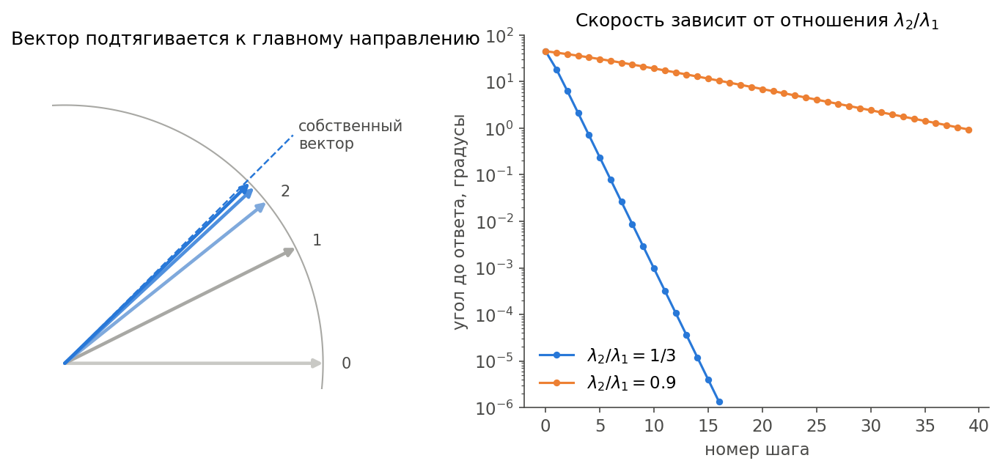

Справа видно важное свойство: скорость зависит от отношения $\lambda_2/\lambda_1$. При $1/3$ хватает полутора десятков шагов. При $0.9$ метод ползёт медленно. Если собственные значения близки, критерий остановки должен быть строгим.

**Спроси:** что будет, если стартовый вектор случайно окажется перпендикулярен главному?

**Ответ:** $a=0$, главного слагаемого в разложении нет. Со случайным стартом это практически невозможно, поэтому старт и берём случайным.

### Как получить следующие компоненты

Первый слой найден. **Вычитаем** его:

$$
\boxed{A\leftarrow A-\sigma uv^T}
$$

В новой матрице первой компоненты нет, и теперь главной стала вторая. Запускаем степенной метод снова. Такой приём называется **дефляцией**.

Весь алгоритм:

1. Посчитать $M=A^TA$.
2. Степенным методом найти главный вектор $v$.
3. Посчитать $\sigma=\lVert Av\rVert$ и $u=Av/\sigma$.
4. Вычесть слой из $A$.
5. Повторить $k$ раз.

Компоненты сразу выходят отсортированными: сначала самая большая.

---

## Часть 7. Твой вариант

Вариант 2, $N=1000$ (число точек в задании не указано, берём как в твоём ноутбуке):

| Признак | Как задан                                  |
| ------- | ------------------------------------------ |
| $X_1$   | Равномерно от 0 до 10                      |
| $X_2$   | Равномерно от 0 до 10                      |
| $X_3$   | $X_1+X_2+\varepsilon$, шум со средним 0 и дисперсией 5 |
| $X_4$   | Нормально, среднее 10, дисперсия 9         |
| $X_5$   | $2X_4+\varepsilon$, шум со средним 1 и дисперсией 3 |
| $X_6$   | Экспоненциально, $\lambda=0.5$             |
| $X_7$   | $\sqrt{X_6}$                               |
| $X_8$   | 0 или 1 с равными вероятностями            |

Здесь $\lambda$ — параметр распределения, а не собственное значение.

Три места, где легко ошибиться в коде:

- `np.random.normal` принимает отклонение, а в условии дисперсия. Для дисперсии 5 пишем `np.sqrt(5)`.
- `np.random.exponential` принимает $1/\lambda$, то есть 2.
- `np.random.randint(0, 2)` выдаёт 0 и 1: правая граница не входит.

Посмотри, как устроены признаки. Они разбиваются на группы:

| Группа              | Что внутри                             |
| ------------------- | -------------------------------------- |
| $X_1,X_2,X_3$       | Два независимых признака и их сумма с шумом |
| $X_4,X_5$           | Почти один признак                     |
| $X_6,X_7$           | Почти один признак, связь нелинейная   |
| $X_8$               | Сам по себе                            |

Независимых источников пять: $X_1,X_2,X_4,X_6,X_8$. Остальное в основном их повторяет. Значит, можно заранее ждать, что пяти компонент хватит.

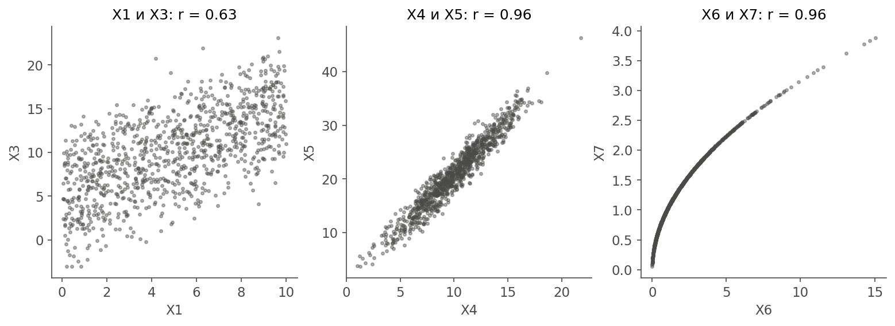

---

## Часть 8. Пишем код

**Ноутбук.** Переключись в `lab4_live.ipynb`.

---

## Часть 9. Результаты и ловушки

### Что получилось

**Корреляция.** Группы из части 7 видны сразу:

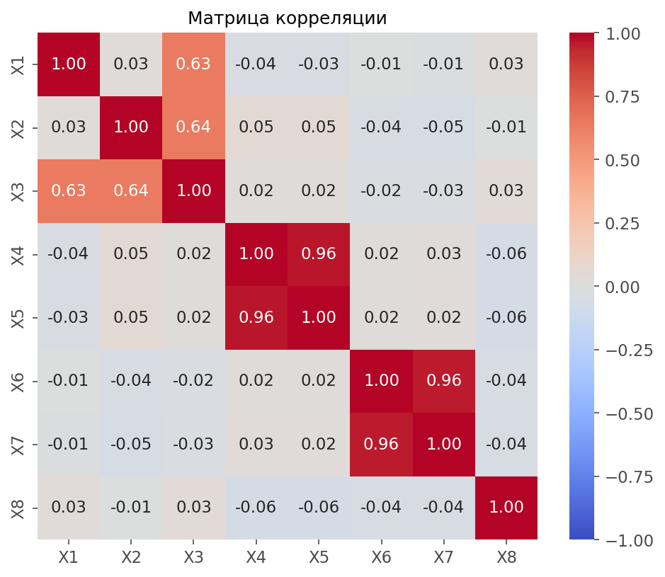

Три ярких блока, всё остальное около нуля. Значения вне блоков не равны нулю точно: это случайность выборки, у 1000 точек такой разброс нормален.

Заметь $r(X_6,X_7)=0.96$. Связь нелинейная, но корень на этом участке похож на прямую, поэтому корреляция почти единица.

**SVD.** Сравниваем с библиотекой:

| Что проверяем                   | Результат                |
| ------------------------------- | ------------------------ |
| $\sigma$ у нас и в `np.linalg.svd` | Совпали до 4 знаков   |
| Наибольшая разница $A$ и $U\Sigma V^T$ | $7\cdot10^{-15}$   |
| Наибольшая разница $V^TV$ и $I$ | $2\cdot10^{-16}$         |
| Наибольшая разница $U^TU$ и $I$ | $7\cdot10^{-13}$         |

Реализация верная. Если запустить `svd` на маленьком примере, получатся те же $\sigma=4.24$ и $1.41$, что мы считали руками.

**Проекция на 2D.** Собственные значения 49.94 и 29.55, ошибка 15.96%. Это совпадает с твоим ноутбуком.

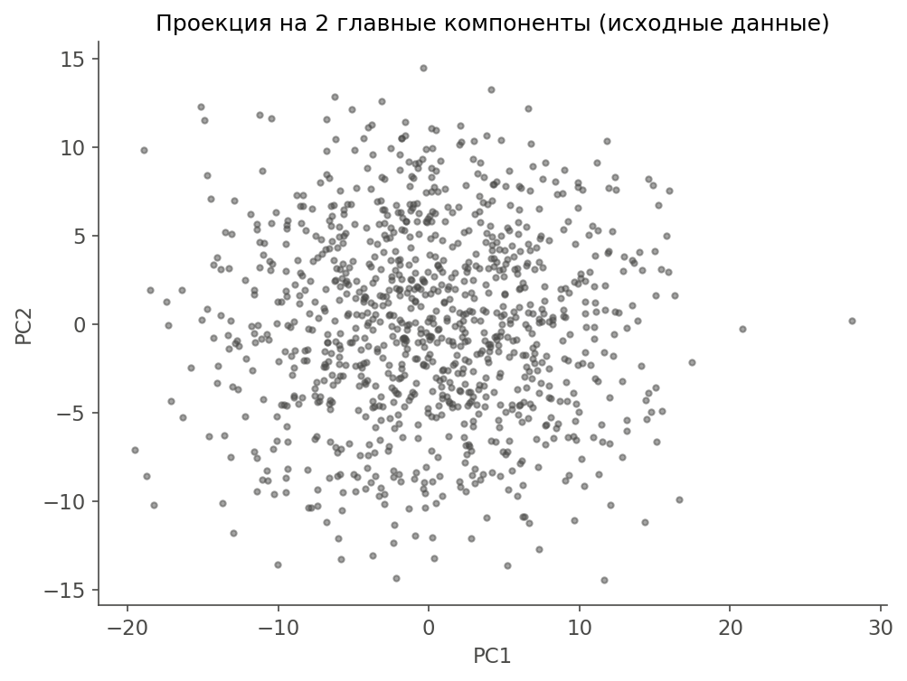

На картинке бесформенное пятно: никаких кластеров в данных нет, и это честный результат.

Посмотрим, из чего состоят компоненты. Числа в столбцах называются **нагрузками**, это координаты вектора $v$:

| Признак | PC1    | PC2    |
| ------- | ------ | ------ |
| $X_1$   | -0.010 | 0.362  |
| $X_2$   | 0.034  | 0.361  |
| $X_3$   | 0.033  | 0.859  |
| $X_4$   | 0.423  | -0.018 |
| $X_5$   | 0.905  | -0.032 |
| $X_6$   | 0.006  | -0.013 |
| $X_7$   | 0.002  | -0.005 |
| $X_8$   | -0.004 | 0.003  |

PC1 — это группа $X_4,X_5$. PC2 — группа $X_1,X_2,X_3$. Группа $X_6,X_7$ и признак $X_8$ сюда почти не попали.

Собственные значения можно предсказать заранее. Для группы $X_4,X_5$ ковариационная матрица равна $\begin{pmatrix}9&18\\18&39\end{pmatrix}$, потому что $\mathrm{Var}(2X_4+\varepsilon)=4\cdot9+3=39$ и $\mathrm{cov}(X_4,2X_4)=2\cdot9=18$. Её собственные значения равны 47.43 и 0.57. Группы между собой не связаны, поэтому их собственные значения просто складываются в общий список:

| Компонента | Что это                | Теория | У нас  |
| ---------- | ---------------------- | ------ | ------ |
| 1          | Группа $X_4,X_5$       | 47.43  | 49.94  |
| 2          | Группа $X_1,X_2,X_3$   | 28.54  | 29.55  |
| 3          | Разность $X_1-X_2$     | 8.33   | 8.26   |
| 4          | Группа $X_6,X_7$       | 4.40   | 4.59   |
| 5          | Шум в $X_3$            | 1.46   | 1.42   |
| 6          | Шум в $X_5$            | 0.57   | 0.55   |
| 7          | $X_8$                  | 0.25   | 0.25   |
| 8          | Разница $X_6$ и $X_7$  | 0.03   | 0.04   |

Отличия объясняются случайностью выборки. В целом PCA нашёл именно то, как мы строили данные.

##### Важная ловушка твоей лабораторной: масштаб признаков

Ошибка 15.96% выглядит хорошо: две компоненты из восьми, а потеряно всего 16%. Посмотрим на дисперсии.

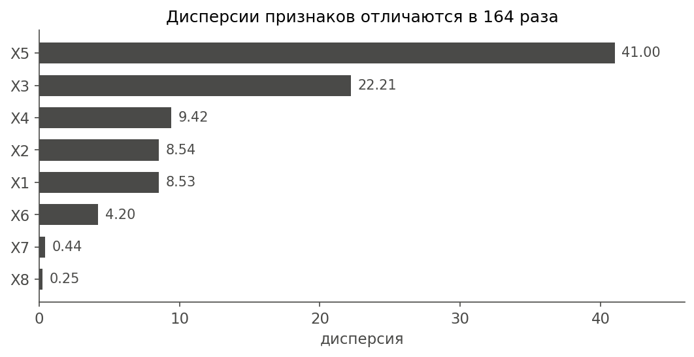

Общая дисперсия равна 94.59. Один $X_5$ даёт 43% от неё, вместе с $X_3$ получается 67%. А это просто следствие того, что значения $X_5$ крупнее. PCA не знает, что такое единицы измерения. Он видит только числа.

<mark>Без стандартизации главными становятся не самые важные признаки, а самые крупные.</mark>

Проверим прямо. Запишем $X_8$ как 0 и 100 вместо 0 и 1. Информации в столбце ровно столько же, только единицы другие.

| Данные               | $\lambda_1$ | $\lambda_2$ | PC1          | Ошибка на 2D |
| -------------------- | ----------- | ----------- | ------------ | ------------ |
| Исходные             | 49.94       | 29.55       | $X_4,X_5$    | 15.96%       |
| $X_8$ записан как 0 и 100 | 2502.69 | 49.75       | Только $X_8$ | 1.71%        |

Ошибка упала почти в десять раз, а данные лучше не сжались. Просто один столбец раздули, и теперь почти весь разброс сидит в нём. Значит, такая ошибка сама по себе ни о чём не говорит.

Лечится стандартизацией. Тогда у всех признаков дисперсия 1, общая дисперсия равна 8, а ковариационная матрица становится матрицей корреляции из пункта 2.

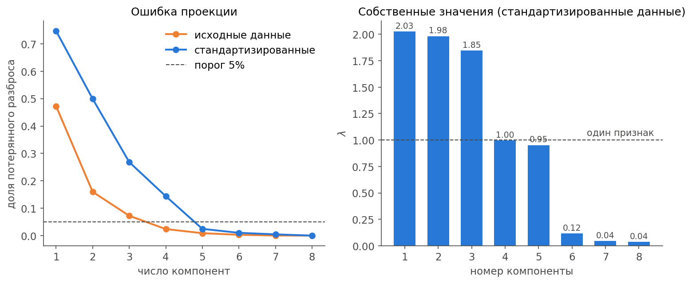

| $k$ | $\lambda$ | Ошибка, исходные | $\lambda$ (станд.) | Ошибка, станд. |
| --- | --------- | ---------------- | ------------------ | -------------- |
| 1   | 49.94     | 47.21%           | 2.03               | 74.67%         |
| 2   | 29.55     | 15.96%           | 1.98               | 49.89%         |
| 3   | 8.26      | 7.23%            | 1.85               | 26.83%         |
| 4   | 4.59      | 2.39%            | 1.00               | 14.37%         |
| 5   | 1.42      | 0.89%            | 0.95               | 2.46%          |
| 6   | 0.55      | 0.30%            | 0.12               | 1.02%          |
| 7   | 0.25      | 0.04%            | 0.04               | 0.45%          |
| 8   | 0.04      | 0%               | 0.04               | 0%             |

На первый взгляд стандартизация только мешает: ошибка на 2D выросла с 16% до 50%. Но эти числа нельзя сравнивать напрямую. Мы делим на разную общую дисперсию, то есть меряем разной линейкой.

Зато теперь $\lambda$ можно читать: дисперсия одного признака равна 1, поэтому $\lambda$ показывает, сколько исходных признаков стоит компонента.

- Три значения около 2: это три группы почти одинаковых признаков.
- Два значения около 1: это $X_8$ и разность $X_1-X_2$.
- Три значения около нуля: шум и почти повторы.

На правом графике резкий обрыв после пятой компоненты. Это те самые пять независимых источников.

##### Ловушка вторая: маленькая общая ошибка не значит, что сохранилось всё

Общая ошибка — среднее по всем признакам, а отдельный признак может пропасть целиком. Посчитаем, какая доля разброса сохранилась у каждого столбца:

| Признак | Исходные, $k=2$ | Исходные, $k=4$ | Станд., $k=2$ | Станд., $k=5$ |
| ------- | --------------- | --------------- | ------------- | ------------- |
| $X_1$   | 0.454           | 0.939           | 0.190         | 0.972         |
| $X_2$   | 0.458           | 0.938           | 0.305         | 0.971         |
| $X_3$   | 0.983           | 0.983           | 0.462         | 0.941         |
| $X_4$   | 0.952           | 0.952           | 0.853         | 0.982         |
| $X_5$   | 0.997           | 0.998           | 0.854         | 0.982         |
| $X_6$   | 0.002           | 0.999           | 0.658         | 0.978         |
| $X_7$   | 0.002           | 0.927           | 0.665         | 0.978         |
| $X_8$   | 0.005           | 0.007           | 0.022         | 1.000         |

Вот что скрывалось за красивыми 15.96%: $X_6$, $X_7$ и $X_8$ потеряны полностью. Даже при четырёх компонентах, когда общая ошибка всего 2.39%, от $X_8$ не осталось почти ничего. Он появляется только в седьмой компоненте.

<mark>Ответ на пункт 6: стандартизация плюс пять компонент. Общая ошибка 2.46%, и у каждого признака сохранилось не меньше 94% разброса.</mark>

Порог 5% мы выбрали сами, в задании он не указан. Способы выбрать $k$:

| Способ             | Как работает                                  | У нас        |
| ------------------ | --------------------------------------------- | ------------ |
| Порог ошибки       | Минимальное $k$ с ошибкой не выше порога      | 5            |
| Обрыв на графике   | Место, где $\lambda$ резко падает             | 5            |
| Правило $\lambda\ge1$ | Для стандартизированных данных: оставить компоненты не слабее одного признака | 3 (четвёртая 0.997 и пятая 0.95 чуть не дотянули) |

Правила не обязаны совпадать, поэтому смотрим на картину целиком. Здесь правило $\lambda\ge1$ промахнулось из-за случайности выборки: два значения около единицы оказались чуть ниже неё, а обрыв на графике стоит после пятого.

Стандартизация нужна не всегда. Если признаки в одних единицах и разница в разбросе важна, её не делают. Так будет с картинками в части 10: у всех пикселей одна шкала яркости.

И ещё: ответ на пункт 6 имеет вторую сторону. Какое бы $k$ мы ни выбрали, сама проекция на первые $k$ компонент уже оптимальна среди всех линейных проекций на $k$ осей. Это и есть смысл SVD из части 5.

##### Ловушка третья: компоненты нельзя читать слишком буквально

Сравни нагрузки стандартизированных компонент:

| Признак | PC1   | PC2   | PC3   | PC4   | PC5   |
| ------- | ----- | ----- | ----- | ----- | ----- |
| $X_1$   | -0.17 | 0.26  | 0.41  | 0.28  | -0.65 |
| $X_2$   | -0.14 | 0.36  | 0.32  | -0.32 | 0.63  |
| $X_3$   | -0.21 | 0.43  | 0.51  | -0.01 | 0.00  |
| $X_4$   | 0.41  | 0.51  | -0.26 | 0.08  | -0.03 |
| $X_5$   | 0.41  | 0.51  | -0.26 | 0.08  | -0.03 |
| $X_6$   | 0.53  | -0.22 | 0.41  | 0.02  | 0.05  |
| $X_7$   | 0.53  | -0.22 | 0.41  | 0.02  | 0.04  |
| $X_8$   | -0.10 | -0.03 | 0.03  | 0.90  | 0.43  |

Каждая из первых трёх компонент смешивает все группы. Почему не по одной группе на компоненту? Потому что $\lambda$ равны 2.03, 1.98, 1.85, почти одинаковые. Если собственные значения совпадают, любой поворот внутри этих направлений тоже подходит. Случайность выборки выбирает какой-то один.

Другая выборка даст другие PC1, PC2, PC3, но вместе они будут описывать то же самое трёхмерное подпространство. Поэтому говорить «PC1 означает то-то» здесь нельзя. То же с PC4 и PC5.

Ещё два следствия:

- **Знак компоненты случаен.** Вектор $v$ и вектор $-v$ задают одну прямую. Если на занятии у какой-то компоненты все знаки выйдут наоборот, это нормально: он зависит от случайного старта.
- **Близкие $\lambda$ замедляют степенной метод.** Здесь $\lambda_2/\lambda_1=0.98$, и на первую компоненту уходит больше тысячи шагов. Поэтому в `top_vector` стоит строгая остановка.

---

## Часть 10. Эксперименты

Эти ячейки идут в конце ноутбука. Они отвечают на вопросы 2, 5, 6, 7 и 8.

### Нелинейные данные

Точки лежат на кольце радиуса 5. По сути это одна величина, угол, но прямая её не опишет.

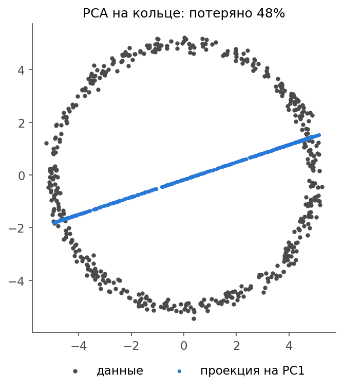

Собственные значения 13.02 и 12.01 почти равны: у круга нет выделенного направления. Одна компонента теряет 47.99%.

PCA умеет только поворачивать оси, а изогнуть их не может. Лечится так же, как в lab3: трансформацией. Перейдём к полярным координатам: радиус и угол. Теперь одна компонента теряет всего 0.73%.

Если подходящая замена неизвестна, берут нелинейные методы:

| Метод         | Идея                                       |
| ------------- | ------------------------------------------ |
| Kernel PCA    | PCA в неявно расширенном пространстве признаков |
| t-SNE, UMAP   | Сохраняют соседей, в основном для картинок |
| Isomap        | Сохраняет расстояния вдоль поверхности     |
| Автоэнкодер   | Нейросеть сжимает и восстанавливает        |

### Выбросы

Добавим 5 точек с $X_6=100$, это 0.5% выборки.

| Что                   | Без выбросов | С выбросами |
| --------------------- | ------------ | ----------- |
| $\lambda_1$           | 49.94        | 51.83       |
| $\lambda_2$           | 29.55        | 50.24       |
| Вес $X_6$ в PC1       | 0.006        | 0.997       |
| Ошибка на 2D          | 15.96%       | 28.36%      |

Косинус угла между старой и новой первой компонентой равен 0.08, они почти перпендикулярны. Пять точек из 1005 полностью развернули ось.

Причина та же, что в lab3: всё считается через квадраты, и далёкая точка тянет на себя. Перед PCA выбросы надо найти и разобраться с ними.

### Что теряется при малом числе компонент

Возьмём 600 картинок рукописных цифр размером $8\times8$, это 64 признака. Сожмём и восстановим.

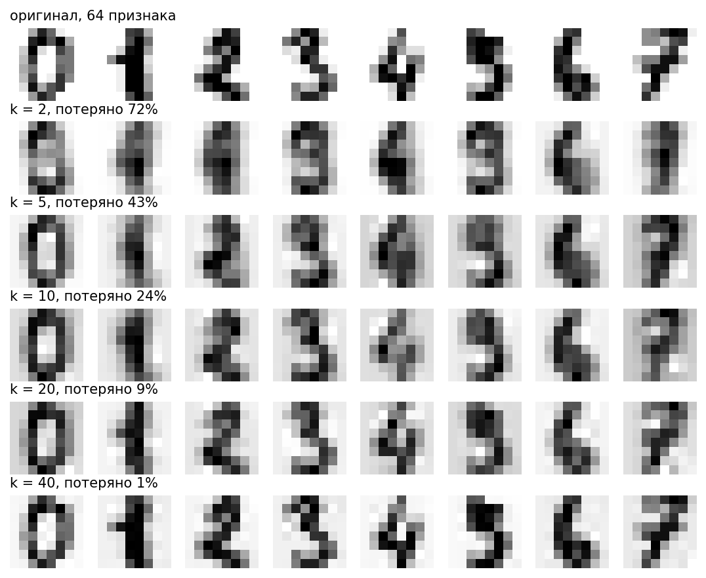

| $k$ | Потеряно разброса |
| --- | ----------------- |
| 2   | 72%               |
| 5   | 43%               |
| 10  | 24%               |
| 20  | 9%                |
| 40  | 1%                |

При двух компонентах остаётся размытое пятно: цифры похожи друг на друга и почти неотличимы. При 20 всё читается. Сначала уходят мелкие детали, которые отличают одну цифру от другой, общая форма держится дольше.

Здесь мы не стандартизировали: все пиксели измеряются в одной шкале яркости.

### PCA перед обучением модели

Сгенерируем цель $y=3X_1-2X_2+X_4+0.5X_6+8X_8+\text{шум}$. Разделим данные на обучение (800 точек) и тест (200 точек). Обучим линейную регрессию на $k$ компонентах и проверим на тесте.

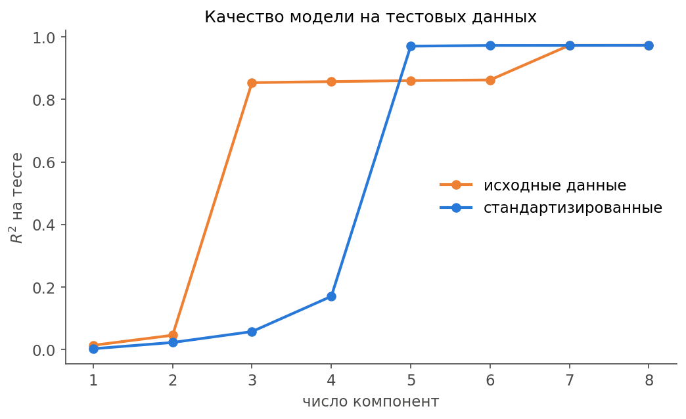

| $k$ | $R^2$, исходные | $R^2$, станд. |
| --- | --------------- | ------------- |
| 1   | 0.014           | 0.003         |
| 2   | 0.046           | 0.023         |
| 3   | 0.854           | 0.057         |
| 4   | 0.857           | 0.170         |
| 5   | 0.860           | 0.970         |
| 6   | 0.862           | 0.973         |
| 7   | 0.973           | 0.973         |
| 8   | 0.973           | 0.973         |

Что здесь видно:

- Две первые компоненты почти бесполезны для модели. <mark>PCA не знает про $y$: большой разброс не значит пользу для предсказания.</mark>
- На исходных данных ступенька на $k=7$: только там появляется $X_8$. У него дисперсия маленькая, а влияние на $y$ большое.
- На стандартизированных данных пяти компонент хватает, $R^2=0.970$ против 0.973 у всех восьми.
- PCA не улучшил модель: максимум и так 0.973. Он дал то же качество на меньшем числе признаков.

Важная деталь: среднее, отклонение и $V$ считаются только на обучающей части. Тест пропускаем через готовое преобразование. Если считать их на всех данных, тест заранее подсмотрит информацию.

---

## Часть 11. Что исправить в ноутбуке

Отчёта по этой работе нет, поэтому смотрим только на `lab4.ipynb`. Числа в нём верные: 49.94, 29.55 и 15.96% совпали с проверкой. Распределения заданы правильно, включая корни из дисперсий и `1/0.5`. Но сдавать его в таком виде нельзя: есть нарушения условия и один настоящий баг.

### Ошибки по существу

| Где | Сейчас | Должно быть |
| --- | ------ | ----------- |
| `manual_svd_pca` | Называется SVD, но $U$ и $\Sigma$ нет. Ищутся собственные векторы ковариационной матрицы | Построить $U$, $\Sigma$, $V$, см. функцию `svd` |
| `manual_svd_pca` | `np.linalg.norm`, комментарий утверждает, что это разрешено | Запрещено условием. Заменить на `(v @ v) ** 0.5` |
| `calculate_projection_error` | `np.trace` | Тоже запрещено. Заменить на сумму квадратов `np.sum(A ** 2)` |
| `calculate_projection_error` | Аргумент `n_componets` не используется, берётся глобальная `eigenvalues` | Считать через восстановление данных, см. `projection_error` |
| Степенной метод | Остановка при `abs(dot) > 0.999999` слишком мягкая | Останавливаться по `norm(w - v) < 1e-12` |
| Степенной метод | `break` стоит до `vec = vec_new`, возвращается предыдущий вектор | Возвращать новый вектор |
| Пункт 6 | Только график и список ошибок, вывода нет | Выбрать $k$ и объяснить выбор |
| Пункт 6 | Нет стандартизации, $X_6,X_7,X_8$ теряются незаметно | Сравнить исходные и стандартизированные данные |

Баг с глобальной переменной легко показать: функция возвращает 0.1596 и при $k=2$, и при $k=5$, и при $k=8$. Сейчас это незаметно только потому, что её вызвали один раз, сразу после расчёта двух компонент.

Мягкая остановка на исходных данных почти не вредит: собственные значения отличаются от точных на $3\cdot10^{-4}$. Но векторы уже неточно перпендикулярны: скалярные произведения доходят до 0.01, а должны быть нулём. На стандартизированных данных с близкими $\lambda$ станет хуже.

### Оформление

- Опечатки в именах: `n_componets`, `explandet_var`, `all_projaction`.
- Опечатка в тексте вывода: «Ошибка проекция».
- `:.2F` работает, но принято писать `:.2f`.
- В конце ноутбука осталась пустая ячейка.

---

## Часть 12. Итоги

### Главное

- **PCA** поворачивает оси так, чтобы разброс собрался в первых компонентах, а потом отбрасывает лишние.
- **Главные компоненты** — собственные векторы ковариационной матрицы, **собственные значения** равны дисперсиям вдоль них.
- **Дисперсия и ошибка**: максимум дисперсии проекций и минимум ошибки проекции — одна задача.
- **Ошибка проекции** равна доле выброшенных собственных значений.
- **SVD** раскладывает $A=U\Sigma V^T$: столбцы $V$ — компоненты, $\lambda=\sigma^2/(N-1)$, проекции $P=U\Sigma$.
- **Степенной метод** находит главный вектор многократным умножением, **дефляция** снимает найденный слой.
- **Масштаб признаков** решает всё: без стандартизации PCA выбирает самые крупные столбцы.
- **Маленькая общая ошибка** не гарантирует, что каждый признак сохранился.
- **Близкие собственные значения** делают отдельные компоненты неустойчивыми, а знак компоненты случаен.
- **PCA линейный**, боится выбросов и ничего не знает про целевую переменную.

### Проверка понимания

Дай решить самостоятельно. Точки $(4,2)$, $(2,4)$, $(0,-2)$, $(-2,0)$.

**Спроси:** центрируй данные.

**Ответ:** средние равны 1 и 1. Получаем $(3,1)$, $(1,3)$, $(-1,-3)$, $(-3,-1)$.

**Спроси:** найди $A^TA$, ковариационную матрицу и корреляцию.

**Ответ:** $A^TA=\begin{pmatrix}20&12\\12&20\end{pmatrix}$, делим на 3: $C=\begin{pmatrix}6.67&4\\4&6.67\end{pmatrix}$. Корреляция $r=12/20=0.6$.

**Спроси:** найди собственные значения и векторы $A^TA$.

**Ответ:** $(20-\lambda)^2=144$, значит, $\lambda=32$ и $\lambda=8$. Векторы $(1,1)/\sqrt{2}$ и $(1,-1)/\sqrt{2}$.

**Спроси:** чему равны сингулярные числа и собственные значения $C$?

**Ответ:** $\sigma_1=\sqrt{32}\approx5.66$, $\sigma_2=\sqrt{8}\approx2.83$. Для $C$ получаем $32/3\approx10.67$ и $8/3\approx2.67$.

**Спроси:** какая ошибка при одной компоненте?

**Ответ:** $8/(32+8)=20\%$.

**Спроси:** сделай два шага степенного метода для $\begin{pmatrix}3&1\\1&3\end{pmatrix}$ со старта $(1,0)$, без нормировки.

**Ответ:** $(3,1)$, потом $(10,6)$. Направление приближается к $(1,1)$.

**Спроси:** один признак измеряли в метрах, потом перевели в миллиметры. Что случится с PCA без стандартизации?

**Ответ:** дисперсия признака вырастет в миллион раз, и первая компонента почти совпадёт с ним. Ошибка на малом $k$ станет меньше, хотя данные лучше не сжались.

### Ответы на вопросы преподавателя

Проговори их вслух.

**1. Что такое метод главных компонент и для какой цели он применяется.** Это метод снижения размерности. Он находит новые перпендикулярные оси, упорядоченные по убыванию дисперсии, и оставляет первые $k$. Применяется для сжатия данных, визуализации, удаления дублирующих признаков и шума, подготовки признаков для моделей. У нас 8 признаков сводятся к 5 с ошибкой 2.46%.

**2. Основные ограничения PCA и случаи, когда он работает плохо.** Метод линейный: на кольце одна компонента теряет 48%, хотя данные по сути одномерные. Чувствителен к масштабу: без стандартизации главными становятся крупные признаки. Чувствителен к выбросам: 5 точек из 1005 развернули первую компоненту почти на 90°. Большая дисперсия не всегда значит важность: метод не знает про целевую переменную. Компоненты трудно интерпретировать, а при близких собственных значениях они неустойчивы.

**3. Как интерпретировать объяснённую дисперсию.** Это доля общего разброса, которая приходится на компоненту: $\lambda_i/\sum\lambda_j$. Накопленная сумма показывает, сколько разброса сохранится при $k$ компонентах. На стандартизированных данных у нас доли равны 25.3%, 24.8%, 23.1%, 12.5%, 11.9%, вместе 97.5%. На остальные три приходится 2.5%, это шум и почти повторы. По резкому падению долей выбирают $k$.

**4. Как SVD связано с PCA.** PCA — это SVD центрированной матрицы данных $A=U\Sigma V^T$. Столбцы $V$ — главные компоненты, потому что $A^TA=V\Sigma^2V^T$. Собственные значения ковариационной матрицы равны $\sigma^2/(N-1)$. Проекции равны $AV=U\Sigma$. Если оставить первые $k$ слоёв, получится наилучшее приближение матрицы.

**5. Почему PCA линейный, примеры нелинейных альтернатив.** Новые координаты — линейные комбинации старых: $P=AV$. Метод только поворачивает оси и не может их изогнуть, поэтому кривую структуру он не разворачивает. Альтернативы: Kernel PCA, t-SNE, UMAP, Isomap, автоэнкодеры.

**6. Что произойдёт с информацией, если оставить слишком мало компонент.** Вместе с шумом потеряется полезная информация, и восстановить её будет нельзя. Сначала уходят направления с малой дисперсией, а в них могут быть важные признаки. У нас при двух компонентах на исходных данных $X_6,X_7,X_8$ потеряны полностью. Картинки цифр при двух компонентах становятся неотличимы. Модель, обученная на двух компонентах, дала $R^2$ меньше 0.05 вместо 0.97.

**7. Как минимизировать ошибку проекции, не меняя алгоритм.** Самое прямое — взять больше компонент. Остальное меняет сами данные: убрать выбросы (ошибка на 2D с ними была 28.36%, без них 15.96%), преобразовать признаки так, чтобы связи стали линейными (на кольце полярные координаты снизили ошибку с 47.99% до 0.73%), убрать шумовые признаки. Масштаб нужно выбирать осознанно: стандартизация честно уравнивает признаки, хотя процент ошибки при этом может вырасти. Сравнивать проценты при разном масштабе нельзя.

**8. Как использовать PCA перед обучением модели.** Разделить данные на обучение и тест. На обучающей части посчитать среднее, отклонение и компоненты. Выбрать $k$ по доле разброса или по качеству на валидации. Обе части преобразовать одними и теми же параметрами, а модель учить на компонентах. Это ускоряет обучение и убирает мультиколлинеарность. Но PCA не смотрит на целевую переменную, поэтому качество надо проверять: у нас на пяти стандартизированных компонентах $R^2=0.970$, а на всех восьми 0.973.
