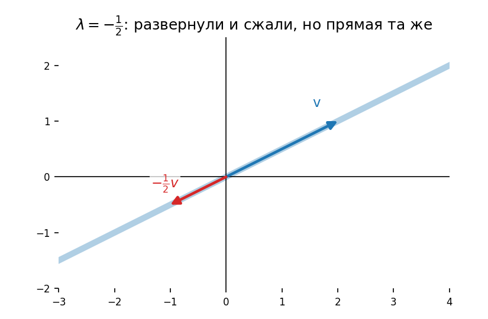
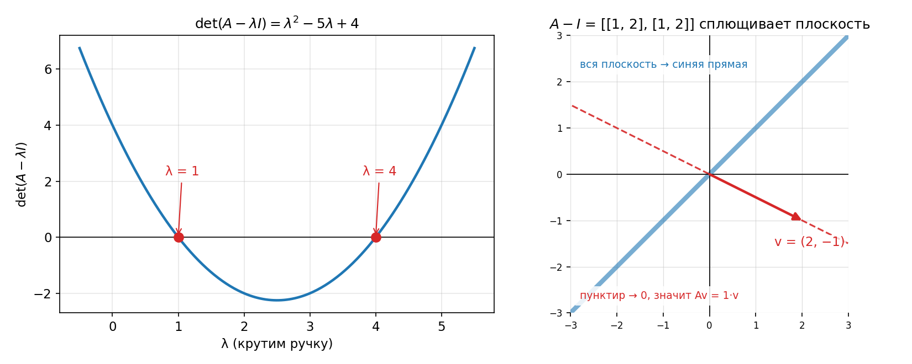
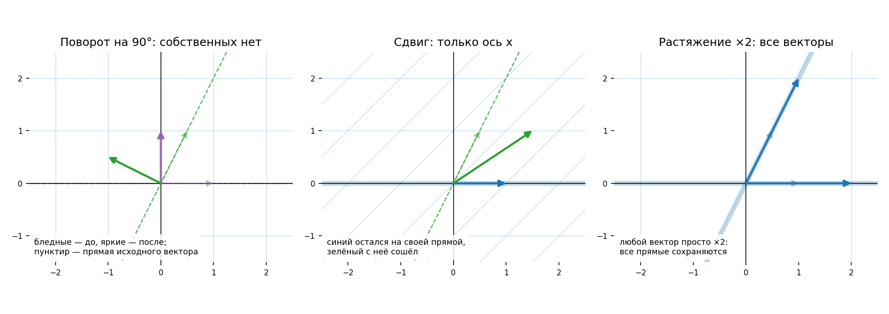
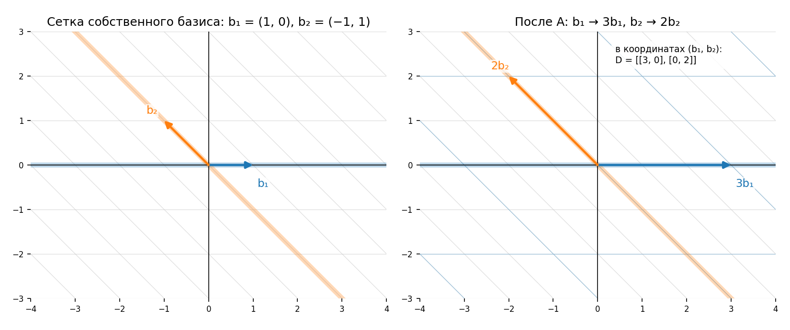
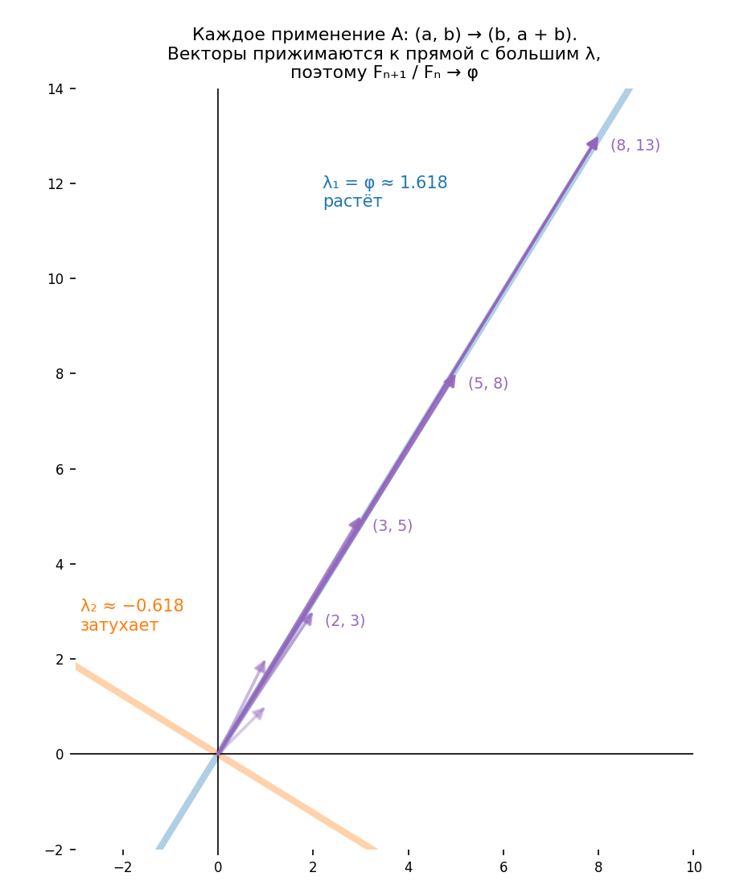

# Урок 14. Собственные векторы и собственные значения

## Пример: кто остаётся на своей прямой

Возьмём преобразование, где $\hat{\imath} \to (3, 0)$, $\hat{\jmath} \to (1, 2)$:

$$
A = \begin{bmatrix} 3 & 1 \\ 0 & 2 \end{bmatrix}
$$

- У каждого вектора есть **своя прямая** — линейная оболочка, то есть прямая через начало координат и его конец.
- Большинство векторов при преобразовании **сходят** со своей прямой.
- Но некоторые остаются на ней: их только растягивает или сжимает, как при умножении на скаляр.

| Вектор (и вся его прямая) | Что с ним происходит | Во сколько раз |
| ------------------------- | -------------------- | -------------- |
| $\hat{\imath}$, вся ось x | Растягивается        | 3              |
| $(1, -1)$, диагональ      | Растягивается        | 2              |

Почему вся прямая: из линейности, если $A\hat{\imath} = 3\hat{\imath}$, то и $A(c\,\hat{\imath}) = 3\,(c\,\hat{\imath})$. Других таких прямых у этой матрицы нет, все остальные векторы поворачиваются.

## Определения

- **Собственный вектор** — ненулевой вектор, который после преобразования остаётся на своей прямой.
- **Собственное значение** — во сколько раз этот вектор растянули или сжали.
- Знак может быть любым: значение $-\tfrac{1}{2}$ значит, что вектор развернули и сжали вдвое, но он остался на своей прямой.

## Пример в 3D: ось вращения

- У поворота в 3D собственный вектор — это **ось вращения**: только она остаётся на месте.
- Собственное значение оси равно **1**: поворот ничего не растягивает.

- Поворот проще описать «ось + угол», чем матрицей 3×3. Так и в целом: столбцы матрицы говорят, куда попадает базис, а собственные векторы и значения показывают суть преобразования, не завися от системы координат.

## Как найти: вычисление

Символьная запись определения:

$$
A\vec{v} = \lambda\vec{v}
$$

Слева матрица умножается на вектор, справа число на вектор. Чтобы привести к одному виду, заменим $\lambda$ на матрицу $\lambda I$ ($\lambda$ на диагонали, остальное нули):

$$
A\vec{v} = (\lambda I)\vec{v}
\;\Rightarrow\;
A\vec{v} - \lambda I\vec{v} = \vec{0}
\;\Rightarrow\;
(A - \lambda I)\vec{v} = \vec{0}
$$

- $\vec{v} = \vec{0}$ подходит всегда, но это неинтересно. Нужен **ненулевой** $\vec{v}$.
- Ненулевой вектор переходит в ноль, только если преобразование сплющивает пространство в меньшую размерность, то есть его определитель равен нулю:

$$
\det(A - \lambda I) = 0
$$

### Идея с «ручкой» λ

Возьмём $A = \begin{bmatrix} 2 & 2 \\ 1 & 3 \end{bmatrix}$ и вычтем $\lambda$ из диагонали:

$$
A - \lambda I = \begin{bmatrix} 2 - \lambda & 2 \\ 1 & 3 - \lambda \end{bmatrix}
$$

- Крутим $\lambda$ как ручку, определитель меняется.
- При $\lambda = 1$ определитель равен 0: матрица $A - I$ сплющивает плоскость в прямую.
- Значит, есть ненулевой $\vec{v}$ с $(A - I)\vec{v} = \vec{0}$, то есть $A\vec{v} = 1 \cdot \vec{v}$: собственное значение 1, вектор остаётся на месте.

Слева видно второй корень, $\lambda = 4$: $\lambda^2 - 5\lambda + 4 = (\lambda - 1)(\lambda - 4)$. Справа проверка: $A \begin{bmatrix} 2 \\ -1 \end{bmatrix} = \begin{bmatrix} 2 \\ -1 \end{bmatrix}$.

### Характеристический многочлен

$\det(A - \lambda I)$ как функция от $\lambda$ — **характеристический многочлен**. Его корни — собственные значения.

Вернёмся к первому примеру:

$$
\det \begin{bmatrix} 3 - \lambda & 1 \\ 0 & 2 - \lambda \end{bmatrix} = (3 - \lambda)(2 - \lambda) = 0
\quad\Rightarrow\quad
\lambda = 2, \ \lambda = 3
$$

Собственные векторы для $\lambda = 2$: подставляем и решаем систему

$$
\begin{bmatrix} 1 & 1 \\ 0 & 0 \end{bmatrix}
\begin{bmatrix} x \\ y \end{bmatrix}
=
\begin{bmatrix} 0 \\ 0 \end{bmatrix}
\quad\Rightarrow\quad
x + y = 0
$$

Решения — вся прямая, натянутая на $(-1, 1)$. Это та самая диагональ, которая растягивается в 2 раза.

## Особые случаи

| Преобразование | Матрица                                         | Характеристический многочлен | Собственные значения      | Собственные векторы                       |
| -------------- | ----------------------------------------------- | ---------------------------- | ------------------------- | ----------------------------------------- |
| Поворот на 90° | $\begin{bmatrix} 0 & -1 \\ 1 & 0 \end{bmatrix}$ | $\lambda^2 + 1$              | $\pm i$, вещественных нет | Нет: каждый вектор сходит со своей прямой |
| Сдвиг (shear)  | $\begin{bmatrix} 1 & 1 \\ 0 & 1 \end{bmatrix}$  | $(1 - \lambda)^2$            | только 1 (кратный корень) | Только ось x                              |
| Растяжение ×2  | $\begin{bmatrix} 2 & 0 \\ 0 & 2 \end{bmatrix}$  | $(2 - \lambda)^2$            | только 2                  | **Все** ненулевые векторы                 |

- Вывод из поворота: у 2D-преобразования может вообще не быть собственных векторов.
- Сдвиг и растяжение: у обоих одно собственное значение, но у сдвига собственные векторы — одна прямая, а у растяжения — вся плоскость.

### Проверь себя

| Матрица                                          | Собственные значения                                   |
| ------------------------------------------------ | ------------------------------------------------------ |
| $\begin{bmatrix} 3 & 2 \\ 2 & 3 \end{bmatrix}$   | $(3 - \lambda)^2 - 4 = 0 \Rightarrow 1$ и $5$          |
| $\begin{bmatrix} 2 & 1 \\ -1 & 2 \end{bmatrix}$  | $(2 - \lambda)^2 + 1 = 0 \Rightarrow$ вещественных нет |
| $\begin{bmatrix} -2 & 1 \\ 0 & -2 \end{bmatrix}$ | $(-2 - \lambda)^2 = 0 \Rightarrow -2$                  |

## Собственный базис

### Диагональные матрицы

- Если оба базисных вектора — собственные, матрица **диагональная**. Например, $\hat{\imath}$ умножается на $-1$, $\hat{\jmath}$ на 2:

$$
\begin{bmatrix} -1 & 0 \\ 0 & 2 \end{bmatrix}
$$

- У диагональной матрицы любого размера все базисные векторы собственные, а числа на диагонали — их собственные значения.
- Степени считаются легко: каждый базисный вектор просто умножается на своё значение $n$ раз:

$$
\begin{bmatrix} 3 & 0 \\ 0 & 2 \end{bmatrix}^{100}
=
\begin{bmatrix} 3^{100} & 0 \\ 0 & 2^{100} \end{bmatrix}
$$

Для недиагональной матрицы сотая степень — долгое перемножение.

### Переход в собственный базис

- **Собственный базис** — базис из собственных векторов. Он есть не всегда: у сдвига собственных векторов на базис не хватает.
- Если он есть, записываем собственные векторы **столбцами** матрицы смены базиса $S$. Тогда

$$
D = S^{-1} A S
$$

— то же преобразование, но в собственном базисе. $D$ диагональная, на диагонали — собственные значения.

- Отсюда $A = S D S^{-1}$, и степень считается через диагональную:

$$
A^n = S D^n S^{-1}
$$

То есть: перешли в собственный базис → возвели диагональ в степень → вернулись обратно.

Пример на матрице из начала урока, $A = \begin{bmatrix} 3 & 1 \\ 0 & 2 \end{bmatrix}$. Собственный базис: $\vec{b}_1 = (1, 0)$, $\vec{b}_2 = (-1, 1)$, то есть $S = \begin{bmatrix} 1 & -1 \\ 0 & 1 \end{bmatrix}$ и $D = S^{-1} A S = \begin{bmatrix} 3 & 0 \\ 0 & 2 \end{bmatrix}$. В сетке этого базиса $A$ просто растягивает одну ось в 3 раза, другую в 2:

## Задача: числа Фибоначчи

$$
A = \begin{bmatrix} 0 & 1 \\ 1 & 1 \end{bmatrix}
$$

### Степени

$$
A^2 = \begin{bmatrix} 1 & 1 \\ 1 & 2 \end{bmatrix},\quad
A^3 = \begin{bmatrix} 1 & 2 \\ 2 & 3 \end{bmatrix},\quad
A^4 = \begin{bmatrix} 2 & 3 \\ 3 & 5 \end{bmatrix},\quad
A^5 = \begin{bmatrix} 3 & 5 \\ 5 & 8 \end{bmatrix},\quad
A^6 = \begin{bmatrix} 5 & 8 \\ 8 & 13 \end{bmatrix}
$$

В элементах — числа Фибоначчи. Причина: $A$ переводит $(a, b)$ в $(b, a + b)$, то есть каждое следующее число — сумма двух предыдущих. В общем виде $A^n = \begin{bmatrix} F_{n-1} & F_n \\ F_n & F_{n+1} \end{bmatrix}$.

### Собственные значения и векторы

$$
\det \begin{bmatrix} -\lambda & 1 \\ 1 & 1 - \lambda \end{bmatrix}
= \lambda^2 - \lambda - 1 = 0
$$

|     | Собственное значение                                                            | Собственный вектор                                                       |
| --- | ------------------------------------------------------------------------------- | ------------------------------------------------------------------------ |
| 1   | $\lambda_1 = \dfrac{1 + \sqrt{5}}{2} = \varphi \approx 1.618$ (золотое сечение) | $\vec{v}_1 = \begin{bmatrix} \frac{-1 + \sqrt{5}}{2} \\ 1 \end{bmatrix}$ |
| 2   | $\lambda_2 = \dfrac{1 - \sqrt{5}}{2} = -\dfrac{1}{\varphi} \approx -0.618$      | $\vec{v}_2 = \begin{bmatrix} \frac{-1 - \sqrt{5}}{2} \\ 1 \end{bmatrix}$ |

### Смена базиса

$$
S = \begin{bmatrix} \frac{-1 + \sqrt{5}}{2} & \frac{-1 - \sqrt{5}}{2} \\ 1 & 1 \end{bmatrix},
\qquad
\det S = \sqrt{5},
\qquad
S^{-1} = \frac{1}{\sqrt{5}} \begin{bmatrix} 1 & \frac{1 + \sqrt{5}}{2} \\ -1 & \frac{-1 + \sqrt{5}}{2} \end{bmatrix}
$$

$$
D = S^{-1} A S = \begin{bmatrix} \lambda_1 & 0 \\ 0 & \lambda_2 \end{bmatrix},
\qquad
D^n = \begin{bmatrix} \lambda_1^n & 0 \\ 0 & \lambda_2^n \end{bmatrix}
$$

$D$ можно было не считать: в собственном базисе на диагонали стоят собственные значения.

### Ответ

Считаем $A^n = S D^n S^{-1}$ и упрощаем с помощью $\lambda_1 \lambda_2 = -1$:

$$
A^n = \frac{1}{\sqrt{5}}
\begin{bmatrix}
\lambda_1^{n-1} - \lambda_2^{n-1} & \lambda_1^n - \lambda_2^n \\
\lambda_1^n - \lambda_2^n & \lambda_1^{n+1} - \lambda_2^{n+1}
\end{bmatrix}
$$

Сравниваем с $A^n$ из чисел Фибоначчи и получаем **формулу Бине**:

$$
F_n = \frac{\lambda_1^n - \lambda_2^n}{\sqrt{5}}
= \frac{1}{\sqrt{5}} \left[ \left( \frac{1 + \sqrt{5}}{2} \right)^n - \left( \frac{1 - \sqrt{5}}{2} \right)^n \right]
$$

Неочевидно, что из корней пятёрки получаются целые числа, но это так.

Картинка объясняет формулу: при каждом применении $A$ часть вектора вдоль $\vec{v}_1$ растёт в $\varphi$ раз, а часть вдоль $\vec{v}_2$ затухает, ведь $|\lambda_2| < 1$. Поэтому векторы $(F_n, F_{n+1})$ прижимаются к прямой $\vec{v}_1$, и $F_{n+1} / F_n \to \varphi$.

## Главное

- Собственный вектор остаётся на своей прямой, собственное значение — во сколько раз его растянули.
- Ищем через $\det(A - \lambda I) = 0$: корни — собственные значения, потом решаем $(A - \lambda I)\vec{v} = \vec{0}$ для каждого.
- Собственных векторов может не быть (поворот), может быть одна прямая (сдвиг), может быть вся плоскость (растяжение).
- В собственном базисе матрица диагональная, и её степени считаются за один шаг: $A^n = S D^n S^{-1}$.
