# Лабораторная работа №4: метод главных компонент (PCA)

## Часть 1. Зачем это нужно

### Задача снижения размерности

Представь таблицу про людей: рост в сантиметрах, рост в дюймах, вес, размер обуви. Столбцов четыре, но рост записан дважды, а размер обуви почти повторяет рост. Настоящей информации здесь меньше, чем столбцов.

В таблицах часто так: признаков много, а независимых величин мало. Хочется заменить много столбцов несколькими новыми и потерять как можно меньше.

Это **снижение размерности**. Зачем оно нужно:

- Сжать данные, чтобы их было легче хранить и считать.
- Нарисовать данные: восемь измерений на экран не выведешь, а два выведешь.
- Убрать дубли и часть шума.
- Подготовить признаки для модели.

**PCA** (principal component analysis, метод главных компонент) делает это так: поворачивает оси и оставляет те, вдоль которых данные разбросаны сильнее всего.

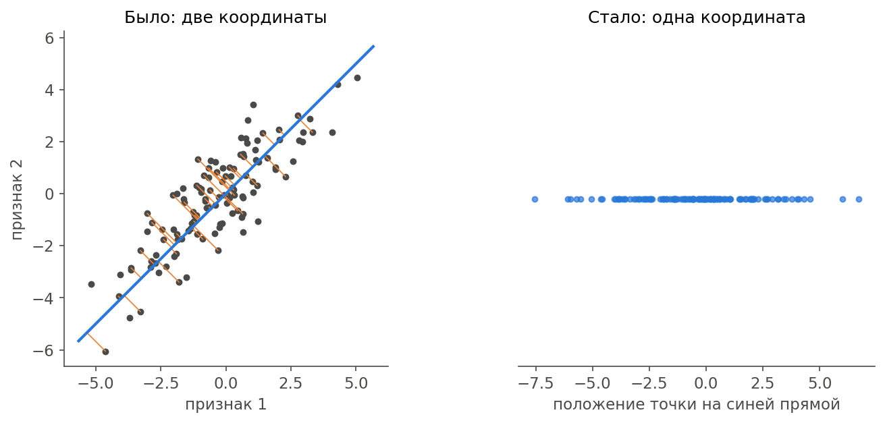

Слева облако точек в двух координатах. Оно вытянуто вдоль синей прямой. Если спроецировать каждую точку на прямую, у точки останется одно число: где она на этой прямой. Справа то же облако, записанное одной координатой. Оранжевые отрезки показывают, что мы выбросили.

---

## Часть 2. Векторы и матрицы

### Вектор

**Скалярное произведение** двух векторов: перемножаем соответствующие числа и складываем.

$$
\boxed{a\cdot b=a_1b_1+a_2b_2+\dots+a_nb_n}
$$

| Что                              | Формула                          | Пример                            |
| -------------------------------- | -------------------------------- | --------------------------------- |
| Длина вектора                    | $\lVert a\rVert=\sqrt{a\cdot a}$ | $\lVert(3,4)\rVert=\sqrt{9+16}=5$ |
| Перпендикулярность               | $a\cdot b=0$                     | $(1,1)\cdot(1,-1)=1-1=0$          |
| Проекция на единичный вектор $v$ | $a\cdot v$                       | Координата точки $a$ вдоль $v$    |

**Единичный вектор** — вектор длины 1. Чтобы его получить, делим вектор на его длину. У $(1,1)$ длина $\sqrt{2}$, значит, единичный вектор того же направления равен $(1,1)/\sqrt{2}\approx(0.71,\ 0.71)$.

**Спроси:** чему равна проекция точки $(2,1)$ на направление $(1,1)/\sqrt{2}$?

**Ответ:** $(2\cdot1+1\cdot1)/\sqrt{2}=3/\sqrt{2}\approx2.12$.

### Матрица как преобразование

**Матрица** — это таблица чисел. Её можно считать просто таблицей, а можно считать машиной: на вход вектор, на выход другой вектор.

Умножение матрицы на вектор: каждая строка матрицы скалярно умножается на вектор.

$$
A=\begin{pmatrix}2&1\\1&2\end{pmatrix},\qquad
A\begin{pmatrix}1\\0\end{pmatrix}=\begin{pmatrix}2\cdot1+1\cdot0\\1\cdot1+2\cdot0\end{pmatrix}=\begin{pmatrix}2\\1\end{pmatrix}
$$

Вектор $(1,0)$ стал вектором $(2,1)$: он повернулся и вытянулся.

**Транспонирование** меняет строки и столбцы местами, обозначается $A^T$. Первая строка становится первым столбцом. Если $v$ и $w$ — столбцы, то $v^Tw$ — это то же скалярное произведение.

Сразу важное наблюдение. Пусть $A$ — наша таблица данных, строки в ней — точки. Тогда $Av$ скалярно умножает каждую точку на $v$.

<mark>Одно умножение $Av$ даёт проекции всех точек сразу. В коде это `A @ v`.</mark>

### Собственные векторы

Большинство векторов матрица поворачивает. Но есть особые направления, которые она только растягивает:

$$
\boxed{Av=\lambda v}
$$

Здесь $v$ — **собственный вектор**, а число $\lambda$ («лямбда») — **собственное значение**. Оно показывает, во сколько раз вектор растянулся.

Для нашей матрицы:

$$
A\begin{pmatrix}1\\1\end{pmatrix}=\begin{pmatrix}3\\3\end{pmatrix}=3\begin{pmatrix}1\\1\end{pmatrix}
$$

Вектор $(1,1)$ собственный, $\lambda=3$.

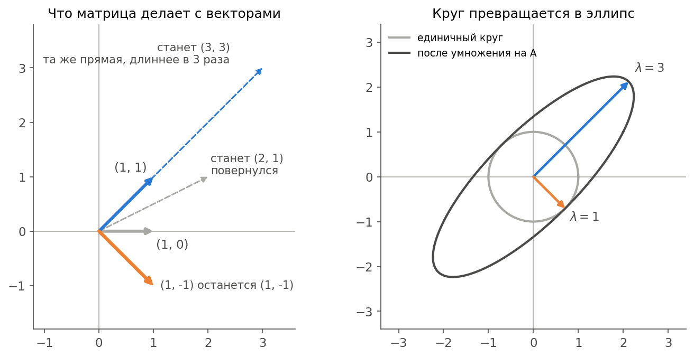

Слева видно разницу: серый вектор поменял направление, синий остался на своей прямой. Справа то же самое для всех векторов сразу: единичный круг превратился в эллипс. Собственные векторы идут вдоль осей эллипса, а собственные значения равны длинам его полуосей.

**Спроси:** проверь, что $(1,-1)$ тоже собственный вектор. Чему равно $\lambda$?

**Ответ:** $A(1,-1)=(2-1,\ 1-2)=(1,-1)$. Вектор не изменился, значит, $\lambda=1$.

##### Как найти руками

Перепишем $Av=\lambda v$ как $(A-\lambda I)v=0$. Здесь $I$ — **единичная матрица**: на диагонали единицы, остальное нули, она ничего не меняет. Ненулевое решение есть, только если определитель равен нулю:

$$
\det\begin{pmatrix}2-\lambda&1\\1&2-\lambda\end{pmatrix}=(2-\lambda)^2-1=0
$$

Отсюда $2-\lambda=\pm1$, то есть $\lambda=3$ и $\lambda=1$. Определитель матрицы $2\times2$ считается как $ad-bc$.

Для восьми признаков получится уравнение восьмой степени, поэтому на практике так не считают. Но для маленьких примеров это удобно.

У **симметричных** матриц, где $A=A^T$, есть два приятных свойства: собственные значения всегда вещественные, а собственные векторы перпендикулярны друг другу. Именно такая матрица нам и встретится.

### Новые оси

Обычные оси $x$ и $y$ — это векторы $(1,0)$ и $(0,1)$. Набор таких векторов называется **базисом**. Базис можно заменить. Возьмём два перпендикулярных единичных вектора:

$$
v_1=\frac{(1,1)}{\sqrt{2}},\qquad v_2=\frac{(1,-1)}{\sqrt{2}}
$$

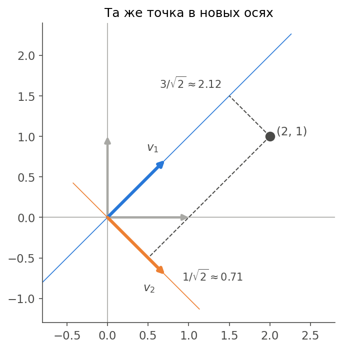

Новые координаты точки — это её проекции на новые оси. Для точки $(2,1)$ получаем $3/\sqrt{2}$ и $1/\sqrt{2}$.

Точка никуда не сдвинулась, поменялось только её описание. Длина тоже прежняя:

$$
2^2+1^2=5,\qquad \left(\frac{3}{\sqrt{2}}\right)^2+\left(\frac{1}{\sqrt{2}}\right)^2=4.5+0.5=5
$$

Если сложить векторы столбцами в матрицу $V$, то новые координаты всех точек считаются одним умножением:

$$
\boxed{P=AV}
$$

<mark>PCA — это поворот осей. Сам поворот ничего не теряет. Потери появляются позже, когда мы выбрасываем часть новых осей.</mark>

---

## Часть 3. Разброс и связь признаков

### Маленький пример

Весь разбор сделаем на четырёх точках:

| $x$ | 5   | 4   | 2   | 1   |
| --- | --- | --- | --- | --- |
| $y$ | 5   | 6   | 2   | 3   |

Первый шаг PCA — **центрирование**: вычитаем из каждого столбца его среднее. Здесь средние равны 3 и 4.

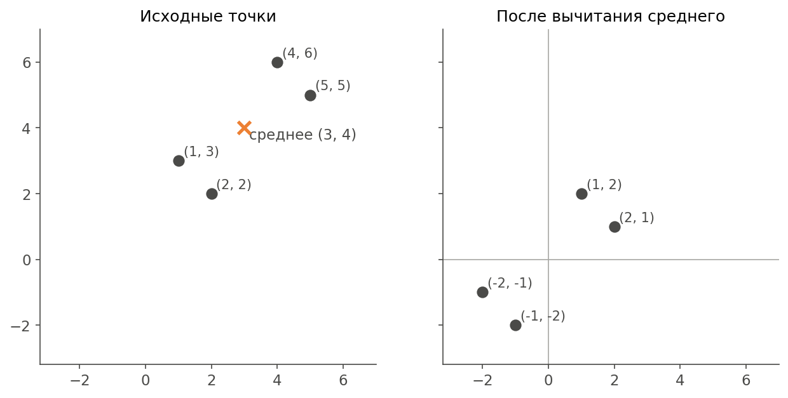

Центрировать нужно, потому что нас интересует разброс вокруг центра, а не положение центра. Без этого первая компонента просто указала бы на центр облака.

Получим таблицу, с которой дальше работаем:

$$
A=\begin{pmatrix}2&1\\1&2\\-1&-2\\-2&-1\end{pmatrix}
$$

### Дисперсия

**Дисперсия** показывает, насколько признак разбросан вокруг среднего:

$$
\boxed{s_x^2=\frac{1}{N-1}\sum_{i=1}^{N}(x_i-\bar{x})^2}
$$

Для нашего $x$: $(4+1+1+4)/3=10/3\approx3.33$. У $y$ столько же.

### Ковариация

**Ковариация** показывает, меняются ли два признака вместе:

$$
\boxed{\mathrm{cov}(x,y)=\frac{1}{N-1}\sum_{i=1}^{N}(x_i-\bar{x})(y_i-\bar{y})}
$$

Если $x$ выше среднего и $y$ выше среднего, произведение положительное. Если они расходятся, отрицательное.

Здесь $(2\cdot1+1\cdot2+1\cdot2+2\cdot1)/3=8/3\approx2.67$. Признаки растут вместе.

### Корреляция

Ковариация зависит от единиц измерения. Рост в сантиметрах даст число в 100 раз больше, чем рост в метрах. Чтобы от этого избавиться, делим на стандартные отклонения. Получаем **коэффициент корреляции** из lab1:

$$
\boxed{r_{xy}=\frac{\mathrm{cov}(x,y)}{s_xs_y}}
$$

Здесь $r=\frac{8/3}{10/3}=0.8$. Значения $r$ всегда лежат от $-1$ до $1$.

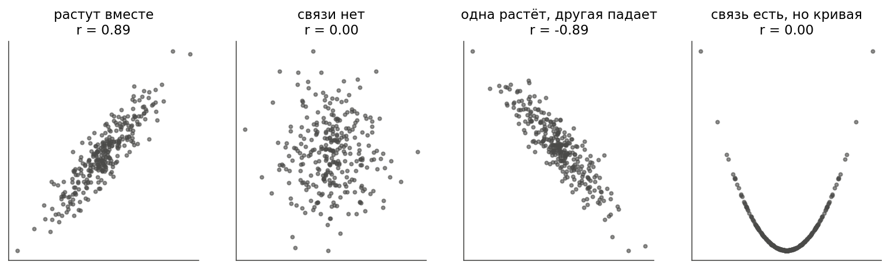

<mark>Корреляция ловит только линейную связь.</mark> На четвёртом графике $y=x^2$: зависимость идеальная, а $r=0$. Левая ветвь падает, правая растёт, и всё гасится.

Если каждый столбец **стандартизировать**, то есть вычесть среднее и поделить на стандартное отклонение, ковариация столбцов станет равна их корреляции:

$$
\boxed{z=\frac{x-\bar{x}}{s}}
$$

После этого у каждого столбца среднее 0 и дисперсия 1. Единицы измерения исчезают. Это нам ещё очень пригодится.

### Ковариационная матрица

Соберём все дисперсии и ковариации в одну таблицу. Благодаря центрированию она считается одним умножением:

$$
\boxed{C=\frac{1}{N-1}A^TA}
$$

Для примера:

$$
A^TA=\begin{pmatrix}10&8\\8&10\end{pmatrix},\qquad
C=\begin{pmatrix}3.33&2.67\\2.67&3.33\end{pmatrix}
$$

На диагонали дисперсии признаков, вне диагонали ковариации. Матрица симметричная, ведь $\mathrm{cov}(x,y)=\mathrm{cov}(y,x)$.

Сумма диагонали $3.33+3.33=6.67$ — это **общая дисперсия**: весь разброс, который есть в данных.

**Спроси:** что значит ноль вне диагонали?

**Ответ:** два признака линейно не связаны.

---

## Часть 4. Главные компоненты

### Какое направление лучшее

Хотим заменить две координаты одной. Выбираем прямую и проецируем на неё точки. Хорошая прямая та, на которой точки остаются разными. Если проекции слиплись, различия между точками потеряны.

Значит, надо искать направление с наибольшей дисперсией проекций.

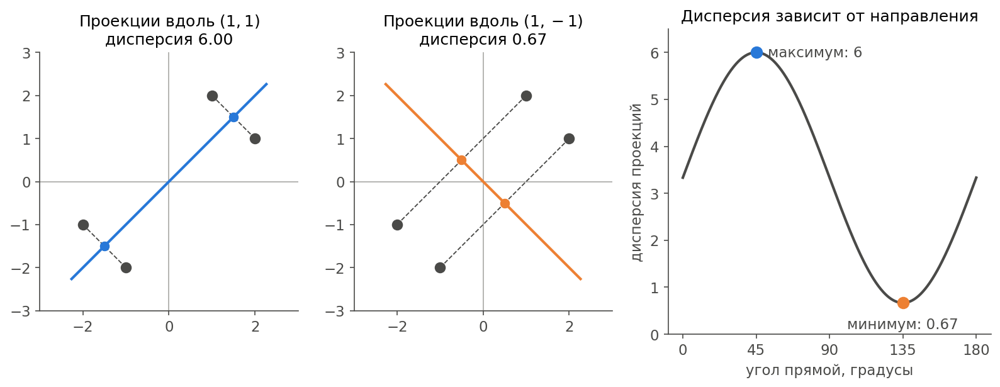

Вдоль $(1,1)$ проекции равны $2.12,\ 2.12,\ -2.12,\ -2.12$, дисперсия 6. Вдоль $(1,-1)$ проекции равны $0.71,\ -0.71,\ 0.71,\ -0.71$, дисперсия 0.67.

Правый график показывает дисперсию для всех направлений подряд. Максимум на 45°, минимум на 135°. Эти углы перпендикулярны.

Дисперсию вдоль единичного вектора $v$ можно записать через матрицу $C$. Проекции равны $Av$, а их среднее равно нулю, потому что данные центрированы:

$$
\boxed{s^2(v)=\frac{(Av)^T(Av)}{N-1}=\frac{v^TA^TAv}{N-1}=v^TCv}
$$

<mark>Направление максимальной дисперсии — это собственный вектор $C$ с наибольшим $\lambda$. Собственное значение равно дисперсии вдоль него.</mark>

Этот вектор называется **первой главной компонентой**. Вторая — лучшее направление среди перпендикулярных к первой, то есть следующий собственный вектор. И так далее.

Собственные значения складываются в общую дисперсию: $6+0.67=6.67$. Поворот разброс не меняет, он только перераспределяет его по осям.

### Объяснённая дисперсия и ошибка

**Доля объяснённой дисперсии** $i$-й компоненты показывает, сколько разброса на неё пришлось:

$$
\boxed{\frac{\lambda_i}{\lambda_1+\lambda_2+\dots+\lambda_n}}
$$

Оставим $k$ компонент. Из проекции можно приближённо восстановить данные:

$$
\boxed{\hat{A}=P_kV_k^T}
$$

**Ошибка проекции** — доля разброса, которую восстановить не удалось:

$$
\boxed{error=\frac{\sum(A-\hat{A})^2}{\sum A^2}=\frac{\lambda_{k+1}+\dots+\lambda_n}{\lambda_1+\dots+\lambda_n}}
$$

### Алгоритм целиком

1. Центрировать данные, при необходимости стандартизировать.
2. Найти собственные векторы и значения ковариационной матрицы.
3. Отсортировать их по убыванию $\lambda$.
4. Оставить первые $k$ векторов.
5. Спроецировать: $P=AV_k$.

---

## Часть 5. SVD

### Зачем ещё одно разложение

В части 4 главные компоненты получились как собственные векторы ковариационной матрицы $C$. Задание просит другой путь: PCA на основе **сингулярного разложения** (SVD, singular value decomposition). SVD работает прямо с таблицей данных $A$, матрицу $C$ строить не нужно. Ответ получится тот же самый.

Чтобы понять SVD, нужны две простые матрицы: поворот и растяжение. Потом окажется, что любая матрица собирается из них.

Одно напоминание. Произведение матриц — это преобразования, выполненные подряд. Читаем его справа налево: в $BAx$ сначала действует $A$, потом $B$.

### Поворот: ортогональная матрица

Сначала полезный факт. Умножим матрицу на $(1,0)$:

$$
\begin{pmatrix}2&1\\1&2\end{pmatrix}\begin{pmatrix}1\\0\end{pmatrix}=\begin{pmatrix}2\\1\end{pmatrix}
$$

Получился первый столбец матрицы. А $(0,1)$ даст второй столбец.

<mark>Столбцы матрицы показывают, куда она переносит векторы $(1,0)$ и $(0,1)$.</mark>

Значит, чтобы собрать поворот, достаточно записать в столбцы повёрнутые $(1,0)$ и $(0,1)$. Поворот на 30°:

$$
Q=\begin{pmatrix}0.87&-0.5\\0.5&0.87\end{pmatrix}
$$

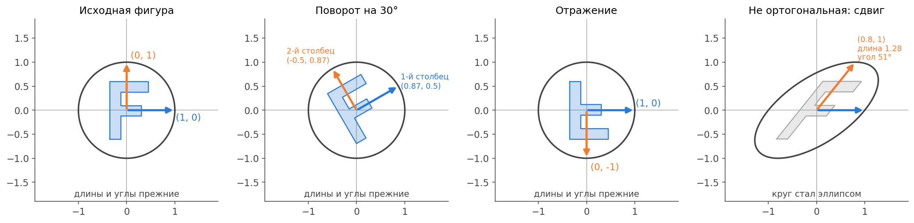

У поворота столбцы особенные:

- Каждый столбец единичной длины: $0.87^2+0.5^2=0.75+0.25=1$.
- Столбцы перпендикулярны: $0.87\cdot(-0.5)+0.5\cdot0.87=0$.

Матрица с такими столбцами называется **ортогональной**. Она поворачивает плоскость, иногда ещё и зеркально отражает, как на третьем рисунке. Длины и углы при этом не меняются: круг остаётся кругом, буква F остаётся той же буквой.

На четвёртом рисунке для сравнения матрица, которая не ортогональная. Её второй столбец $(0.8,\ 1)$ длиннее единицы и не перпендикулярен первому. Буква перекосилась, круг стал эллипсом.

##### Обратный поворот — это транспонирование

Перемножим $Q^T$ и $Q$. Строки $Q^T$ — это столбцы $Q$. Поэтому каждый элемент $Q^TQ$ — скалярное произведение двух столбцов $Q$:

$$
Q^TQ=\begin{pmatrix}q_1\cdot q_1&q_1\cdot q_2\\q_2\cdot q_1&q_2\cdot q_2\end{pmatrix}=\begin{pmatrix}1&0\\0&1\end{pmatrix}=I
$$

На диагонали длины в квадрате, это единицы. Вне диагонали произведения перпендикулярных столбцов, это нули.

Что это значит: $Q^T(Qx)=Ix=x$. Повернули на 30°, потом умножили на $Q^T$ и вернулись назад.

$$
\boxed{Q^TQ=I}
$$

<mark>Для ортогональной матрицы транспонирование — это обратный поворот.</mark> Это свойство дальше будет сокращать формулы.

### Растяжение: диагональная матрица

У **диагональной** матрицы числа стоят только на диагонали:

$$
\Sigma=\begin{pmatrix}2.5&0\\0&0.6\end{pmatrix},\qquad
\Sigma\begin{pmatrix}x\\y\end{pmatrix}=\begin{pmatrix}2.5x\\0.6y\end{pmatrix}
$$

Она растягивает каждую ось в своё число раз и ничего не поворачивает. Горизонталь вытянулась в 2.5 раза, вертикаль сжалась до 0.6.

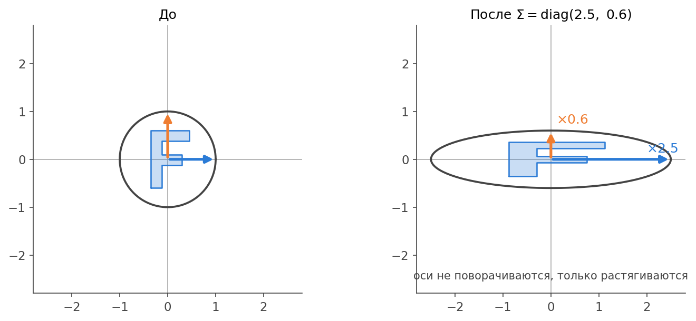

### Любая матрица — поворот, растяжение, поворот

Теперь главная теорема. Любую матрицу можно записать так:

$$
\boxed{A=U\Sigma V^T}
$$

Здесь $U$ и $V$ ортогональные, а $\Sigma$ диагональная, числа на её диагонали неотрицательные и идут по убыванию. Они называются **сингулярными числами**: $\sigma_1\ge\sigma_2\ge\dots\ge0$. Значок $\sigma$ читается «сигма».

Читаем справа налево. Когда матрица действует на вектор $x$:

1. $V^T$ поворачивает.
2. $\Sigma$ растягивает вдоль осей.
3. $U$ снова поворачивает.

Пример:

$$
A=\begin{pmatrix}3&0\\4&5\end{pmatrix}
=\underbrace{\begin{pmatrix}0.32&-0.95\\0.95&0.32\end{pmatrix}}_{U:\ \text{поворот на }72^\circ}
\underbrace{\begin{pmatrix}6.71&0\\0&2.24\end{pmatrix}}_{\Sigma}
\underbrace{\begin{pmatrix}0.71&0.71\\-0.71&0.71\end{pmatrix}}_{V^T:\ \text{поворот на }-45^\circ}
$$

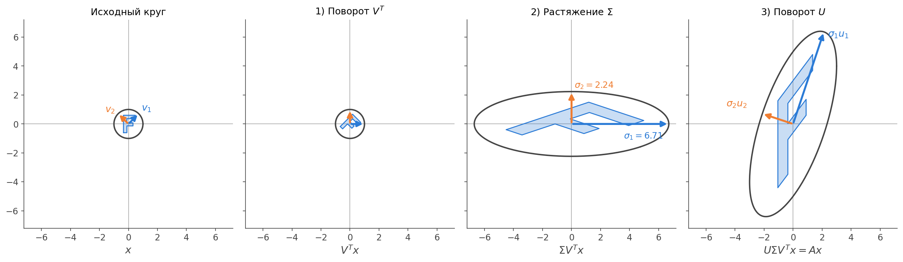

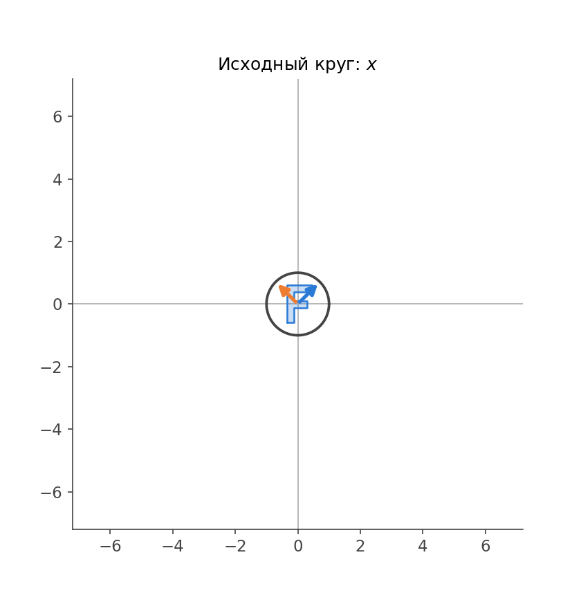

В конце получилось ровно то же, что даёт умножение на $A$ сразу.

Отсюда видно, что значит каждая часть:

| Что        | Смысл                                                 |
| ---------- | ----------------------------------------------------- |
| $\sigma_i$ | Длины полуосей эллипса, в который $A$ превращает круг |
| $u_i$      | Направления осей этого эллипса                        |
| $v_i$      | Какие входные направления попадают на оси эллипса     |

### Главное равенство: $Av=\sigma u$

Умножим $A=U\Sigma V^T$ справа на $V$. Так как $V^TV=I$, получаем $AV=U\Sigma$. Слева столбцы $Av_i$, справа столбцы $\sigma_iu_i$. Значит, для каждой пары:

$$
\boxed{Av_i=\sigma_iu_i}
$$

Простыми словами: <mark>матрица переводит перпендикулярные $v_1,v_2$ в перпендикулярные $u_1,u_2$ и растягивает их в $\sigma_1$ и $\sigma_2$ раз.</mark>

<mark>SVD — это поиск перпендикулярных направлений, которые остаются перпендикулярными после умножения на матрицу.</mark>

##### Чем это отличается от собственных векторов

|                  | Собственный вектор                  | Сингулярная пара                                    |
| ---------------- | ----------------------------------- | --------------------------------------------------- |
| Равенство        | $Av=\lambda v$                      | $Av=\sigma u$                                       |
| Куда идёт вектор | На ту же прямую                     | На другую прямую, но перпендикулярность сохраняется |
| Для каких матриц | Только квадратных, и не всегда есть | Для любых, даже $1000\times8$                       |

Пример, где собственных векторов нет: поворот на 90°. Он поворачивает каждый вектор, и ни один не остаётся на своей прямой. А SVD у поворота есть: $\Sigma=I$, растягивать нечего.

### SVD таблицы данных

Теперь $A$ — наша центрированная таблица из части 3, 4 точки и 2 признака:

$$
A=\begin{pmatrix}2&1\\1&2\\-1&-2\\-2&-1\end{pmatrix}
$$

Что делает такая матрица с вектором? Берёт направление $v$ из двух чисел и выдаёт столбец из четырёх чисел. Из части 2 мы знаем, что это за числа: $Av$ — проекции всех точек на $v$. Отсюда смысл каждой части SVD:

| Что        | Смысл для таблицы                                       |
| ---------- | ------------------------------------------------------- |
| $v_i$      | Новая ось в пространстве признаков                      |
| $Av_i$     | Координаты всех точек вдоль этой оси, по числу на точку |
| $\sigma_i$ | Длина этого столбца координат                           |
| $u_i$      | Тот же столбец координат, поделённый на свою длину      |

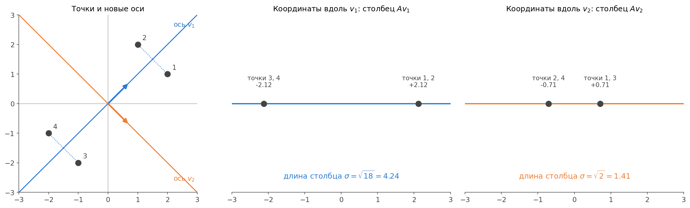

##### Сингулярное число и дисперсия

$\sigma^2$ — это сумма квадратов координат вдоль оси. Среднее координат ноль, данные центрированы. Значит, если поделить $\sigma^2$ на $N-1$, получится дисперсия вдоль оси, то есть собственное значение из части 4:

$$
\boxed{\lambda_i=\frac{\sigma_i^2}{N-1}}
$$

Отсюда понятно, почему $v_1$ из SVD — это первая главная компонента. Самое большое $\sigma_1$ значит самый длинный столбец координат, то есть самую большую дисперсию.

<mark>Новые координаты не коррелируют друг с другом. PCA убирает связи между признаками.</mark>

### Связь с собственными векторами

Покажем то же самое формулами. Подставим $A=U\Sigma V^T$ в $A^TA$.

Транспонирование произведения меняет порядок множителей: $(XY)^T=Y^TX^T$. У диагональной матрицы $\Sigma^T=\Sigma$. Поэтому $A^T=V\Sigma U^T$, и:

$$
A^TA=V\Sigma\underbrace{U^TU}_{I}\Sigma V^T=V\Sigma^2V^T
$$

Вот где пригодилось $U^TU=I$. Умножим обе части справа на $V$ и снова используем $V^TV=I$:

$$
A^TAV=V\Sigma^2
$$

Слева столбцы $A^TAv_i$, справа столбцы $\sigma_i^2v_i$. Получилось определение собственного вектора: $A^TAv_i=\sigma_i^2v_i$.

Итого:

- Столбцы $V$ — собственные векторы $A^TA$, а значит, и $C=A^TA/(N-1)$. Это главные компоненты.
- Собственные значения $C$ равны $\sigma_i^2/(N-1)$.
- Проекции точек получаются сразу: $P=AV=U\Sigma$.

<mark>PCA — это SVD центрированной матрицы данных.</mark>

### Разложение на слои

Произведение $U\Sigma V^T$ можно расписать как сумму. Каждое слагаемое — столбец, умноженный на строку:

$$
\boxed{A=\sigma_1u_1v_1^T+\sigma_2u_2v_2^T+\dots}
$$

Каждое слагаемое — таблица того же размера, что $A$. Назовём её **слоем**. В слое $\sigma_iu_iv_i^T$ строка для точки равна её координате вдоль $v_i$, умноженной на $v_i$. То есть слой — это все точки, у которых оставили только одну координату: проекции на одну ось.

Посчитаем для примера:

$$
\sigma_1u_1v_1^T=\begin{pmatrix}1.5&1.5\\1.5&1.5\\-1.5&-1.5\\-1.5&-1.5\end{pmatrix},\qquad
\sigma_2u_2v_2^T=\begin{pmatrix}0.5&-0.5\\-0.5&0.5\\0.5&-0.5\\-0.5&0.5\end{pmatrix}
$$

Сложим первые строки: $(1.5+0.5,\ 1.5-0.5)=(2,\ 1)$. Это первая точка. Остальные проверяются так же.

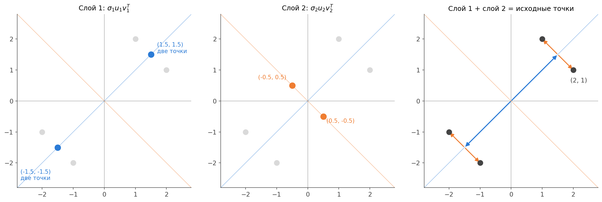

Первый слой кладёт все точки на ось $v_1$. Второй добавляет недостающие отрезки вдоль $v_2$. Вместе они возвращают исходные точки.

Если оставить $k$ слоёв, получится то же приближение $\hat{A}=P_kV_k^T$, что в части 4. Ошибка равна доле выброшенных $\sigma^2$:

$$
\boxed{error=\frac{\sigma_{k+1}^2+\dots+\sigma_n^2}{\sigma_1^2+\dots+\sigma_n^2}}
$$

У нас при одном слое: $2/(18+2)=10\%$.

##### Слои на картинке

Картинка тоже таблица: $110\times160$ чисел яркости. Её тоже можно разложить на слои.

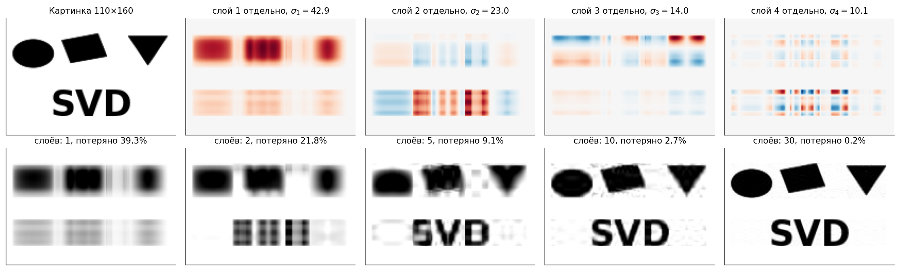

В верхнем ряду слои по отдельности. Каждый похож на клетчатую ткань: это столбец, умноженный на строку, все строки слоя пропорциональны друг другу. В нижнем ряду сумма первых $k$ слоёв. Один слой даёт только общие пятна, пять уже похожи на картинку, на десяти всё читается.

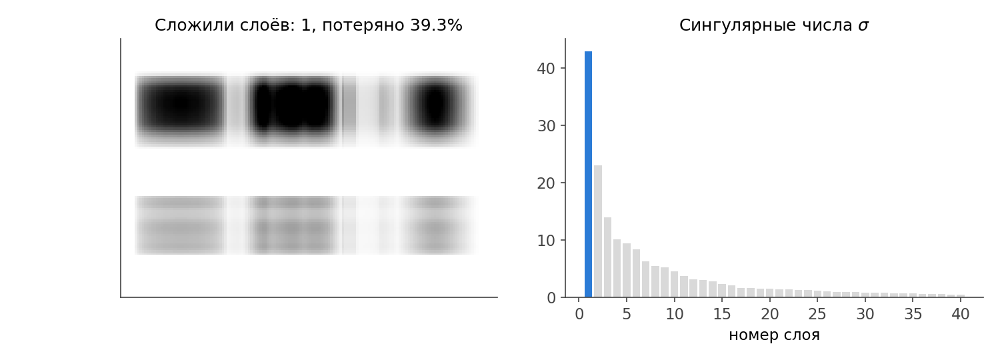

Справа сингулярные числа. Первые большие, дальше быстро падают. Поэтому первых слоёв хватает: в них почти весь разброс.

Заодно это сжатие. Один слой хранит столбец из 110 чисел, строку из 160 и одно $\sigma$, всего 271 число. Десять слоёв занимают 2710 чисел вместо 17 600, это 15% от исходного размера, а потеряно меньше 3%.

**Теорема Эккарта — Янга** говорит, что лучше нельзя: из любых $k$ слоёв вида «столбец на строку» первые $k$ слоёв SVD дают наименьшую ошибку. В PCA это значит, что проекция на первые $k$ компонент лучше любой другой линейной проекции на $k$ осей.

### Сводка

| Что               | Формула                               | Смысл в PCA                      |
| ----------------- | ------------------------------------- | -------------------------------- |
| Разложение        | $A=U\Sigma V^T$                       | Поворот, растяжение, поворот     |
| Главное равенство | $Av_i=\sigma_iu_i$                    | Координаты точек вдоль оси $v_i$ |
| Компоненты        | столбцы $V$                           | Новые оси                        |
| Дисперсия         | $\lambda_i=\sigma_i^2/(N-1)$          | Разброс вдоль оси                |
| Проекции          | $P=AV=U\Sigma$                        | Новые координаты точек           |
| Слои              | $A=\sum\sigma_iu_iv_i^T$              | $k$ слоёв = $k$ компонент        |
| Ошибка            | $\sum_{i>k}\sigma_i^2/\sum\sigma_i^2$ | Доля выброшенного разброса       |

---

## Часть 6. Степенной метод

### Что нужно найти

Из части 5 знаем, как собрать SVD, если известны столбцы $V$:

- $v_i$ — собственные векторы матрицы $M=A^TA$;
- $\sigma_i=\lVert Av_i\rVert$;
- $u_i=Av_i/\sigma_i$.

Значит, вся работа сводится к одному: найти собственные векторы $M$.

Почему $A^TA$, а не сама $A$? Таблица $A$ размером $1000\times8$ прямоугольная. Она берёт 8 чисел и выдаёт 1000, поэтому умножить на неё результат ещё раз нельзя. А $A^TA$ квадратная, $8\times8$: из 8 чисел делает 8 чисел. Такую матрицу можно применять к вектору сколько угодно раз.

Руками через определитель, как в части 2, получится уравнение восьмой степени. Нужен способ проще.

### Опыт: умножаем снова и снова

Возьмём знакомую матрицу из части 2. Её собственные векторы $(1,1)$ с $\lambda=3$ и $(1,-1)$ с $\lambda=1$.

$$
M=\begin{pmatrix}2&1\\1&2\end{pmatrix}
$$

Начнём с $(1,0)$ и будем умножать на $M$ раз за разом. После каждого умножения поделим вектор на длину, чтобы сравнивать только направления.

| Шаг | Вектор    | Делим на длину  | Угол до $(1,1)$ |
| --- | --------- | --------------- | --------------- |
| 0   | $(1,0)$   | $(1,\ 0)$       | 45°             |
| 1   | $(2,1)$   | $(0.89,\ 0.45)$ | 18.4°           |
| 2   | $(5,4)$   | $(0.78,\ 0.62)$ | 6.3°            |
| 3   | $(14,13)$ | $(0.73,\ 0.68)$ | 2.1°            |
| 4   | $(41,40)$ | $(0.72,\ 0.70)$ | 0.7°            |

Числа в векторе выравниваются, и он поворачивается к $(1,1)$. Угол на каждом шаге уменьшается в 3 раза.

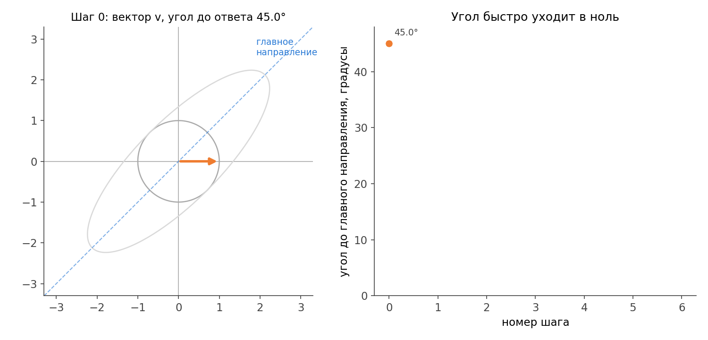

Слева вектор на каждом шаге: умножили на матрицу, он вытянулся и повернулся, поделили на длину и вернули на круг. Справа угол до ответа.

### Зачем делить на длину

Без деления числа растут как $3^t$. Через 50 шагов это примерно $7\cdot10^{23}$. В настоящей задаче хуже: у $A^TA$ первое собственное значение около $50\cdot999\approx5\cdot10^4$. Примерно через 65 шагов числа превысят $10^{308}$, больше компьютер хранить не умеет, и вместо чисел получится `inf`.

Нам важно только направление, длина не нужна. Поэтому на каждом шаге делим на длину. Это и есть **степенной метод**:

$$
\boxed{v\leftarrow\frac{Mv}{\lVert Mv\rVert}}
$$

### Когда остановиться

Сравниваем новый вектор со старым. Если они почти совпали, например $\lVert w-v\rVert<10^{-12}$, то направление больше не меняется, ответ найден.

Знак вектора по дороге не прыгает: все собственные значения $A^TA$ равны $\sigma^2$, то есть неотрицательные. Поэтому такое сравнение работает.

Скорость зависит от отношения $\lambda_2/\lambda_1$. На каждом шаге лишний кусок уменьшается во столько раз, во сколько $\lambda_2$ меньше $\lambda_1$.

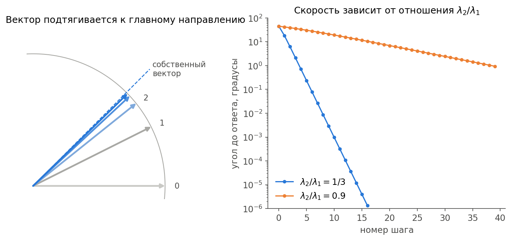

### $\sigma$ и $u$

Главный вектор $v$ нашли. Остальное берём из части 5: $Av=\sigma u$, и $u$ единичной длины. Значит:

$$
\boxed{\sigma=\lVert Av\rVert,\qquad u=\frac{Av}{\sigma}}
$$

### Следующие компоненты: дефляция

Степенной метод находит только главный вектор. Чтобы найти второй, уберём из таблицы первый слой:

$$
\boxed{A\leftarrow A-\sigma uv^T}
$$

Из части 5 мы знаем, что таблица — это сумма слоёв. Вычли первый слой, остались все остальные. Первой компоненты в новой таблице нет, и главной стала вторая. Запускаем степенной метод снова. Такой приём называется **дефляцией** («сдуванием»).

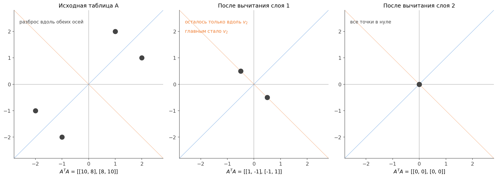

Слева исходные точки, разброс вдоль обеих осей. В центре после вычитания первого слоя: точки легли на ось $v_2$, вдоль $v_1$ разброса нет. Справа после второго слоя всё ушло в ноль.

Посмотри на $A^TA$ под картинками. После первого вычитания получилось $\begin{pmatrix}1&-1\\-1&1\end{pmatrix}$. У этой матрицы собственные значения 2 и 0. Двойка соответствует $v_2$, и это ровно $\sigma_2^2$. Ноль соответствует $v_1$: эту компоненту мы уже сняли.

Степенной метод здесь справится за один шаг: $(1,0)$ сразу переходит в $(1,-1)$, это направление $v_2$.

### Весь алгоритм и код

1. Посчитать $M=A^TA$.
2. Степенным методом найти главный вектор $v$.
3. Посчитать $\sigma=\lVert Av\rVert$ и $u=Av/\sigma$.
4. Вычесть слой из $A$.
5. Повторить $k$ раз.

Компоненты выходят сразу отсортированными: сначала самая большая.

Код из ноутбука:

```python
def norm(v):
    return (v @ v) ** 0.5

def top_vector(M, tol=1e-12, max_iter=20000):
    v = np.random.rand(M.shape[0])
    v = v / norm(v)
    for _ in range(max_iter):
        w = M @ v
        w = w / norm(w)
        if norm(w - v) < tol:
            return w
        v = w
    return v

def svd(A, k):
    U, S, V = [], [], []
    for _ in range(k):
        v = top_vector(A.T @ A)
        s = norm(A @ v)
        u = A @ v / s
        A = A - s * np.outer(u, v)
        U.append(u)
        S.append(s)
        V.append(v)
    return np.array(U).T, np.array(S), np.array(V).T
```

Что какая строка делает:

| Строка                               | Формула                           | Смысл                                    |
| ------------------------------------ | --------------------------------- | ---------------------------------------- |
| `(v @ v) ** 0.5`                     | $\lVert v\rVert=\sqrt{v\cdot v}$  | Длина вектора                            |
| `np.random.rand(...)`, `v / norm(v)` | случайный $v$, $\lVert v\rVert=1$ | Случайный старт единичной длины          |
| `w = M @ v`, `w / norm(w)`           | $v\leftarrow Mv/\lVert Mv\rVert$  | Шаг степенного метода                    |
| `norm(w - v) < tol`                  | $\lVert w-v\rVert<10^{-12}$       | Остановка: направление не меняется       |
| `top_vector(A.T @ A)`                | $M=A^TA$                          | Главный вектор текущей таблицы           |
| `s = norm(A @ v)`                    | $\sigma=\lVert Av\rVert$          | Сингулярное число                        |
| `u = A @ v / s`                      | $u=Av/\sigma$                     | Нормированные координаты точек           |
| `A - s * np.outer(u, v)`             | $A-\sigma uv^T$                   | Дефляция. `np.outer` — столбец на строку |
| `np.array(U).T`                      | $U=(u_1\ u_2\ \dots)$             | Найденные векторы встают в столбцы       |

Таблица снаружи функции не портится. Строка `A = A - ...` создаёт новую таблицу, а старая остаётся как была.

##### Как из SVD получается PCA

```python
def pca(data, k):
    m = mean(data)
    A = data - m
    U, S, V = svd(A, k)
    return A @ V, S ** 2 / (len(data) - 1), V, m
```

| Строка                     | Формула                  | Смысл                     |
| -------------------------- | ------------------------ | ------------------------- |
| `A = data - m`             | центрирование            | Убираем положение центра  |
| `svd(A, k)`                | $A\approx U\Sigma V^T$   | Первые $k$ компонент      |
| `A @ V`                    | $P=AV$                   | Новые координаты точек    |
| `S ** 2 / (len(data) - 1)` | $\lambda=\sigma^2/(N-1)$ | Дисперсии вдоль компонент |

Среднее `m` возвращаем, чтобы потом восстанавливать данные: $\hat{X}=PV^T+m$.

**Спроси:** почему в `top_vector` передаём `A.T @ A`, а не саму `A`?

**Ответ:** `A` прямоугольная, $1000\times8$. Умножить на неё вектор из 8 чисел можно, а результат из 1000 чисел ещё раз уже нельзя. `A.T @ A` квадратная, $8\times8$, и её собственные векторы — это столбцы $V$.

---

## Часть 7. Твой вариант

Вариант 2, $N=1000$ (число точек в задании не указано, берём как в твоём ноутбуке):

| Признак | Как задан                                              |
| ------- | ------------------------------------------------------ |
| $X_1$   | Равномерно от 0 до 10                                  |
| $X_2$   | Равномерно от 0 до 10                                  |
| $X_3$   | $X_1+X_2+\varepsilon$, шум со средним 0 и дисперсией 5 |
| $X_4$   | Нормально, среднее 10, дисперсия 9                     |
| $X_5$   | $2X_4+\varepsilon$, шум со средним 1 и дисперсией 3    |
| $X_6$   | Экспоненциально, $\lambda=0.5$                         |
| $X_7$   | $\sqrt{X_6}$                                           |
| $X_8$   | 0 или 1 с равными вероятностями                        |

Здесь $\lambda$ — параметр распределения, а не собственное значение.

Три места, где легко ошибиться в коде:

- `np.random.normal` принимает отклонение, а в условии дисперсия. Для дисперсии 5 пишем `np.sqrt(5)`.
- `np.random.exponential` принимает $1/\lambda$, то есть 2.
- `np.random.randint(0, 2)` выдаёт 0 и 1: правая граница не входит.

Посмотри, как устроены признаки. Они разбиваются на группы:

| Группа        | Что внутри                                  |
| ------------- | ------------------------------------------- |
| $X_1,X_2,X_3$ | Два независимых признака и их сумма с шумом |
| $X_4,X_5$     | Почти один признак                          |
| $X_6,X_7$     | Почти один признак, связь нелинейная        |
| $X_8$         | Сам по себе                                 |

Независимых источников пять: $X_1,X_2,X_4,X_6,X_8$. Остальное в основном их повторяет. Значит, можно заранее ждать, что пяти компонент хватит.

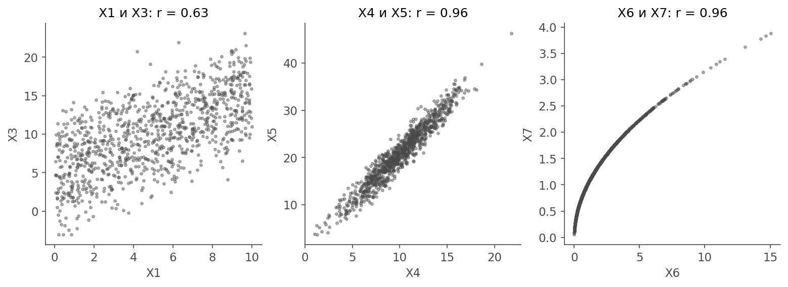

---

## Часть 8. Пишем код

**Ноутбук.** Переключись в `lab4_live.ipynb`.

---

## Часть 9. Результаты и ловушки

### Что получилось

**Корреляция.** Группы из части 7 видны сразу:

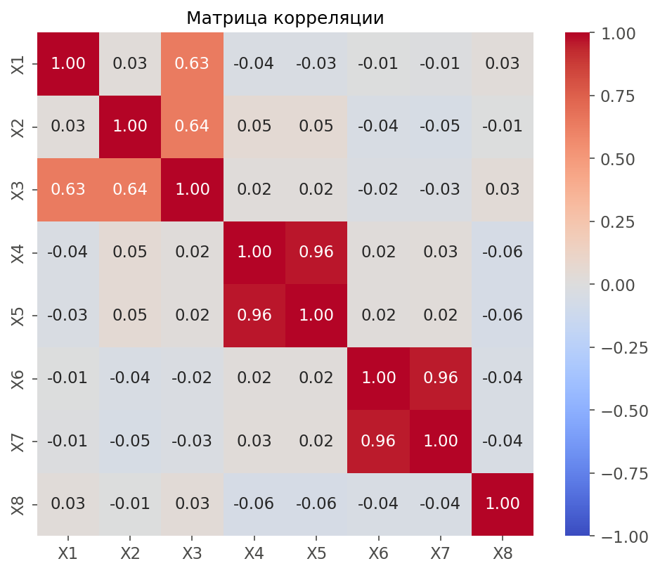

Как читать карту. В клетке на пересечении строки $X_i$ и столбца $X_j$ стоит корреляция $r(X_i,X_j)$. Красный цвет значит, что признаки растут вместе. Синий — один растёт, другой падает. Белый — линейной связи нет. На диагонали единицы: каждый признак полностью связан сам с собой. Карта симметрична, как и ковариационная матрица.

Три ярких блока, всё остальное около нуля. Значения вне блоков не равны нулю точно: это случайность выборки, у 1000 точек такой разброс нормален.

Заметь $r(X_6,X_7)=0.96$. Связь нелинейная, но корень на этом участке похож на прямую, поэтому корреляция почти единица.

**SVD.** Сравниваем с библиотекой:

| Что проверяем                          | Результат           |
| -------------------------------------- | ------------------- |
| $\sigma$ у нас и в `np.linalg.svd`     | Совпали до 4 знаков |
| Наибольшая разница $A$ и $U\Sigma V^T$ | $7\cdot10^{-15}$    |
| Наибольшая разница $V^TV$ и $I$        | $2\cdot10^{-16}$    |
| Наибольшая разница $U^TU$ и $I$        | $7\cdot10^{-13}$    |

Реализация верная. Если запустить `svd` на маленьком примере, получатся те же $\sigma=4.24$ и $1.41$, что мы считали руками.

**Проекция на 2D.** Собственные значения 49.94 и 29.55, ошибка 15.96%. Это совпадает с твоим ноутбуком.

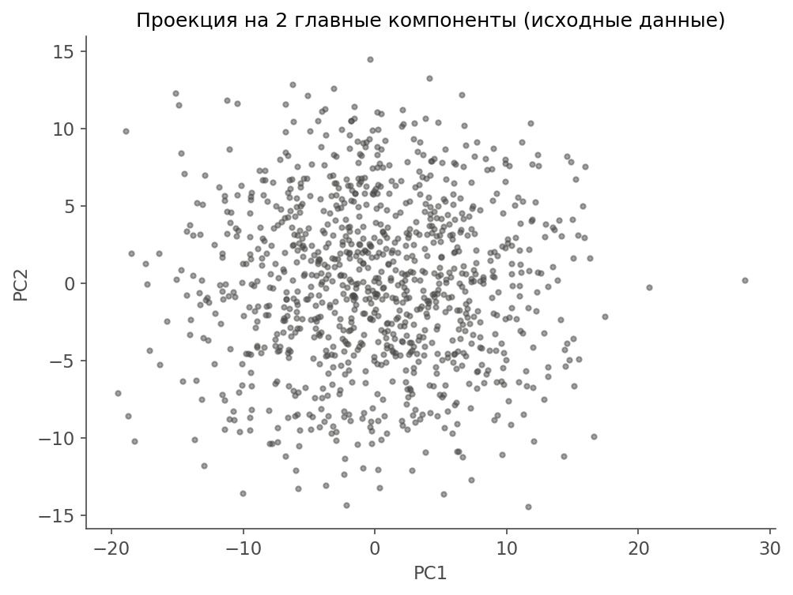

На картинке бесформенное пятно: никаких кластеров в данных нет, и это честный результат.

Посмотрим, из чего состоят компоненты. Числа в столбцах называются **нагрузками**, это координаты вектора $v$:

| Признак | PC1    | PC2    |
| ------- | ------ | ------ |
| $X_1$   | -0.010 | 0.362  |
| $X_2$   | 0.034  | 0.361  |
| $X_3$   | 0.033  | 0.859  |
| $X_4$   | 0.423  | -0.018 |
| $X_5$   | 0.905  | -0.032 |
| $X_6$   | 0.006  | -0.013 |
| $X_7$   | 0.002  | -0.005 |
| $X_8$   | -0.004 | 0.003  |

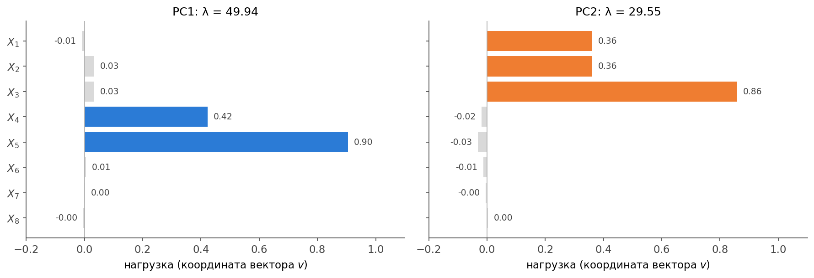

Как читать нагрузки:

- Компонента — единичный вектор, поэтому квадраты нагрузок в сумме дают 1.
- Чем больше нагрузка по модулю, тем сильнее признак входит в компоненту. Серые столбики почти нулевые, эти признаки в компоненту не попали.
- Новая координата точки — сумма признаков с весами-нагрузками: $PC1\approx0.42(X_4-\bar{X}_4)+0.90(X_5-\bar{X}_5)$, остальные слагаемые почти нулевые.
- Знак показывает направление. Признаки с одинаковым знаком вдоль компоненты растут вместе.

PC1 — это группа $X_4,X_5$. PC2 — группа $X_1,X_2,X_3$. Группа $X_6,X_7$ и признак $X_8$ сюда почти не попали.

Почему у $X_5$ вес вдвое больше, чем у $X_4$? Потому что $X_5\approx2X_4$. Если точка сдвинулась на 1 по $X_4$, по $X_5$ она сдвинулась примерно на 2. Направление совместного роста $(1,2)$, после нормировки $(1,2)/\sqrt{5}=(0.45,\ 0.89)$. Почти наши 0.42 и 0.90, остаток объясняется шумом в $X_5$.

Собственные значения тоже можно предсказать заранее. Группы между собой не связаны, поэтому ковариационная матрица распадается на независимые блоки. Каждый блок разбираем отдельно.

- **$X_4,X_5$.** $\mathrm{Var}(X_4)=9$. Умножение на 2 увеличивает дисперсию в 4 раза, а дисперсии независимых слагаемых складываются: $\mathrm{Var}(2X_4+\varepsilon)=4\cdot9+3=39$. Ковариация $\mathrm{cov}(X_4,2X_4)=2\cdot9=18$. Блок $\begin{pmatrix}9&18\\18&39\end{pmatrix}$, через определитель, как в части 2, получаем 47.43 и 0.57.
- **$X_1,X_2,X_3$.** Дисперсия равномерного распределения от 0 до 10 равна $10^2/12=8.33$. $\mathrm{Var}(X_3)=8.33+8.33+5=21.67$. $X_3$ связан с каждым из первых двух с ковариацией 8.33, а $X_1$ и $X_2$ не связаны. Одно направление видно сразу: $(1,-1,0)$, то есть разность $X_1-X_2$. $X_3$ от неё не зависит, и её $\lambda=8.33$. Ещё два значения дают направления «всё растёт вместе» (28.54) и «шум в $X_3$» (1.46).
- **$X_6,X_7$.** У экспоненциального распределения дисперсия $1/0.5^2=4$. У корня из него дисперсия 0.43, ковариация с $X_6$ равна 1.25. Блок $\begin{pmatrix}4&1.25\\1.25&0.43\end{pmatrix}$ даёт 4.40 и 0.03.
- **$X_8$.** Значения 0 и 1 поровну: среднее 0.5, каждая точка отстоит от него на 0.5, дисперсия $0.5^2=0.25$.

Складываем все значения в общий список:

| Компонента | Что это               | Теория | У нас |
| ---------- | --------------------- | ------ | ----- |
| 1          | Группа $X_4,X_5$      | 47.43  | 49.94 |
| 2          | Группа $X_1,X_2,X_3$  | 28.54  | 29.55 |
| 3          | Разность $X_1-X_2$    | 8.33   | 8.26  |
| 4          | Группа $X_6,X_7$      | 4.40   | 4.59  |
| 5          | Шум в $X_3$           | 1.46   | 1.42  |
| 6          | Шум в $X_5$           | 0.57   | 0.55  |
| 7          | $X_8$                 | 0.25   | 0.25  |
| 8          | Разница $X_6$ и $X_7$ | 0.03   | 0.04  |

Отличия объясняются случайностью выборки. В целом PCA нашёл именно то, как мы строили данные.

##### Важная ловушка твоей лабораторной: масштаб признаков

Ошибка 15.96% выглядит хорошо: две компоненты из восьми, а потеряно всего 16%. Посмотрим на дисперсии.

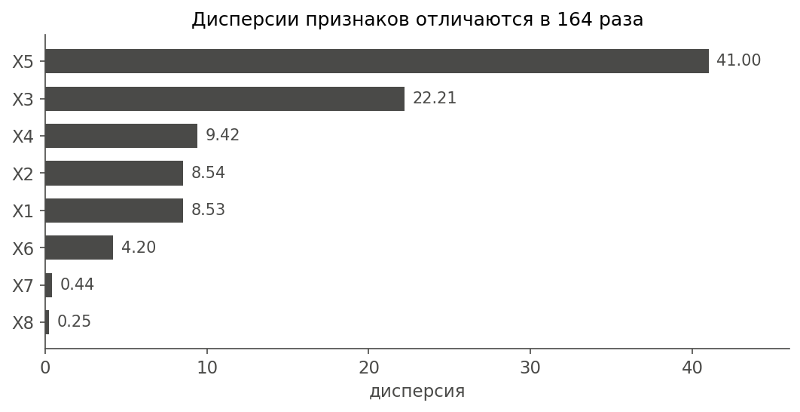

Общая дисперсия равна 94.59. Один $X_5$ даёт 43% от неё, вместе с $X_3$ получается 67%. А это просто следствие того, что значения $X_5$ крупнее. PCA не знает, что такое единицы измерения. Он видит только числа.

<mark>Без стандартизации главными становятся не самые важные признаки, а самые крупные.</mark>

Проверим прямо. Запишем $X_8$ как 0 и 100 вместо 0 и 1. Информации в столбце ровно столько же, только единицы другие.

| Данные                    | $\lambda_1$ | $\lambda_2$ | PC1          | Ошибка на 2D |
| ------------------------- | ----------- | ----------- | ------------ | ------------ |
| Исходные                  | 49.94       | 29.55       | $X_4,X_5$    | 15.96%       |
| $X_8$ записан как 0 и 100 | 2502.69     | 49.75       | Только $X_8$ | 1.71%        |

Ошибка упала почти в десять раз, а данные лучше не сжались. Просто один столбец раздули, и теперь почти весь разброс сидит в нём. Значит, такая ошибка сама по себе ни о чём не говорит.

Лечится стандартизацией. Тогда у всех признаков дисперсия 1, общая дисперсия равна 8, а ковариационная матрица становится матрицей корреляции из пункта 2.

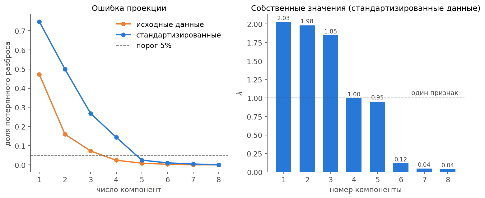

| $k$ | $\lambda$ | Ошибка, исходные | $\lambda$ (станд.) | Ошибка, станд. |
| --- | --------- | ---------------- | ------------------ | -------------- |
| 1   | 49.94     | 47.21%           | 2.03               | 74.67%         |
| 2   | 29.55     | 15.96%           | 1.98               | 49.89%         |
| 3   | 8.26      | 7.23%            | 1.85               | 26.83%         |
| 4   | 4.59      | 2.39%            | 1.00               | 14.37%         |
| 5   | 1.42      | 0.89%            | 0.95               | 2.46%          |
| 6   | 0.55      | 0.30%            | 0.12               | 1.02%          |
| 7   | 0.25      | 0.04%            | 0.04               | 0.45%          |
| 8   | 0.04      | 0%               | 0.04               | 0%             |

На первый взгляд стандартизация только мешает: ошибка на 2D выросла с 16% до 50%. Но эти числа нельзя сравнивать напрямую. Мы делим на разную общую дисперсию, то есть меряем разной линейкой.

Зато теперь $\lambda$ можно читать: дисперсия одного признака равна 1, поэтому $\lambda$ показывает, сколько исходных признаков стоит компонента.

- Три значения около 2: это три группы почти одинаковых признаков.
- Два значения около 1: это $X_8$ и разность $X_1-X_2$.
- Три значения около нуля: шум и почти повторы.

На правом графике резкий обрыв после пятой компоненты. Это те самые пять независимых источников.

##### Ловушка вторая: маленькая общая ошибка не значит, что сохранилось всё

Общая ошибка — среднее по всем признакам, а отдельный признак может пропасть целиком. Посчитаем ту же ошибку, но для каждого столбца отдельно. Восстанавливаем данные $\hat{A}=P_kV_k^T$ и для столбца $j$ смотрим, какая доля его разброса осталась:

$$
\boxed{kept_j=1-\frac{\sum_i(A_{ij}-\hat{A}_{ij})^2}{\sum_iA_{ij}^2}}
$$

Единица значит, что столбец восстановился полностью. Ноль значит, что от него ничего не осталось. В ноутбуке это функция `kept_by_feature`.

| Признак | Исходные, $k=2$ | Исходные, $k=4$ | Станд., $k=2$ | Станд., $k=5$ |
| ------- | --------------- | --------------- | ------------- | ------------- |
| $X_1$   | 0.454           | 0.939           | 0.190         | 0.972         |
| $X_2$   | 0.458           | 0.938           | 0.305         | 0.971         |
| $X_3$   | 0.983           | 0.983           | 0.462         | 0.941         |
| $X_4$   | 0.952           | 0.952           | 0.853         | 0.982         |
| $X_5$   | 0.997           | 0.998           | 0.854         | 0.982         |
| $X_6$   | 0.002           | 0.999           | 0.658         | 0.978         |
| $X_7$   | 0.002           | 0.927           | 0.665         | 0.978         |
| $X_8$   | 0.005           | 0.007           | 0.022         | 1.000         |

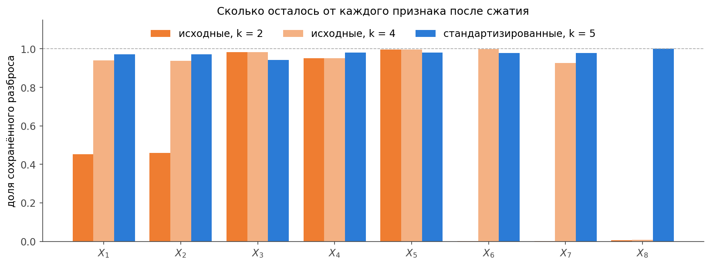

Вот что скрывалось за красивыми 15.96%: $X_6$, $X_7$ и $X_8$ потеряны полностью. Даже при четырёх компонентах, когда общая ошибка всего 2.39%, от $X_8$ не осталось почти ничего. Он появляется только в седьмой компоненте.

<mark>Ответ на пункт 6: стандартизация плюс пять компонент. Общая ошибка 2.46%, и у каждого признака сохранилось не меньше 94% разброса.</mark>

Порог 5% мы выбрали сами, в задании он не указан. Способы выбрать $k$:

| Способ                | Как работает                                                                  | У нас                                             |
| --------------------- | ----------------------------------------------------------------------------- | ------------------------------------------------- |
| Порог ошибки          | Минимальное $k$ с ошибкой не выше порога                                      | 5                                                 |
| Обрыв на графике      | Место, где $\lambda$ резко падает                                             | 5                                                 |
| Правило $\lambda\ge1$ | Для стандартизированных данных: оставить компоненты не слабее одного признака | 3 (четвёртая 0.997 и пятая 0.95 чуть не дотянули) |

Правила не обязаны совпадать, поэтому смотрим на картину целиком. Здесь правило $\lambda\ge1$ промахнулось из-за случайности выборки: два значения около единицы оказались чуть ниже неё, а обрыв на графике стоит после пятого.

Стандартизация нужна не всегда. Если признаки в одних единицах и разница в разбросе важна, её не делают. Так будет с картинками в части 10: у всех пикселей одна шкала яркости.

И ещё: ответ на пункт 6 имеет вторую сторону. Какое бы $k$ мы ни выбрали, сама проекция на первые $k$ компонент уже оптимальна среди всех линейных проекций на $k$ осей. Это и есть смысл SVD из части 5.

##### Ловушка третья: компоненты нельзя читать слишком буквально

Сравни нагрузки стандартизированных компонент:

| Признак | PC1   | PC2   | PC3   | PC4   | PC5   |
| ------- | ----- | ----- | ----- | ----- | ----- |
| $X_1$   | -0.17 | 0.26  | 0.41  | 0.28  | -0.65 |
| $X_2$   | -0.14 | 0.36  | 0.32  | -0.32 | 0.63  |
| $X_3$   | -0.21 | 0.43  | 0.51  | -0.01 | 0.00  |
| $X_4$   | 0.41  | 0.51  | -0.26 | 0.08  | -0.03 |
| $X_5$   | 0.41  | 0.51  | -0.26 | 0.08  | -0.03 |
| $X_6$   | 0.53  | -0.22 | 0.41  | 0.02  | 0.05  |
| $X_7$   | 0.53  | -0.22 | 0.41  | 0.02  | 0.04  |
| $X_8$   | -0.10 | -0.03 | 0.03  | 0.90  | 0.43  |

Каждая из первых трёх компонент смешивает все группы. Почему не по одной группе на компоненту? Потому что $\lambda$ равны 2.03, 1.98, 1.85, почти одинаковые. Если собственные значения совпадают, любой поворот внутри этих направлений тоже подходит. Случайность выборки выбирает какой-то один.

Другая выборка даст другие PC1, PC2, PC3, но вместе они будут описывать то же самое трёхмерное подпространство. Поэтому говорить «PC1 означает то-то» здесь нельзя. То же с PC4 и PC5.

Ещё два следствия:

- **Знак компоненты случаен.** Вектор $v$ и вектор $-v$ задают одну прямую. Если на занятии у какой-то компоненты все знаки выйдут наоборот, это нормально: он зависит от случайного старта.
- **Близкие $\lambda$ замедляют степенной метод.** Здесь $\lambda_2/\lambda_1=0.98$, и на первую компоненту уходит больше тысячи шагов. Поэтому в `top_vector` стоит строгая остановка.

---

## Часть 10. Эксперименты

Эти ячейки идут в конце ноутбука. Они отвечают на вопросы 2, 5, 6, 7 и 8.

### Нелинейные данные

Точки лежат на кольце радиуса 5. По сути это одна величина, угол, но прямая её не опишет.

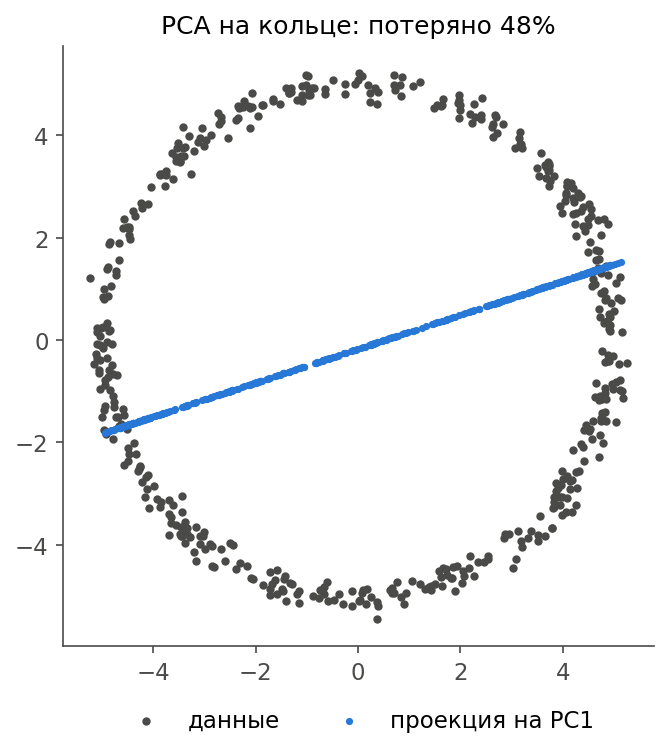

Собственные значения 13.02 и 12.01 почти равны: у круга нет выделенного направления. Одна компонента теряет 47.99%.

PCA умеет только поворачивать оси, а изогнуть их не может. Какую прямую ни возьми, точки с другой стороны кольца на неё лягут плохо.

Лечится так же, как в lab3: трансформацией. Перейдём к полярным координатам. Вместо $x$ и $y$ запишем для каждой точки **радиус**, то есть расстояние до центра $\sqrt{x^2+y^2}$, и **угол**, то есть направление на точку.

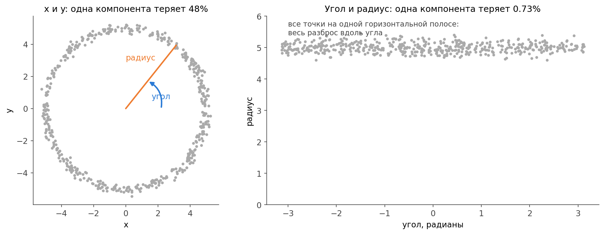

В новых координатах кольцо развернулось в горизонтальную полосу. Радиус почти у всех около 5, меняется только угол. Теперь данные лежат вдоль прямой, и одна компонента теряет всего 0.73%.

Если подходящая замена неизвестна, берут нелинейные методы:

| Метод       | Идея                                            |
| ----------- | ----------------------------------------------- |
| Kernel PCA  | PCA в неявно расширенном пространстве признаков |
| t-SNE, UMAP | Сохраняют соседей, в основном для картинок      |
| Isomap      | Сохраняет расстояния вдоль поверхности          |
| Автоэнкодер | Нейросеть сжимает и восстанавливает             |

### Выбросы

Добавим 5 точек с $X_6=100$, это 0.5% выборки.

| Что             | Без выбросов | С выбросами |
| --------------- | ------------ | ----------- |
| $\lambda_1$     | 49.94        | 51.83       |
| $\lambda_2$     | 29.55        | 50.24       |
| Вес $X_6$ в PC1 | 0.006        | 0.997       |
| Ошибка на 2D    | 15.96%       | 28.36%      |

Косинус угла между старой и новой первой компонентой равен 0.08, они почти перпендикулярны. Пять точек из 1005 полностью развернули ось.

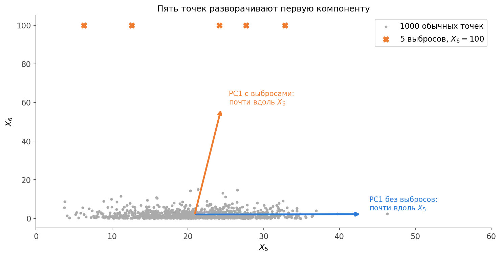

Посчитаем, почему так. Дисперсия $X_6$ была 4.2. Каждый выброс отстоит от среднего примерно на 98, а в дисперсию идёт квадрат: $5\cdot98^2/1004\approx48$. Дисперсия $X_6$ выросла до 51.8 и обогнала $X_5$ с его 41. PCA ищет направление с наибольшей дисперсией, и теперь это $X_6$.

Причина та же, что в lab3: всё считается через квадраты, и далёкая точка тянет на себя. Перед PCA выбросы надо найти и разобраться с ними.

### Что теряется при малом числе компонент

Возьмём 600 картинок рукописных цифр размером $8\times8$, это 64 признака. Сожмём и восстановим.

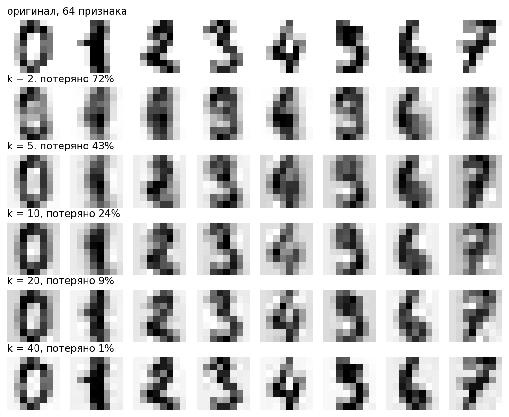

| $k$ | Потеряно разброса |
| --- | ----------------- |
| 2   | 72%               |
| 5   | 43%               |
| 10  | 24%               |
| 20  | 9%                |
| 40  | 1%                |

При двух компонентах остаётся размытое пятно: цифры похожи друг на друга и почти неотличимы. При 20 всё читается. Сначала уходят мелкие детали, которые отличают одну цифру от другой, общая форма держится дольше.

Здесь мы не стандартизировали: все пиксели измеряются в одной шкале яркости.

Сами компоненты тоже можно нарисовать. Каждая — вектор из 64 чисел, то есть картинка $8\times8$:

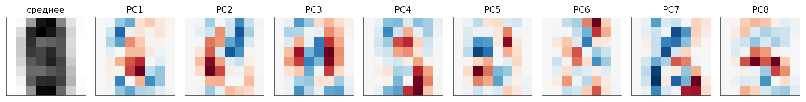

Если координата точки вдоль компоненты положительная, красные пиксели становятся темнее, а синие светлее. Если отрицательная, наоборот. Восстановленная цифра — это среднее плюс несколько таких картинок с весами-координатами:

$$
\hat{x}=\bar{x}+p_1v_1+p_2v_2+\dots+p_kv_k
$$

При двух компонентах у каждой цифры есть только два числа $p_1,p_2$. Десять разных цифр двумя узорами не описать, поэтому все они выходят похожими на размытое среднее.

### PCA перед обучением модели

Сгенерируем цель $y=3X_1-2X_2+X_4+0.5X_6+8X_8+\text{шум}$. Разделим данные на обучение (800 точек) и тест (200 точек). Обучим линейную регрессию на $k$ компонентах и проверим на тесте. Качество меряем через $R^2$ из lab3: 1 означает идеальное предсказание, 0 — не лучше, чем всегда предсказывать среднее.

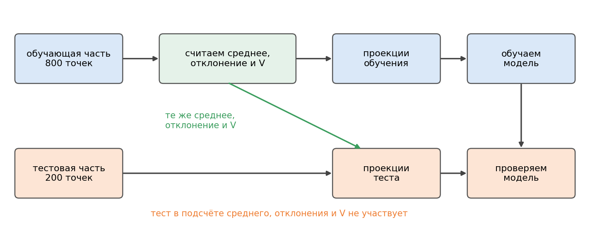

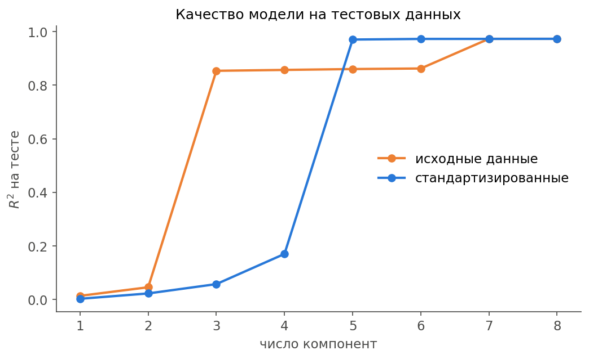

| $k$ | $R^2$, исходные | $R^2$, станд. |
| --- | --------------- | ------------- |
| 1   | 0.014           | 0.003         |
| 2   | 0.046           | 0.023         |
| 3   | 0.854           | 0.057         |
| 4   | 0.857           | 0.170         |
| 5   | 0.860           | 0.970         |
| 6   | 0.862           | 0.973         |
| 7   | 0.973           | 0.973         |
| 8   | 0.973           | 0.973         |

Что здесь видно:

- Две первые компоненты почти бесполезны для модели. <mark>PCA не знает про $y$: большой разброс не значит пользу для предсказания.</mark>
- На исходных данных ступенька на $k=7$: только там появляется $X_8$. У него дисперсия маленькая, а влияние на $y$ большое.
- На стандартизированных данных пяти компонент хватает, $R^2=0.970$ против 0.973 у всех восьми.
- PCA не улучшил модель: максимум и так 0.973. Он дал то же качество на меньшем числе признаков.

Почему $X_8$ появляется так поздно: в $y$ он входит с самым большим коэффициентом 8, но его собственная дисперсия всего 0.25. PCA смотрит только на дисперсию признаков, а не на их пользу для $y$, поэтому ставит $X_8$ в самый конец.

Важная деталь, она на схеме выше: среднее, отклонение и $V$ считаются только на обучающей части. Тест пропускаем через готовое преобразование. Если считать их на всех данных, в них попадёт информация о тесте. Модель на проверке окажется в знакомой обстановке, и оценка выйдет завышенной. Это называется **утечкой данных**. В реальной задаче новых данных во время обучения нет, поэтому и здесь тест держим в стороне.

---

## Часть 11. Что исправить в ноутбуке

Отчёта по этой работе нет, поэтому смотрим только на `lab4.ipynb`. Числа в нём верные: 49.94, 29.55 и 15.96% совпали с проверкой. Распределения заданы правильно, включая корни из дисперсий и `1/0.5`. Но сдавать его в таком виде нельзя: есть нарушения условия и один настоящий баг.

### Ошибки по существу

| Где                          | Сейчас                                                                                   | Должно быть                                                  |
| ---------------------------- | ---------------------------------------------------------------------------------------- | ------------------------------------------------------------ |
| `manual_svd_pca`             | Называется SVD, но $U$ и $\Sigma$ нет. Ищутся собственные векторы ковариационной матрицы | Построить $U$, $\Sigma$, $V$, см. функцию `svd`              |
| `manual_svd_pca`             | `np.linalg.norm`, комментарий утверждает, что это разрешено                              | Запрещено условием. Заменить на `(v @ v) ** 0.5`             |
| `calculate_projection_error` | `np.trace`                                                                               | Тоже запрещено. Заменить на сумму квадратов `np.sum(A ** 2)` |
| `calculate_projection_error` | Аргумент `n_componets` не используется, берётся глобальная `eigenvalues`                 | Считать через восстановление данных, см. `projection_error`  |
| Степенной метод              | Остановка при `abs(dot) > 0.999999` слишком мягкая                                       | Останавливаться по `norm(w - v) < 1e-12`                     |
| Степенной метод              | `break` стоит до `vec = vec_new`, возвращается предыдущий вектор                         | Возвращать новый вектор                                      |
| Пункт 6                      | Только график и список ошибок, вывода нет                                                | Выбрать $k$ и объяснить выбор                                |
| Пункт 6                      | Нет стандартизации, $X_6,X_7,X_8$ теряются незаметно                                     | Сравнить исходные и стандартизированные данные               |

Баг с глобальной переменной легко показать: функция возвращает 0.1596 и при $k=2$, и при $k=5$, и при $k=8$. Сейчас это незаметно только потому, что её вызвали один раз, сразу после расчёта двух компонент.

Мягкая остановка на исходных данных почти не вредит: собственные значения отличаются от точных на $3\cdot10^{-4}$. Но векторы уже неточно перпендикулярны: скалярные произведения доходят до 0.01, а должны быть нулём. На стандартизированных данных с близкими $\lambda$ станет хуже.

### Оформление

- Опечатки в именах: `n_componets`, `explandet_var`, `all_projaction`.
- Опечатка в тексте вывода: «Ошибка проекция».
- `:.2F` работает, но принято писать `:.2f`.
- В конце ноутбука осталась пустая ячейка.

---

## Часть 12. Итоги

### Главное

- **PCA** поворачивает оси так, чтобы разброс собрался в первых компонентах, а потом отбрасывает лишние.
- **Главные компоненты** — собственные векторы ковариационной матрицы, **собственные значения** равны дисперсиям вдоль них.
- **Дисперсия и ошибка**: максимум дисперсии проекций и минимум ошибки проекции — одна задача.
- **Ошибка проекции** равна доле выброшенных собственных значений.
- **Ортогональная матрица** — поворот, возможно с отражением. Её столбцы единичные и перпендикулярные, а $Q^TQ=I$: транспонирование поворачивает обратно.
- **SVD** раскладывает любую матрицу на поворот, растяжение и поворот: $A=U\Sigma V^T$. Главное равенство $Av_i=\sigma_iu_i$: перпендикулярные $v$ переходят в перпендикулярные $u$.
- **SVD таблицы данных**: столбцы $V$ — компоненты, $Av$ — координаты точек вдоль них, $\lambda=\sigma^2/(N-1)$, проекции $P=U\Sigma$.
- **Слои** $\sigma_iu_iv_i^T$ в сумме дают таблицу. Первые $k$ слоёв — лучшее приближение, ошибка равна доле выброшенных $\sigma^2$.
- **Степенной метод** находит главный вектор многократным умножением на $A^TA$ с делением на длину. Скорость зависит от $\lambda_2/\lambda_1$. **Дефляция** снимает найденный слой, и главной становится следующая компонента.
- **Масштаб признаков** решает всё: без стандартизации PCA выбирает самые крупные столбцы.
- **Маленькая общая ошибка** не гарантирует, что каждый признак сохранился.
- **Близкие собственные значения** делают отдельные компоненты неустойчивыми, а знак компоненты случаен.
- **PCA линейный**, боится выбросов и ничего не знает про целевую переменную.

### Проверка понимания

Дай решить самостоятельно. Точки $(4,2)$, $(2,4)$, $(0,-2)$, $(-2,0)$.

**Спроси:** центрируй данные.

**Ответ:** средние равны 1 и 1. Получаем $(3,1)$, $(1,3)$, $(-1,-3)$, $(-3,-1)$.

**Спроси:** найди $A^TA$, ковариационную матрицу и корреляцию.

**Ответ:** $A^TA=\begin{pmatrix}20&12\\12&20\end{pmatrix}$, делим на 3: $C=\begin{pmatrix}6.67&4\\4&6.67\end{pmatrix}$. Корреляция $r=12/20=0.6$.

**Спроси:** найди собственные значения и векторы $A^TA$.

**Ответ:** $(20-\lambda)^2=144$, значит, $\lambda=32$ и $\lambda=8$. Векторы $(1,1)/\sqrt{2}$ и $(1,-1)/\sqrt{2}$.

**Спроси:** чему равны сингулярные числа и собственные значения $C$?

**Ответ:** $\sigma_1=\sqrt{32}\approx5.66$, $\sigma_2=\sqrt{8}\approx2.83$. Для $C$ получаем $32/3\approx10.67$ и $8/3\approx2.67$.

**Спроси:** какая ошибка при одной компоненте?

**Ответ:** $8/(32+8)=20\%$.

**Спроси:** найди координаты точек вдоль $v_1=(1,1)/\sqrt{2}$, потом $\sigma_1$ и $u_1$ без собственных значений, как в части 5.

**Ответ:** $Av_1=(4,\ 4,\ -4,\ -4)/\sqrt{2}\approx(2.83,\ 2.83,\ -2.83,\ -2.83)$. Длина $\sigma_1=\sqrt{4\cdot8}=\sqrt{32}\approx5.66$, совпало. $u_1=(0.5,\ 0.5,\ -0.5,\ -0.5)$.

**Спроси:** вычти первый слой $\sigma_1u_1v_1^T$. Что осталось и какое у остатка $A^TA$?

**Ответ:** первый слой даёт строки $(2,2)$, $(2,2)$, $(-2,-2)$, $(-2,-2)$. Остаток $(1,-1)$, $(-1,1)$, $(1,-1)$, $(-1,1)$, все точки на оси $(1,-1)$. Его $A^TA=\begin{pmatrix}4&-4\\-4&4\end{pmatrix}$, собственные значения 8 и 0. Восьмёрка — это $\sigma_2^2$.

**Спроси:** ортогональна ли матрица $\begin{pmatrix}0.6&-0.8\\0.8&0.6\end{pmatrix}$?

**Ответ:** да. $0.6^2+0.8^2=1$ для обоих столбцов, их произведение $0.6\cdot(-0.8)+0.8\cdot0.6=0$. Это поворот примерно на 53°.

**Спроси:** сделай два шага степенного метода для $\begin{pmatrix}3&1\\1&3\end{pmatrix}$ со старта $(1,0)$, без нормировки.

**Ответ:** $(3,1)$, потом $(10,6)$. Направление приближается к $(1,1)$.

**Спроси:** один признак измеряли в метрах, потом перевели в миллиметры. Что случится с PCA без стандартизации?

**Ответ:** дисперсия признака вырастет в миллион раз, и первая компонента почти совпадёт с ним. Ошибка на малом $k$ станет меньше, хотя данные лучше не сжались.

### Ответы на вопросы преподавателя

Проговори их вслух.

**1. Что такое метод главных компонент и для какой цели он применяется.** Это метод снижения размерности. Он находит новые перпендикулярные оси, упорядоченные по убыванию дисперсии, и оставляет первые $k$. Применяется для сжатия данных, визуализации, удаления дублирующих признаков и шума, подготовки признаков для моделей. У нас 8 признаков сводятся к 5 с ошибкой 2.46%.

**2. Основные ограничения PCA и случаи, когда он работает плохо.** Метод линейный: на кольце одна компонента теряет 48%, хотя данные по сути одномерные. Чувствителен к масштабу: без стандартизации главными становятся крупные признаки. Чувствителен к выбросам: 5 точек из 1005 развернули первую компоненту почти на 90°. Большая дисперсия не всегда значит важность: метод не знает про целевую переменную. Компоненты трудно интерпретировать, а при близких собственных значениях они неустойчивы.

**3. Как интерпретировать объяснённую дисперсию.** Это доля общего разброса, которая приходится на компоненту: $\lambda_i/\sum\lambda_j$. Накопленная сумма показывает, сколько разброса сохранится при $k$ компонентах. На стандартизированных данных у нас доли равны 25.3%, 24.8%, 23.1%, 12.5%, 11.9%, вместе 97.5%. На остальные три приходится 2.5%, это шум и почти повторы. По резкому падению долей выбирают $k$.

**4. Как SVD связано с PCA.** SVD раскладывает любую матрицу на поворот, растяжение и поворот: $A=U\Sigma V^T$. Столбцы $V$ — перпендикулярные направления, которые матрица переводит в перпендикулярные: $Av_i=\sigma_iu_i$. PCA — это SVD центрированной матрицы данных. Для неё $Av$ — координаты точек вдоль оси $v$, а $\sigma^2$ — сумма их квадратов. Поэтому $\sigma^2/(N-1)$ — дисперсия вдоль оси, то есть собственное значение ковариационной матрицы, а столбцы $V$ — главные компоненты. Формулами то же следует из $A^TA=V\Sigma^2V^T$. Проекции равны $AV=U\Sigma$. Первые $k$ слоёв $\sigma_iu_iv_i^T$ дают наилучшее приближение таблицы, ошибка равна доле выброшенных $\sigma^2$. У нас SVD посчитан без готовых функций: степенной метод на $A^TA$ и дефляция.

**5. Почему PCA линейный, примеры нелинейных альтернатив.** Новые координаты — линейные комбинации старых: $P=AV$. Метод только поворачивает оси и не может их изогнуть, поэтому кривую структуру он не разворачивает. Альтернативы: Kernel PCA, t-SNE, UMAP, Isomap, автоэнкодеры.

**6. Что произойдёт с информацией, если оставить слишком мало компонент.** Вместе с шумом потеряется полезная информация, и восстановить её будет нельзя. Сначала уходят направления с малой дисперсией, а в них могут быть важные признаки. У нас при двух компонентах на исходных данных $X_6,X_7,X_8$ потеряны полностью. Картинки цифр при двух компонентах становятся неотличимы. Модель, обученная на двух компонентах, дала $R^2$ меньше 0.05 вместо 0.97.

**7. Как минимизировать ошибку проекции, не меняя алгоритм.** Самое прямое — взять больше компонент. Остальное меняет сами данные: убрать выбросы (ошибка на 2D с ними была 28.36%, без них 15.96%), преобразовать признаки так, чтобы связи стали линейными (на кольце полярные координаты снизили ошибку с 47.99% до 0.73%), убрать шумовые признаки. Масштаб нужно выбирать осознанно: стандартизация честно уравнивает признаки, хотя процент ошибки при этом может вырасти. Сравнивать проценты при разном масштабе нельзя.

**8. Как использовать PCA перед обучением модели.** Разделить данные на обучение и тест. На обучающей части посчитать среднее, отклонение и компоненты. Выбрать $k$ по доле разброса или по качеству на валидации. Обе части преобразовать одними и теми же параметрами, а модель учить на компонентах. Это ускоряет обучение и убирает мультиколлинеарность. Но PCA не смотрит на целевую переменную, поэтому качество надо проверять: у нас на пяти стандартизированных компонентах $R^2=0.970$, а на всех восьми 0.973.
