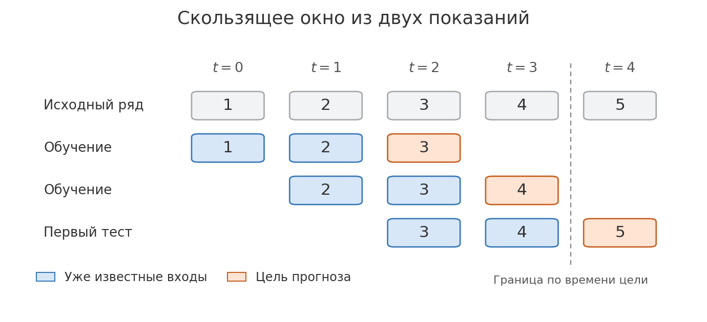
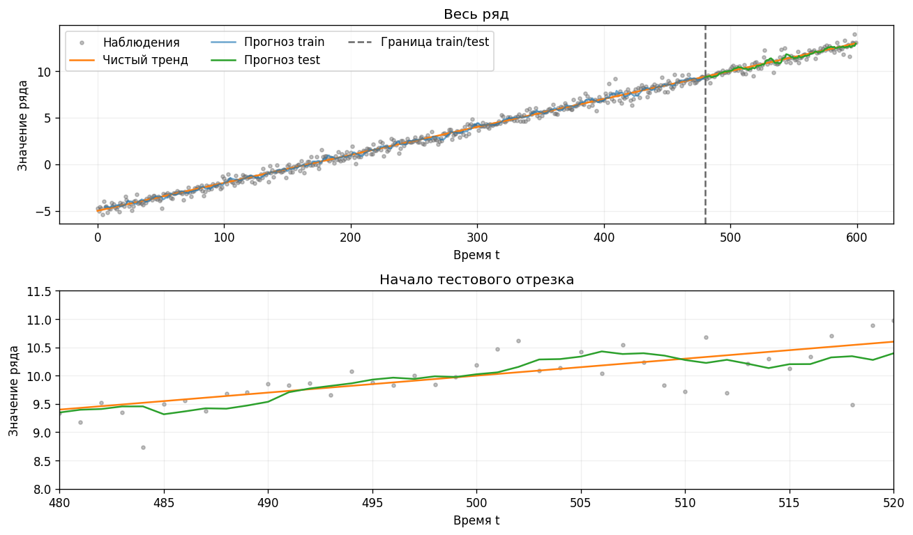
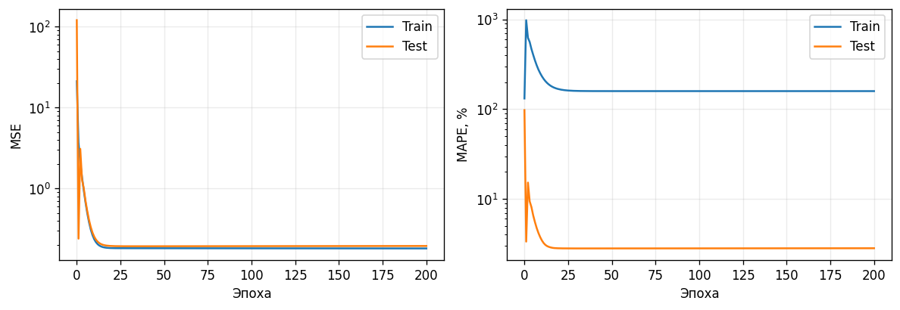
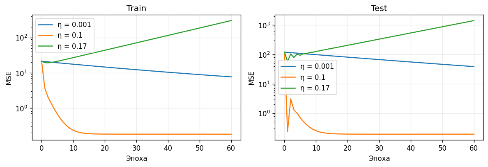
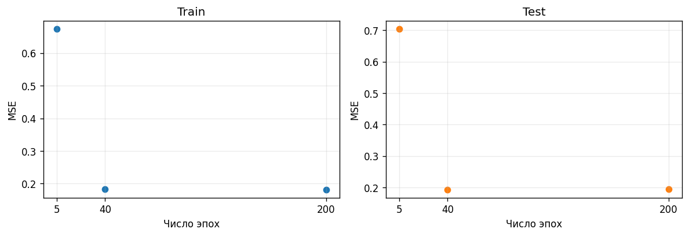

# Лабораторная работа №5. Перцептрон для регрессии

## Карта темы

Научимся предсказывать следующее показание прибора по предыдущим. Без окон у нас есть одна длинная запись. Из неё получим таблицу примеров с известными ответами и сможем обучить модель.

Сигнал с шумом из лабы 1 → окна и подготовка столбцов как в лабе 4 → линейная регрессия и ошибка из лабы 3 → шаг градиентного спуска из лабы 2 → проверка прогноза на новых наблюдениях.

**Перед занятием.** Открой [лайв-ноутбук](../lab5_live.ipynb) и [ГДЗ](lab5_gdz.ipynb). Веди один пример на доске от окна до первого прогноза на тесте. Оставь рядом числа из частей 2–6, они понадобятся при выводе дельта-правила. После ручного разбора переходи к коду и результатам.

---

## Часть 1. Зачем это нужно

### От показаний прибора к прогнозу

Представь прибор, который каждую секунду записывает температуру. Сейчас видим последние показания $18, 19, 20$. Как прикинуть следующее, пока прибор его ещё не измерил?

**Спроси.** Какое число ты бы поставил следующим? По каким показаниям ты это решил?

**Ответ.** Например, $21$, если продолжить рост на единицу. Можно предположить и $20$, если ожидаем, что температура почти не изменится. Оба прогноза используют только уже известные числа. Какой лучше, узнаем после следующего измерения.

В лабе 3 по известной площади квартиры предсказывали её цену. Здесь тоже предсказываем число. Входами будут несколько прошлых показаний, а ответом — одно следующее. Это снова **регрессия**.

### Наш вариант

Покажи [условие](../lab5.md). На этом этапе достаточно разобрать, откуда берутся показания и сколько их в ряду. К длине окна вернись после маленького примера.

**Временной ряд** — показания, записанные в порядке времени. Например, числа $1, 2, 3, 4, 5$ могли быть измерены в моменты $0, 1, 2, 3, 4$. Если переставить числа, изменится история, которую увидит модель.

В варианте 2 чистый сигнал растёт на $0.03$ за один шаг. В момент $t=0$ он равен $-5$, в момент $t=1$ равен $-4.97$. Допустим, случайный шум в этот момент оказался $0.20$. Тогда в ряд попадёт $-4.97+0.20=-4.77$. Эту же операцию мы делали в лабе 3, когда добавляли шум к значениям на прямой.

$$f(t)=0.03t-5,\qquad y_t=f(t)+\varepsilon_t.$$

$t$ — момент измерения, $f(t)$ — чистый сигнал, $\varepsilon_t$ — случайное отклонение в этот момент, $y_t$ — полученное показание. Индекс у $y_t$ указывает, **когда** записано число. Вызов `rng.laplace(0, 0.3, size=...)` даёт шум Лапласа с центром $0$ и параметром масштаба $0.3$. Как в лабе 1, распределение задаёт, какие отклонения встречаются чаще. Центр $0$ означает, что в среднем шум не тянет показания вверх или вниз. Для распределения Лапласа $0.3$ — масштаб, а стандартное отклонение равно $0.3\sqrt{2}$.

Берём $600$ равноотстоящих моментов от $0$ до $599$. В реальном приборе обычно доступны только показания $y_t$. В нашей симуляции есть ещё и $f(t)$, поэтому на графике можно отдельно увидеть чистый тренд и разброс вокруг него. Модель будет учиться по показаниям $y_t$.

**Спроси.** Если на следующем шаге чистая линия вырастет на $0.03$, может ли измеренное показание упасть?

**Ответ.** Да. Например, шум на одном шаге равен $0.20$, а на следующем равен $-0.20$. Тогда изменение показания составит $0.03-0.20-0.20=-0.37$. Знакомые по лабе 1 случайные величины здесь помогают имитировать разброс реальных измерений.

---

## Часть 2. Как из ряда получаются строки таблицы

### Маленький пример

Запиши ряд $1,2,3,4,5$ и проставь под ним моменты времени от $0$ до $4$. Обведи первые два числа, а третье оставь за рамкой. Дай ученику самому сдвинуть рамку на один шаг.

Возьмём ряд из пяти показаний. Для ручного примера используем окно из двух, чтобы видеть все числа сразу.

| Момент цели $t$ | Окно от старого показания к новому | Цель $y_t$ |
| --- | --- | --- |
| $2$ | $[1,2]$ | $3$ |
| $3$ | $[2,3]$ | $4$ |
| $4$ | $[3,4]$ | $5$ |

**Спроси.** Для цели в момент $3$ какие два числа будут входом? А какое число будет ответом?

**Ответ.** Вход $[2,3]$, ответ $4$. Если ученик указывает на $y_3$ как на вход, закрой на доске показания с момента $3$ и попроси выбрать два последних из тех, что видны.

Чтобы получить вторую строку, сдвигаем рамку на одно показание вправо. Новая строка снова получает два числа из прошлого и одно следующее число в качестве ответа. Поэтому окно называется **скользящим**. Получилась таблица как в лабе 4. Строка здесь — один пример прогноза, а столбец — показание на определённом расстоянии в прошлом. При двух прошлых значениях первый прогноз возможен для момента $2$.

Для варианта 2 та же строка выглядит так:

$$\mathbf{x}_t=[y_{t-6},\ y_{t-5},\ y_{t-4},\ y_{t-3},\ y_{t-2},\ y_{t-1}],\qquad \text{цель}=y_t.$$

$\mathbf{x}_t$ — вектор входов для прогноза в момент $t$. Запись $y_{t-6}$ читается «показание на шесть шагов раньше», $y_{t-1}$ — самое свежее известное показание. Такие признаки называют **лагами**. Для первого окна при $t=6$ подставь $6$ вместо $t$: в строке окажутся $y_0$–$y_5$, а ответом станет $y_6$. Из $600$ наблюдений получается $594$ строки по шесть признаков.

### Почему делим по времени

Модель должна учиться на ранней истории и проверяться на более поздней. Поэтому граница проходит по времени **цели**. Берём первые $480$ наблюдений, чтобы учиться прогнозировать цели до $t=479$, и оставшиеся $120$ для проверки целей с $t=480$.

| Часть | Моменты целей | Размер матрицы входов |
| --- | --- | --- |
| `train` | $6,7,\ldots,479$ | $474\times6$ |
| `test` | $480,481,\ldots,599$ | $120\times6$ |

Первые шесть моментов служат историей. Отсюда $474$ обучающих окна при $480$ исходных точках в ранней части. Если перемешать все окна перед разделением, в обучении могут оказаться примеры из будущего относительно тестовых целей. Пересекающиеся окна дополнительно делят много одних и тех же измерений. Такая проверка плохо имитирует прогноз вперёд во времени.

**Спроси.** Где взять шесть входов для первого тестового прогноза $y_{480}$? А что изменится в окне для $y_{481}$, когда прибор пришлёт новое измерение?

**Ответ.** Для $y_{480}$ уже известны $y_{474}$–$y_{479}$. Для $y_{481}$ сдвигаем окно и добавляем измеренное $y_{480}$. Это **одношаговый прогноз по мере поступления наблюдений**. Если нужен прогноз сразу на несколько шагов из момента $479$, новых измерений ещё нет. Тогда можно подставлять предыдущие прогнозы или обучить модель на другом горизонте.

В маленьком ряду отдадим первые две строки в обучение, а строку $[3,4]\to5$ оставим для проверки. Позже получим прогноз для неё уже обученными весами.

---

## Часть 3. Зачем менять масштаб входов

### Вспоминаем стандартизацию

В лабе 4 мы вычитали среднее столбца, а потом делили на его стандартное отклонение. Здесь делаем ту же **стандартизацию**. Среднее задаёт точку отсчёта, а стандартное отклонение задаёт типичный масштаб разброса. Так вход, равный среднему, станет нулём. Вход на одно стандартное отклонение выше среднего станет единицей. Для градиентного спуска это важно, потому что величина входа влияет на величину поправки к его весу.

Посчитай с учеником первый столбец. В нём стоят $1$ и $2$. Среднее равно $1.5$. Оба числа отстоят от среднего на $0.5$. Как в лабе 1, возводим отклонения в квадрат, усредняем и берём корень. Получаем $\sqrt{(0.5^2+0.5^2)/2}=0.5$. После вычитания среднего и деления первый столбец станет $-1,1$.

**Спроси.** Во втором столбце стоят $2$ и $3$. Как поменяются среднее и стандартное отклонение? Во что превратятся числа?

**Ответ.** Среднее тоже сдвинется на единицу и станет $2.5$. Отклонение останется $0.5$. Стандартизированный столбец тоже равен $[-1,1]$.

$$
X_{\text{train}}=\begin{bmatrix}1&2\\2&3\end{bmatrix}
\quad\longrightarrow\quad
Z_{\text{train}}=\begin{bmatrix}-1&-1\\1&1\end{bmatrix}.
$$

Для первого и второго столбца одной строки считаем $(x_1-\mu_1)/\sigma_1$ и $(x_2-\mu_2)/\sigma_2$. Компактно $z_{ij}=(x_{ij}-\mu_j)/\sigma_j$. Здесь $i$ — номер строки, $j$ — номер столбца, $x_{ij}$ — исходное число, а $z_{ij}$ — результат. Параметры $\mu_j$ и $\sigma_j$ — среднее и отклонение **по обучающим строкам** для столбца $j$. В коде эту операцию выполняем по столбцам через `axis=0`.

**Спроси.** Какими средними преобразуем проверочную строку $[3,4]$?

**Ответ.** Берём уже найденные $1.5$ и $2.5$. Отклонения тоже оставляем прежними. Получаем $[(3-1.5)/0.5, (4-2.5)/0.5]=[3,3]$. Значение $3$ говорит, что наблюдение на три обучающих отклонения выше среднего. Поздние точки растущего ряда действительно могут выйти за привычный ранний диапазон.

<mark>Средние и отклонения берём из `train`, а применяем к `train` и `test`. Если включить тестовые точки в вычисление среднего, подготовка входов начнёт зависеть от будущего.</mark> Тот же принцип уже был в [эксперименте с PCA перед регрессией](../../lab4/lesson/lab4.md#pca-перед-обучением-модели).

Цели $y_t$ оставляем в исходных единицах. Поэтому нейрон выдаёт показание в тех же единицах, что прибор. Тестовую кривую сравним с показаниями напрямую.

---

## Часть 4. Нейрон, который умеет считать прогноз

Окно подготовлено. Теперь из нескольких чисел нужно получить одно. На доске оставь рядом строку из окна, веса и цель, чтобы при подстановке было видно, откуда берётся каждое число.

В лабе 3 у нас был один вход $x$ и прогноз $b_0+b_1x$. Прибавляли свободный член $b_0$ и вклад признака $b_1x$. Теперь входов несколько, и у каждого свой коэффициент. В обозначениях этой лабы свободный член называется $b$ (**смещение**), а коэффициенты $w_1,w_2,\ldots$ — **веса**.

Вернёмся к двум обучающим строкам. Для ручного разбора возьмём $w_1=0.5$, $w_2=-0.5$ и $b=3$. Для второй строки $[1,1]$ прогноз такой:

$$\hat y=3+0.5\cdot1+(-0.5)\cdot1=3.$$

Один вход прибавил половину единицы, другой убавил столько же.

**Спроси.** Какой прогноз получится для первой строки $[-1,-1]$? А для окна $[0,0]$?

**Ответ.** Для $[-1,-1]$ получаем $3-0.5+0.5=3$. Для $[0,0]$ оба вклада равны нулю, поэтому остаётся $b=3$. Смещение позволяет модели выдавать ненулевое показание даже для окна со средними значениями входов.

Для двух входов формула $\hat y=b+w_1z_1+w_2z_2$. В варианте 2 складываем шесть вкладов:

$$\boxed{\hat y_i=b+w_1z_{i1}+w_2z_{i2}+\cdots+w_6z_{i6}=b+\sum_{j=1}^6 w_jz_{ij}}$$

Шляпка над $y$ означает прогноз. Здесь $i$ — строка, $j$ — номер лага. Знак $\sum$ предлагает перебрать $j$ от $1$ до $6$, умножить каждый вход на его вес и сложить произведения. В NumPy `Z @ w + b` делает это для всех строк. Например, матрица `Z_train` размера $474\times6$ умножается на вектор из шести весов, и получается $474$ прогноза. Прибавление `b` сдвигает каждый из них.

### Что значит «линейная активация»

Вычисленную сумму $s=b+\sum_j w_jz_j$ нейрон передаёт в функцию активации. В задании она просто возвращает то же число, то есть $a(s)=s$. Например, для $s=-1.4$ ответ будет $-1.4$. Такой выход подходит для **регрессии**, где нужно предсказать число.

**Спроси.** А если нужно решить, исправен ли прибор? Какой формы будет ответ?

**Ответ.** Это **классификация**. Можно договориться, что $0$ означает «исправен», а $1$ — «сломался». Пороговая активация могла бы вернуть $1$ при $s\geq0$ и $0$ при $s<0$. Для $s=-1.4$ получился бы класс $0$.

В условии работа называется «Перцептрон Розенблатта». Классический перцептрон использует порог для классификации. В нашей реализации задана линейная активация для регрессии, поэтому в объяснении используем название «линейный нейрон».

<mark>Формула та же, что в линейной регрессии из лабы 3. На месте одного входа теперь шесть прошлых показаний, на месте одного коэффициента — шесть весов.</mark> Входы уже записаны, поэтому при обучении меняем параметры $w$ и $b$. В основном опыте стартовые веса и смещение случайные. Фиксированный `seed` позволяет повторить тот же старт.

---

## Часть 5. Как понять, удачен ли прогноз

Попроси ученика посчитать промахи для двух строк. Здесь можно быстро вспомнить метрики из лабы 3 и оставить больше времени на обновление весов.

Для двух строк прогнозы равны $3$ и $3$, цели равны $3$ и $4$. Определим остаток как $e_i=y_i-\hat y_i$. Первый остаток равен нулю, второй равен $1$. Если просто сложить остатки, положительный и отрицательный промахи могут компенсироваться. В лабе 3 мы решали эту задачу квадратами. Здесь берём среднее квадратов:

$$\operatorname{MSE}=\frac{(3-3)^2+(4-3)^2}{2}=\frac12.$$

Для двух строк пишем $L=(e_1^2+e_2^2)/2$. Если строк $N$, та же операция выглядит так:

$$\boxed{L=\operatorname{MSE}(y,\hat y)=\frac{1}{N}\sum_{i=1}^N (y_i-\hat y_i)^2}$$

$N$ — число строк в той части, по которой считаем ошибку. Под знаком суммы стоит квадрат промаха на одной строке. МНК из лабы 3 минимизировал сумму квадратов. Среднее отличается от суммы множителем $1/N$. Для фиксированной выборки и сумма, и среднее достигают минимума при одних и тех же параметрах. В этой лабораторной MSE служит и функцией потерь для обучения, и метрикой на графике.

**MAPE** отвечает на другой вопрос. Как велик промах относительно самого показания? В первой строке промах $0$ от $3$, во второй $1$ от $4$, то есть $25\%$. Среднее этих процентов равно $12.5\%$.

$$\operatorname{MAPE}(y,\hat y)=\frac{100\%}{N}\sum_{i=1}^N\left|\frac{y_i-\hat y_i}{y_i}\right|.$$

**Спроси.** Промах на $0.2$ при $y=10$ даёт $2\%$. Что будет с тем же промахом при $y=0.01$? Что при этом случится с квадратом ошибки?

**Ответ.** Процент вырастет до $2000\%$, квадрат останется $0.04$. Как и в [лабе 3](../../lab3/lesson/lab3.md#mape), дело в знаменателе. При $y=0$ процент не определён. В коде берём среднее по ненулевым целям и возвращаем `NaN`, если таких целей нет. В данных варианта 2 точных нулей нет. Почти нулевые значения остаются в расчёте, поэтому смотрим на MSE вместе с MAPE. Веса обучаем по MSE.

---

## Часть 6. Почему дельта-правило уменьшает ошибку

В [лабе 2](../../lab2/lesson/lab2.md) двигали точку по двум координатам, чтобы спуститься к минимуму. Здесь координаты точки — веса и смещение, высота над ней — MSE. Напомни рисунок со склоном из лабы 2, затем вернись к двум строкам на доске. Нужно выяснить, как маленькое изменение веса влияет на прогноз, а прогноз — на ошибку.

### Сначала меняем один вес

Обведи вторую строку. У неё $z_1=1$, $z_2=1$, цель $4$ и прогноз $3$.

**Спроси.** Если увеличить $w_1$ с $0.5$ до $0.6$, прогноз приблизится к $4$? Что произойдёт в первой строке, где $z_1=-1$?

**Ответ.** Во второй строке прогноз вырастет до $3.1$, квадрат ошибки упадёт с $1$ до $0.81$. В первой прогноз уменьшится с $3$ до $2.9$, квадрат ошибки вырастет с $0$ до $0.01$. Общее среднее улучшится с $0.5$ до $(0.01+0.81)/2=0.41$.

**Если ученик застопорился.** Выпиши вклад первого веса отдельно. Во второй строке он меняется с $0.5\cdot1$ на $0.6\cdot1$. В первой — с $0.5\cdot(-1)$ на $0.6\cdot(-1)$. Сравни изменения вкладов и перенеси их в прогнозы.

На этом примере видно, зачем складывать вклад **всех** строк. Одно изменение веса сдвигает прогнозы разных окон по-разному. Знак входа говорит, в какую сторону сдвинется прогноз, а величина входа показывает, насколько сильно. Если в какой-то строке $z_1=0$, изменение $w_1$ вообще не затронет её прогноз.

### От небольшого изменения к производной

Обозначим прибавку к весу через $h$. Прогноз одной строки вырастет на $z_{ij}h$, а остаток $e_i=y_i-\hat y_i$ уменьшится на $z_{ij}h$. Можно раскрыть квадрат нового остатка:

$$
(e_i-z_{ij}h)^2=e_i^2-2e_i z_{ij}h+z_{ij}^2h^2.
$$

Вычитаем старый квадрат $e_i^2$ и делим изменение на $h$. Остаётся $-2e_i z_{ij}+z_{ij}^2h$. Когда $h$ приближается к нулю, второй член исчезает. Число $-2e_i z_{ij}$ — скорость изменения квадрата ошибки этой строки при изменении веса $w_j$. Это та же идея производной из лабы 2: смотрим, сколько изменения функции приходится на очень маленькое изменение входа.

Для среднего двух ошибок производная по первому весу равна $(-2e_1z_{11}-2e_2z_{21})/2$. Для $N$ строк получаем частные производные:

$$
\frac{\partial L}{\partial w_j}=-\frac{2}{N}\sum_{i=1}^N e_i z_{ij},
\qquad
\frac{\partial L}{\partial b}=-\frac{2}{N}\sum_{i=1}^N e_i.
$$

Запись $\partial L/\partial w_j$ читается «частная производная потерь по весу $w_j$». Меняем один вес, остальные фиксируем. Для смещения множитель $z_{ij}$ заменяется на $1$, потому что добавка к $b$ целиком прибавляется к каждому прогнозу. Все такие производные вместе составляют **градиент**. В варианте 2 у него семь координат: шесть для весов и одна для смещения.

### Один шаг и одна эпоха

В лабе 2 вычитали градиент, умноженный на шаг. Применяем то же правило с **скоростью обучения** $\eta$:

$$
w_j^{\text{нов}}=w_j-\eta\frac{\partial L}{\partial w_j}
=w_j+\eta\frac{2}{N}\sum_{i=1}^N e_i z_{ij},
\qquad
b^{\text{нов}}=b+\eta\frac{2}{N}\sum_{i=1}^N e_i.
$$

Плюс во второй записи появился после подстановки производной со знаком минус. Это **дельта-правило** для линейного выхода и MSE. Иногда его записывают без двойки, когда в функции потерь берут половину MSE или включают двойку в размер шага. В этой лабе $L$ равна MSE, поэтому множитель $2$ остаётся явным.

Разверни формулу на двух строках. У нас $e_1=0$, $e_2=1$. Для каждого веса сумма $e_i z_{ij}$ равна $0\cdot(-1)+1\cdot1=1$. Сумма остатков для смещения тоже равна $1$. Множитель $2/N$ при $N=2$ равен $1$. Выберем $\eta=0.25$. Каждый вес и смещение увеличатся на $0.25$:

| Параметр | Было | Стало |
| --- | ---: | ---: |
| $w_1$ | $0.50$ | $0.75$ |
| $w_2$ | $-0.50$ | $-0.25$ |
| $b$ | $3.00$ | $3.25$ |

Теперь прогнозы равны $3.25-0.75+0.25=2.75$ и $3.25+0.75-0.25=3.75$. MSE упала с $0.5$ до $(0.25^2+0.25^2)/2=0.0625$. Первый прогноз чуть ухудшился, а второй улучшился сильнее. Шаг уменьшил среднюю ошибку на двух строках.

В коде `e = y - predict(Z, w, b)`, а `Z.T @ e` считает суммы $e_i z_{ij}$ сразу для всех лагов. Для нашего случая первая строка `Z.T` равна $[-1,1]$. Умножение на $[0,1]$ даёт $(-1)\cdot0+1\cdot1=1$. В рабочем варианте размер `Z_train.T` равен $6\times474$, а `e` содержит $474$ остатка. Получаем шесть поправок и одно отдельное среднее остатков для смещения. Все поправки считаются по одним и тем же старым весам.

**Эпоха** — один проход по всей обучающей части. Здесь за эпоху считаем прогнозы на всех обучающих окнах, собираем их вклад и делаем один общий шаг. Это пакетный градиентный спуск, где пакет — весь `train`. Если обновлять веса после каждой строки, за ту же эпоху было бы много шагов. В лабе 2 мы искали размер шага вдоль направления на каждой итерации. Здесь $\eta$ фиксирована внутри запуска, чтобы можно было увидеть, как её выбор влияет на обучение.

В `fit` сохраняем параметры до первого обновления и после каждой эпохи. Начальному состоянию соответствует эпоха $0$. Затем по сохранённым параметрам можно посчитать MSE и MAPE на обоих наборах. Тестовые цели нужны для оценки, а направление шага вычисляется по обучающим целям.

**Спроси.** Обучили модель на $474$ окнах за $5$ эпох. Сколько раз каждое окно участвовало в расчёте ошибки? Сколько раз обновились веса?

**Ответ.** Каждое окно участвовало пять раз. Веса тоже обновились пять раз, потому что один шаг использует сразу все $474$ окна.

---

## Часть 7. Пишем код

**Ноутбук.** Переключись в [lab5_live.ipynb](../lab5_live.ipynb). Готовое решение держи в [lab5_gdz.ipynb](lab5_gdz.ipynb).

| В ноутбуке | Что показать на занятии |
| --- | --- |
| Генерация сигнала | На одном участке графика найди чистый тренд и измерение. Разность между ними — шум в этот момент. |
| Окна и разделение по времени | До запуска `make_windows` попроси назвать первую строку и её цель. После запуска сверь размеры `train` и `test` и покажи первое тестовое окно. |
| Нормализация входов | Напиши вычисление среднего и отклонения по столбцам. Спроси, почему в преобразовании теста используются уже найденные числа. |
| Линейный нейрон и метрики | Перед `Z @ w + b` попроси предсказать форму результата. Один скаляр на строку, поэтому для `train` получится вектор длины $474$. |
| Дельта-правило и обучение | Перенеси три строки с доски в `delta_step`. Сначала `e`, потом `Z.T @ e` для весов и среднее `e` для смещения. В `fit` покажи, где заканчивается одна эпоха. |
| Графики и проверка по МНК | Попроси объяснить, почему на тестовом участке сравниваются прогнозы и показания в одни и те же моменты времени. |
| Эксперименты | Попроси сначала прикинуть форму графика. Потом запусти и сравни с гипотезой. |

**Если в `delta_step` расходятся знаки.** Вернись к строке, где цель $4$, прогноз $3$ и вход $1$. Прибавление к весу поднимает прогноз, поэтому в коде с остатком `y - y_pred` поправка для этой строки положительная.

---

## Часть 8. Результаты и ловушки

### Что получилось

Основной запуск использует $600$ точек, окно из шести значений, скорость обучения $0.1$ и $200$ эпох. Начальные параметры одинаковы во всех сравниваемых запусках.

Сначала покажи весь ряд. Вертикальная линия отмечает начало теста. Потом увеличь начало тестового участка. На нём видно, что прогнозы следуют за ростом сигнала, а отдельные шумовые скачки остаются в наблюдениях. Мы сравниваем прогноз и измерение с одинаковым $t$. Если сдвинуть прогнозы на одну точку, получится сравнение с чужими целями.

**Спроси.** Почему прогноз выглядит спокойнее измерений? Можем ли мы узнать шум для $t=480$ по показаниям до $t=479$?

**Ответ.** Каждый шумовой отсчёт в симуляции генерируется независимо. Из старых показаний можно восстановить уровень и направление тренда. Сам шум следующего измерения заранее неизвестен. Усреднение информации из окна сглаживает часть прошлых случайных отклонений.

| Модель | MSE `train` | MSE `test` | MAPE `train` | MAPE `test` |
| --- | ---: | ---: | ---: | ---: |
| Линейный нейрон, $200$ эпох | $0.1817$ | $0.1949$ | $159.26\%$ | $2.82\%$ |
| Те же лаги, решение МНК | $0.1804$ | $0.2018$ | $159.34\%$ | $2.90\%$ |
| Последнее известное показание | $0.3055$ | $0.3020$ | $78.87\%$ | $3.72\%$ |

**Сравни с МНК.** `np.linalg.lstsq` находит веса и смещение, минимизирующие квадраты ошибок на тех же обучающих окнах. Для смещения добавляем столбец единиц. Это тот же критерий из лабы 3. После $200$ эпох спуск уже близок к этому минимуму по значению MSE. У МНК на `train` ошибка чуть ниже, а на `test` чуть выше. МНК решает задачу на обучающей выборке, поэтому порядок моделей на новом участке может измениться.

**Сравни с простым прогнозом.** Возьми ответ $\hat y_t=y_{t-1}$. Так мы в начале занятия предлагали повторить последнее показание. По MSE обученная модель выиграла у этого ориентира и на раннем участке, и на позднем. Это понятный способ оценить, дала ли пользу работа с шестью весами.

### Почему MAPE так различается на двух участках

Обрати внимание ученика на две панели. MSE на `train` и `test` к концу близки, а проценты отличаются в десятки раз. Чистая линия пересекает ноль около $t=167$, то есть в обучающей части. В нашем ряду одна обучающая цель по модулю около $0.0012$, а на тесте минимальный модуль около $8.73$. Вспомни ловушку из лабы 3. Деление на почти нулевое число раздувает процент.

**Спроси.** Почему в начале MSE на `train` снижается, а MAPE на `train` сначала растёт?

**Ответ.** Каждый шаг рассчитан на снижение **MSE на `train`**. Если большинство прогнозов стало точнее, а прогноз у цели около нуля ухудшился, MSE может упасть одновременно с ростом MAPE. Тестовая ошибка тоже может меняться неровно, потому что её цели в градиент не входят.

---

## Часть 9. Эксперименты

### Скорость обучения

Перед запуском начерти оси «эпоха» и «ошибка» и напомни склон из лабы 2.

**Спроси.** Как пойдёт ошибка, если шаг очень маленький? Что случится, если он настолько большой, что мы перелетаем минимум всё дальше?

**Ответ.** При маленьком шаге MSE снижается медленно. При подходящем шаге она быстро падает и потом меняется слабо. При слишком большом шаге веса перелетают минимум из стороны в сторону, а ошибка растёт.

Во всех трёх запусках используем одни окна, один старт и $60$ эпох. Меняем только $\eta$.

| $\eta$ | MSE `train` после $60$ эпох | MSE `test` после $60$ эпох | Что видно |
| ---: | ---: | ---: | --- |
| $0.001$ | $7.688$ | $38.698$ | Движение медленное. За $60$ шагов модель ещё далеко от минимума. |
| $0.1$ | $0.183$ | $0.194$ | Быстро вышли на участок, где ошибка меняется мало. |
| $0.17$ | $302.224$ | $1430.935$ | Ошибка растёт. Этот шаг для нашей задачи слишком большой. |

Покажи, почему на графике взяли логарифмическую шкалу. Она позволяет вместе разглядеть ошибки меньше единицы и ошибки в сотни единиц. Равные вертикальные отрезки на ней означают умножение на одинаковое число, например переход с $1$ до $10$ и с $10$ до $100$.

**Связь с лабой 4.** Соседние лаги вместе растут вслед за трендом. Если одновременно увеличить два веса, их вклады часто сложатся. Если один увеличить, а второй уменьшить на столько же, вклады могут почти сократиться. Отсюда у одной и той же чаши MSE бывают крутые и пологие направления. В крутом направлении крупный шаг опасен, а в пологом веса могут меняться медленно. Стандартизация уравнивает масштабы столбцов, при этом связь между соседними лагами сохраняется. Так знакомая по PCA корреляция помогает читать кривую градиентного спуска.

### Число эпох

Теперь держим $\eta=0.1$ и сравниваем, где остановиться на одном и том же пути обучения.

| Эпох | MSE `train` | MSE `test` |
| ---: | ---: | ---: |
| $5$ | $0.6735$ | $0.7036$ |
| $40$ | $0.1827$ | $0.1934$ |
| $200$ | $0.1817$ | $0.1949$ |

**Спроси.** Как отличить «мы слишком рано остановились» от «модели не хватает выразительности»?

**Ответ.** Если ошибка ещё быстро падает по эпохам, стоит дать спуску больше шагов. Если `train` вышел на плато и промахи сохраняют закономерность, которую выбранная формула не может выразить, дополнительные эпохи мало помогут. Можно сравнить MSE с минимумом по МНК. Если значения близки, оптимизатор почти сделал всё, что мог для этой формулы.

В нашем опыте к $40$ эпохам основное снижение уже произошло. Дальше MSE на `train` убывает, а на `test` немного выросла. Назови это наблюдением на одной выборке. Разница около $0.0015$ сама по себе даёт мало оснований диагностировать переобучение. Графики `test` требуются в задании. Если использовать кривые для реального подбора скорости обучения или момента остановки, для этого выделяют отдельный более поздний участок валидации, а итоговый тест берегут для финальной оценки.

---

## Часть 10. Итоги

### Ответы на вопросы преподавателя

**1. Что такое переобучение и как его избежать?** Модель начинает подстраиваться под случайные особенности обучающих примеров, и качество на новых примерах ухудшается. Для ряда разделяй данные по времени. Сложность модели и число эпох подбирай на валидационном участке. При необходимости помогают более простая модель, регуляризация и дополнительные данные. Регуляризация ограничивает, насколько сильно отдельные веса могут подстроиться под обучающие примеры.

**2. Зачем нормализовать данные?** В дельта-правиле есть произведение остатка на вход. Из-за очень разных масштабов входов поправки для одних весов могут получаться большими, а для других маленькими. Стандартизация по `train` делает масштабы сопоставимыми и облегчает выбор шага. Тестовые окна переводим в ту же шкалу.

**3. Как скорость обучения связана со сходимостью?** Она умножает градиент. При малой скорости шаги короткие, и до хорошего результата нужно больше эпох. При подходящей скорости ошибка быстро снижается. Слишком большая скорость приводит к перелётам через минимум и может заставить ошибку расти. В нашем эксперименте это видно при $\eta=0.17$.

**4. Может ли один нейрон аппроксимировать любую функцию?** С линейной активацией он выражает взвешенную сумму входов со смещением. При одном входе это прямая. Например, через точки $(-1,1)$ и $(1,1)$ проходит горизонтальная прямая, а для функции $y=x^2$ точка посередине равна $(0,0)$. Одной прямой все три точки описать нельзя. При нескольких лагах выход по-прежнему линейно зависит от входов. При этом на графике по времени прогноз может выглядеть кривой, потому что сами лаги меняются со временем.

**5. Как визуально заметить недообучение или переобучение?** Если прогноз систематически пропускает видимую закономерность, а ошибки высоки на обоих наборах, проверь, продолжает ли снижаться ошибка на `train`. Это помогает отличить слишком раннюю остановку от слишком простой модели. На переобучение указывает устойчивое расхождение кривых, когда `train` улучшается, а качество на более поздних данных ухудшается. У ряда такое расхождение также бывает при изменении закономерности со временем, поэтому сначала сравни сами участки и ошибки прогноза.

## Как всё складывается

Вернись к доске и попроси ученика довести пример до тестового ответа. Из ряда $1,2,3,4,5$ взяли две обучающие строки. По ним нашли средние $1.5$ и $2.5$ и отклонения $0.5$, превратили входы в $[-1,-1]$ и $[1,1]$. Начальные веса дали два прогноза по $3$. Ошибка второй строки дала направление шага, после которого веса стали $0.75$ и $-0.25$, а смещение $3.25$.

Для первого тестового прогноза уже известны показания $3$ и $4$. В обучающем масштабе это $[3,3]$. Подставляем в модель:

$$\hat y=3.25+0.75\cdot3-0.25\cdot3=4.75.$$

Когда прибор выдаст $5$, промах можно измерить. Он равен $0.25$. В коде выполняем те же действия для $600$ показаний, шести весов и многих эпох. Именно поэтому опыт из лаб 1–4 пригодился целиком. Дальше та же цепочка «прогноз → потеря → градиент → обновление» останется при изучении сетей с несколькими нейронами и нелинейными активациями.

## Проверь себя

Дай ученику подумать перед открытием ответов. Достаточно объяснения вслух и пары строк расчёта.

**1. Есть ряд $[8,10,9,11,12]$ и окно длины два. Как построить пример для цели в момент $t=3$?**

Ответ

Берём $[10,9]$ из моментов $1$ и $2$. Цель — $11$ из момента $3$. Саму цель в окно не кладём, потому что она становится известна после прогноза.

**2. Модель недооценила ответ, поэтому остаток положителен. Какой вклад в поправку веса даст вход $z_j=-2$?**

Ответ

Произведение $e z_j$ отрицательно, поэтому вклад этой строки уменьшает вес. При отрицательном входе уменьшение веса увеличит прогноз. Итоговый шаг ещё зависит от остальных строк.

**3. У двух прогнозов абсолютный промах $0.2$. Одна цель равна $10$, другая $0.01$. Как сравнятся их вклады в MSE и MAPE?**

Ответ

Вклад в сумму квадратов у обоих равен $0.04$. В MAPE относительные ошибки равны $2\%$ и $2000\%$ соответственно.

**4. При $\eta=0.17$ кривая `train` после короткого снижения начинает расти. Стоит ли для начала увеличивать число эпох?**

Ответ

Сначала уменьши шаг и повтори запуск на тех же данных с тем же стартом. Если ошибка растёт из-за перелётов через минимум, больше эпох продлит расходящийся спуск.

