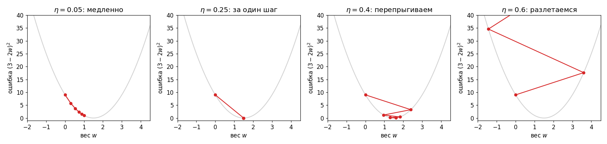
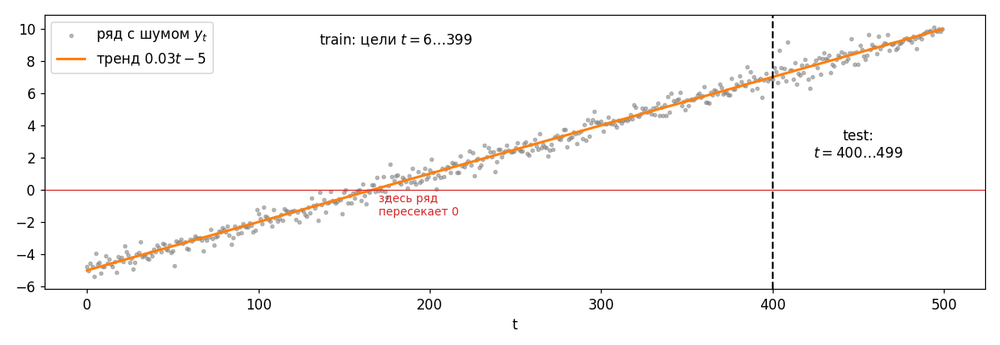

# Лабораторная работа №5: перцептрон и дельта-правило

## Часть 1. Зачем это нужно

### Задача прогноза

Термометр каждую минуту записывает температуру. Последние показания: $18.0,\ 18.2,\ 18.4$. Каким будет следующее?

Скорее всего около $18.6$: температура растёт на $0.2$ в минуту. Ты посмотрел на несколько прошлых чисел и выдал одно новое. Это и есть **прогноз временного ряда**.

Теперь то же самое поручим машине. У неё будет простейший «мозг»: один **нейрон**. Он берёт несколько прошлых показаний, умножает каждое на свой вес, складывает и выдаёт прогноз. Веса сначала случайные, прогнозы плохие. Нейрон сравнивает прогноз с правильным ответом и чуть-чуть подправляет веса. Правило подправки называется **дельта-правилом**. После сотен таких поправок прогноз становится хорошим.

Предсказываем число, значит, это **регрессия**, как в лабе 3. Только там вход был один ($x$), а здесь входов шесть: шесть прошлых значений ряда.

### Что понадобится из прошлых лаб

Эта лаба почти целиком собрана из того, что уже было. Нового по-настоящему два куска: окно по ряду и само дельта-правило.

| Что нужно здесь                               | Где было                                                                                                                                 |
| --------------------------------------------- | ---------------------------------------------------------------------------------------------------------------------------------------- |
| Шум из распределения, дисперсия               | Лаба 1: [экспоненциальное распределение](../../lab1/lesson/lab1.md#экспоненциальное-распределение), [дисперсия](../../lab1/lesson/lab1.md#дисперсия-и-стандартное-отклонение) |
| Шаг против градиента, размер шага             | Лаба 2: [градиентный спуск](../../lab2/lesson/lab2.md#часть-4-градиентный-спуск), [размер шага](../../lab2/lesson/lab2.md#почему-размер-шага-так-важен) |
| Линейная модель, МНК, MSE и MAPE              | Лаба 3: [метрики](../../lab3/lesson/lab3.md#часть-5-метрики-качества), [ловушка с MAPE](../../lab3/lesson/lab3.md#ловушка-третья-mape-здесь-не-работает) |
| Таблица «строки — примеры, столбцы — признаки» | Лаба 4                                                                                                                                   |
| Стандартизация, обучение только на train      | Лаба 4: [масштаб признаков](../../lab4/lesson/lab4.md#важная-ловушка-твоей-лабораторной-масштаб-признаков), [утечка данных](../../lab4/lesson/lab4.md#pca-перед-обучением-модели) |
| Сильно связанные признаки                     | Лаба 4: [корреляция](../../lab4/lesson/lab4.md#корреляция)                                                                               |

Порядок разбора: нейрон → окно по ряду → нормализация → ошибка → дельта-правило → твой вариант → результаты → эксперименты.

---

## Часть 2. Нейрон

### Взвешенная сумма

Нейрон делает два действия. Сначала **сумматор** умножает каждый вход на свой вес, складывает и прибавляет смещение. Потом **активация** превращает сумму в ответ.

Посчитаем по картинке. Входы $z=(1,\ 2,\ 3)$, веса $w=(0.5,\ -1,\ 2)$, смещение $b=1$:

$$
s=0.5\cdot1+(-1)\cdot2+2\cdot3+1=0.5-2+6+1=5.5
$$

Что делает каждый кусок:

- **Вес** $w_j$ говорит, насколько вход $z_j$ важен и в какую сторону тянет ответ. Вес $2$ усиливает вход вчетверо сильнее, чем вес $0.5$ (если входы одинаковые). Вес $-1$ тянет ответ вниз.
- **Смещение** $b$ — ответ нейрона, когда все входы равны нулю. В лабе 3 это свободный член $b_0$.

Это ровно скалярное произведение из лабы 4, плюс число $b$:

$$
\boxed{s=w_1z_1+w_2z_2+\dots+w_nz_n+b=w\cdot z+b}
$$

**Спроси:** вход $z_2$ вырос с 2 до 3. Как изменится $s$?

**Ответ:** на $w_2\cdot1=-1$. Было $5.5$, станет $4.5$. Каждый вес показывает, на сколько меняется сумма, когда его вход растёт на единицу.

### Активация: классификация и регрессия

Сумма $s$ может быть любым числом. Что с ней делать дальше, зависит от задачи.

- **Классификация**: ответ — класс. Например, «прибор исправен» (0) или «сломался» (1). Нужна **пороговая** активация: если $s\ge0$, ответ 1, иначе 0. Для $s=5.5$ получаем класс 1.
- **Регрессия**: ответ — число, например температура. Нужна **линейная** активация $a(s)=s$, то есть никакой обработки. Для $s=5.5$ ответ $5.5$.

В нашей лабе регрессия, поэтому активация линейная, и прогноз нейрона — это просто $\hat y=s$.

| | Классификация | Регрессия |
| --- | --- | --- |
| Ответ | Класс: 0 или 1 | Любое число |
| Активация на выходе | Порог (в современных сетях сигмоида) | Линейная |
| Ошибка, которую уменьшаем | Число неверных ответов (в сетях перекрёстная энтропия) | MSE |
| Как оцениваем | Доля верных ответов | MSE, MAPE, $R^2$ |

### Перцептрон Розенблатта и наш нейрон

Фрэнк Розенблатт в 1958 году построил **перцептрон**: нейрон с пороговой активацией, который учился различать картинки. Правило обучения было такое:

$$
w\leftarrow w+\eta\,(y-\hat y)\,z
$$

Здесь $y$ — правильный класс, $\hat y$ — ответ перцептрона, $\eta$ — скорость обучения. Ответы 0 или 1, поэтому $y-\hat y$ бывает только $0$, $1$ или $-1$. Угадал — веса не трогаем. Ошибся — сдвигаем веса на вход в нужную сторону.

Пример. $z=(1,\ 2)$, $w=(0.5,\ -1)$, $b=0$. Сумма $0.5-2=-1.5<0$, ответ 0. А правильный класс 1. Ошибка $1-0=1$, при $\eta=1$:

$$
w=(0.5+1,\ -1+2)=(1.5,\ 1),\qquad b=0+1=1
$$

Новая сумма $1.5+2+1=4.5\ge0$, ответ 1. Исправился.

В 1960 году Уидроу и Хофф сделали то же для непрерывного выхода. Активация линейная, и ошибка $y-\hat y$ теперь любое число: чем сильнее промахнулись, тем сильнее поправка. Это **дельта-правило** (дельта — греческая буква $\delta$, ей обозначали ошибку). Формула выглядит так же, но, в отличие от правила Розенблатта, это честный градиентный спуск по MSE. Докажем в части 6.

<mark>В лабе написано «перцептрон Розенблатта», но с линейной активацией и дельта-правилом это нейрон Уидроу–Хоффа (ADALINE). Устройство то же, отличается только активация и смысл ошибки.</mark>

### Один нейрон — это линейная регрессия из лабы 3

В [лабе 3](../../lab3/lesson/lab3.md#уравнение-прямой) модель была $\hat y=b_0+b_1x$. Наш нейрон с линейной активацией:

$$
\hat y=b+w_1z_1+w_2z_2+\dots+w_6z_6
$$

Та же прямая, только входов шесть. $b$ играет роль $b_0$, веса $w_j$ — роль $b_1$. Модель та же, что в лабе 3, а находим параметры другим способом: не формулой МНК, а маленькими шагами. Поэтому в конце сверимся с МНК: ответы должны почти совпасть.

**Спроси:** зачем тогда шаги, если есть формула?

**Ответ:** для одного нейрона формула действительно есть. Но в сети из многих нейронов с нелинейными активациями формулы нет, а шаги по градиенту работают всегда. Дельта-правило — самый простой случай обучения нейросети, на нём видна вся механика.

---

## Часть 3. Временной ряд и окно

### Ряд

**Временной ряд** — числа, записанные по порядку во времени: $y_0,\ y_1,\ y_2,\ \dots$. Индекс — момент времени. Переставлять числа нельзя, порядок и есть информация.

У нас есть только ряд. Нет столбца «вход» и столбца «ответ», как в лабе 3. Нужно их сделать.

### Скользящее окно

Идея: прошлые значения — это входы, следующее значение — ответ. Возьмём ряд $1,\ 2,\ 3,\ 4,\ 5$ и окно из двух чисел:

| Входы (окно) | Цель |
| --- | --- |
| $1,\ 2$ | $3$ |
| $2,\ 3$ | $4$ |
| $3,\ 4$ | $5$ |

Окно сдвигается на одно число вправо, и получается новая строка. Из одного ряда вышла таблица, как в лабе 4: строка — пример, столбец — признак. Только признаки здесь особенные: первый столбец — значение два шага назад, второй — шаг назад.

**Спроси:** сколько строк получится из ряда длины 10 с окном 3?

**Ответ:** первая цель может быть только $y_3$: перед ней нужно три значения. Цели $y_3,\dots,y_9$, то есть $10-3=7$ строк.

В твоём варианте окно 6:

$$
x_t=(y_{t-6},\ y_{t-5},\ y_{t-4},\ y_{t-3},\ y_{t-2},\ y_{t-1})\quad\to\quad y_t
$$

Так это выглядит на начале твоего ряда. Синие точки — вход, красная — цель. Внизу копится таблица:

Из 500 значений получится $500-6=494$ строки по 6 чисел.

### Делим по времени

В лабе 4 строки были независимы: неважно, какие из них отправить в test, хоть случайные. Здесь так нельзя.

Окна перекрываются: строка для $y_{101}$ и строка для $y_{100}$ делят пять чисел. Если перемешать строки, в train попадут соседи тестовой строки, и модель будет проверяться на почти тех же данных, что видела. Хуже того, train будет содержать будущее относительно test. А прогноз всегда делают вперёд: учимся на прошлом, проверяем на будущем.

Поэтому режем по времени. Первые 80% ряда — train, последние 20% — test:

| Часть | Цели | Строк |
| --- | --- | --- |
| train | $y_6,\dots,y_{399}$ | 394 |
| test | $y_{400},\dots,y_{499}$ | 100 |

**Спроси:** что будет входом для первой тестовой цели $y_{400}$?

**Ответ:** $y_{394},\dots,y_{399}$. Это числа из train-части ряда, но это нормально: к моменту прогноза они уже известны. Нельзя только одного: использовать саму цель или что-то после неё.

---

## Часть 4. Нормализация

### Стандартизация из лабы 4

Каждый столбец приводим к среднему 0 и отклонению 1:

$$
\boxed{z=\frac{x-\mu}{\sigma}}
$$

Пример. Столбец $2,\ 4,\ 6$: среднее $\mu=4$, отклонения от среднего $-2,\ 0,\ 2$, дисперсия $(4+0+4)/3=8/3$, $\sigma=\sqrt{8/3}\approx1.63$. Получаем $z=-1.22,\ 0,\ 1.22$.

После этого $z$ читается как «на сколько отклонений значение выше среднего». $z=2$ значит «на два типичных разброса выше обычного».

### Только по train

$\mu$ и $\sigma$ считаем **только по train** и этими же числами преобразуем test. Причина та же, что в [лабе 4](../../lab4/lesson/lab4.md#pca-перед-обучением-модели): если считать по всем данным, в преобразование просочится информация о будущем. Это **утечка данных**.

**Спроси:** train-столбец $2,\ 4,\ 6$, тестовое значение $10$. Во что оно превратится?

**Ответ:** $(10-4)/1.63\approx3.67$. Больше любого train-значения, и это честно: тест лежит выше всего, что модель видела. У тебя ряд растёт, поэтому весь test окажется выше train. Это вернётся в части 9.

Цель $y$ не трогаем. Нейрон сразу выдаёт прогноз в единицах ряда.

### Зачем это градиентному спуску

В лабе 4 стандартизация была нужна, чтобы крупные столбцы не забирали себе весь разброс. Здесь причина другая: от масштаба входов зависит **размер шага**. В части 6 увидим, что поправка веса пропорциональна входу. Огромные входы дают огромные шаги, и спуск разлетается, как в [лабе 2 при большом шаге](../../lab2/lesson/lab2.md#почему-размер-шага-так-важен). После стандартизации все входы порядка единицы, и одна скорость обучения подходит для любых единиц измерения.

---

## Часть 5. Ошибка и метрики

Обе метрики из [лабы 3](../../lab3/lesson/lab3.md#часть-5-метрики-качества):

$$
\boxed{MSE=\frac{1}{n}\sum(y_i-\hat y_i)^2}\qquad
\boxed{MAPE=\frac{100\%}{n}\sum\left|\frac{y_i-\hat y_i}{y_i}\right|}
$$

Пример. Цели $2,\ 4$, прогнозы $3,\ 3$. Ошибки $-1$ и $1$.

$$
MSE=\frac{1+1}{2}=1,\qquad MAPE=\frac{100\%}{2}\left(\frac12+\frac14\right)=37.5\%
$$

MSE нейрон и будет уменьшать. MAPE — только для отчёта.

Напоминание из лабы 3: в MAPE делим на $y_i$. Если $y_i$ около нуля, процент взлетает до тысяч. <mark>Твой ряд проходит через ноль</mark>, так что это снова случится. Подробно в части 9.

---

## Часть 6. Дельта-правило

Нейрон есть, ошибка есть. Нужно правило, как менять веса, чтобы ошибка падала. Это градиентный спуск из лабы 2, только функция теперь — ошибка, а переменные — веса.

### Как ошибка зависит от веса

Самый маленький случай. Один вход $z=2$, правильный ответ $y=3$, смещения нет. Прогноз $\hat y=w\cdot2$. Квадрат ошибки как функция веса:

$$
L(w)=(3-2w)^2
$$

Это парабола. Минимум там, где $2w=3$, то есть $w=1.5$: тогда прогноз точный.

Чтобы спускаться, нужна производная. Раскроем скобки:

$$
L(w)=9-12w+4w^2,\qquad L'(w)=-12+8w
$$

В точке $w=0$ производная $-12$: функция падает, значит, $w$ надо увеличивать. Шаг из лабы 2: $w\leftarrow w-\alpha L'(w)$. При $\alpha=0.05$: $w=0-0.05\cdot(-12)=0.6$. Ошибка была $9$, стала $(3-1.2)^2=3.24$.

##### Производная сложной функции

Раскрывать скобки каждый раз неудобно: при шести входах их будет очень много. Есть короткий путь.

$L$ устроена как матрёшка: внутри $u=3-2w$, снаружи квадрат $u^2$. **Правило цепочки**: производная матрёшки равна производной внешней части, умноженной на производную внутренней:

$$
L'(w)=\underbrace{2u}_{(u^2)'}\cdot\underbrace{(-2)}_{(3-2w)'}=2(3-2w)\cdot(-2)
$$

Проверим: $2(3-2w)(-2)=-12+8w$. Совпало с раскрытием скобок.

Смысл: $w$ растёт на чуть-чуть → $u$ меняется в $-2$ раза сильнее → $u^2$ меняется в $2u$ раз сильнее, чем $u$. Скорости перемножаются.

**Спроси:** найди производную $(5-3w)^2$.

**Ответ:** $2(5-3w)\cdot(-3)=-6(5-3w)$. При $w=0$ это $-30$.

### Градиент для нейрона

Теперь настоящий нейрон с двумя входами:

$$
L=(y-\hat y)^2=(y-w_1z_1-w_2z_2-b)^2
$$

Частные производные, как в [лабе 2](../../lab2/lesson/lab2.md#частная-производная): двигаем один параметр, остальные заморожены. Внутренняя часть $u=y-w_1z_1-w_2z_2-b$. При изменении $w_1$ она меняется со скоростью $-z_1$, при изменении $b$ — со скоростью $-1$:

$$
\frac{\partial L}{\partial w_1}=2u\cdot(-z_1)=-2(y-\hat y)z_1,\qquad
\frac{\partial L}{\partial b}=-2(y-\hat y)
$$

Обозначим ошибку $e=y-\hat y$. Шаг против градиента из лабы 2:

$$
w_1\leftarrow w_1-\alpha\cdot(-2ez_1)=w_1+2\alpha\,e\,z_1
$$

Двойку прячут внутрь скорости обучения: $\eta=2\alpha$. Получаем дельта-правило:

$$
\boxed{e=y-\hat y,\qquad w_j\leftarrow w_j+\eta\,e\,z_j,\qquad b\leftarrow b+\eta\,e}
$$

Как его читать:

- **Знак ошибки** задаёт направление. Прогноз ниже правды ($e>0$) — веса двигаются так, чтобы прогноз вырос.
- **Размер ошибки** задаёт силу поправки. Чуть промахнулись — чуть поправили.
- **Вход** $z_j$ задаёт, кому достаётся поправка. Вход был нулевым — его вес ни при чём, не трогаем. Вход был большим — он сильнее повлиял на промах, его вес правим сильнее.
- **Смещение** — вес входа, который всегда равен 1.

### Один шаг руками

Вход $z=(1,\ 2)$, цель $y=3$, старт $w=(0,\ 0)$, $b=0$, $\eta=0.1$.

1. Прогноз: $\hat y=0\cdot1+0\cdot2+0=0$.
2. Ошибка: $e=3-0=3$.
3. Поправки: $w_1=0+0.1\cdot3\cdot1=0.3$, $w_2=0+0.1\cdot3\cdot2=0.6$, $b=0+0.1\cdot3=0.3$.
4. Новый прогноз: $0.3\cdot1+0.6\cdot2+0.3=1.8$. Ошибка $3-1.8=1.2$.

Ошибка упала с 3 до 1.2. Вес второго входа вырос вдвое сильнее, потому что вход вдвое больше.

**Спроси:** а если $\eta=0.5$?

**Ответ:** $w=(1.5,\ 3)$, $b=1.5$, прогноз $1.5+6+1.5=9$. Ошибка $3-9=-6$: перелетели правду вдвое дальше, чем были от неё. Как в лабе 2 при $\alpha=1$.

### Размер шага

Есть простая проверка. На одном примере ошибка после шага умножается на число

$$
1-\eta\,(z_1^2+z_2^2+\dots+1)
$$

Единица в конце — от смещения. В примере выше $z_1^2+z_2^2+1=6$: при $\eta=0.1$ множитель $1-0.6=0.4$, и $3\cdot0.4=1.2$. При $\eta=0.5$ множитель $1-3=-2$, и $3\cdot(-2)=-6$. Сходится с подсчётом руками.

Для параболы $(3-2w)^2$ множитель $1-4\eta$. Четыре режима:

| $\eta$ | Множитель | Что происходит |
| --- | --- | --- |
| 0.05 | 0.8 | Ошибка убывает на 20% за шаг, медленно |
| 0.25 | 0 | Попали в минимум за один шаг |
| 0.4 | $-0.6$ | Перепрыгиваем через минимум, но сходимся |
| 0.6 | $-1.4$ | Каждый прыжок дальше прошлого, разлетаемся |

<mark>Спуск устойчив, пока $\eta\,(\lVert z\rVert^2+1)<2$.</mark> Здесь $\lVert z\rVert^2$ — сумма квадратов входов. Чем крупнее входы, тем меньше допустимый шаг. Вот почему нужна нормализация из части 4.

### По одному примеру или по всем сразу

В лабе 2 был один шаг по всей функции. Здесь функция ошибки — среднее по всем строкам train, и есть два способа:

- **По одному примеру** (так в классическом дельта-правиле и в нашем ГДЗ): взяли строку, сделали шаг, взяли следующую. Каждый шаг смотрит на одну строку, поэтому немного дёргается, зато шагов много.
- **По всем сразу** (пакетный спуск): сложили поправки со всех строк, поделили на $n$, сделали один шаг. Это ровно лаба 2 для функции MSE: $w\leftarrow w+\eta\frac{2}{n}\sum e_iz_i$.

**Эпоха** — один проход по всем строкам train. При обучении по одному примеру за эпоху у нас 394 шага. Порядок строк в каждой эпохе перемешиваем, чтобы веса не подстраивались под конец train.

### Алгоритм целиком

1. Веса и смещение — маленькие случайные числа.
2. Для каждой эпохи:
   1. Перемешать номера строк train.
   2. Для каждой строки: прогноз, ошибка $e$, поправка весов и смещения.
   3. Записать веса, чтобы потом посчитать MSE и MAPE по эпохам.
3. Прогноз на test готовыми весами.

---

## Часть 7. Твой вариант

| Что | Значение |
| --- | --- |
| Ряд | $y_t=0.03t-5+\varepsilon_t$, $t=0,\dots,499$ |
| Шум | Распределение Лапласа, $b=0.3$ |
| Окно | 6 |
| train / test | 80% / 20% по времени: цели до $t=399$ и после |

Ряд начинается с $-5$ и растёт на $0.03$ за шаг. Ноль он проходит при $0.03t=5$, то есть $t\approx167$. Конец train $\approx7$, конец test $\approx10$.

### Шум Лапласа

В лабе 1 было [экспоненциальное распределение](../../lab1/lesson/lab1.md#экспоненциальное-распределение): только положительные значения, малые чаще. Распределение Лапласа — две такие экспоненты, поставленные спиной к спине: шум с равной вероятностью вверх и вниз, малые отклонения чаще больших.

По сравнению с нормальным шумом того же разброса пик острее, а хвосты толще: чаще почти ноль, но и чаще редкие крупные выбросы. Числа:

$$
\text{среднее}=0,\qquad \text{дисперсия}=2b^2=2\cdot0.3^2=0.18,\qquad \sigma=\sqrt{0.18}\approx0.42
$$

В коде `rng.laplace(0, 0.3, N)`: второй аргумент — это $b$, а не отклонение. Та же ловушка, что с `np.random.normal` в лабе 4.

### Чего ждать заранее

Шум каждой точки свой и от прошлого не зависит. Значит, $\varepsilon_t$ предсказать нельзя в принципе, и <mark>MSE на новых данных не может быть меньше дисперсии шума $0.18$</mark>. Это пол.

Что можно сделать лучше всего? Оценить, где сейчас прямая, по шести прошлым точкам. Каждое значение окна — прямая плюс шум. Если усреднить шесть значений, шум частично погасится. Дисперсия суммы независимых слагаемых — сумма дисперсий (это было в лабе 4 при расчёте блоков), а деление на 6 уменьшает дисперсию в 36 раз:

$$
\mathrm{Var}\left(\frac{\varepsilon_1+\dots+\varepsilon_6}{6}\right)=\frac{6\cdot0.18}{36}=0.03
$$

Среднее окна отстаёт от текущего момента: середина окна на 3.5 шага в прошлом, прямая за это время вырастет на $0.03\cdot3.5=0.105$. Идеальный прогноз: среднее окна плюс $0.105$. Его ошибка — новый шум плюс остаток шума окна:

$$
MSE\approx0.18+0.03=0.21
$$

Для сравнения: прогноз «следующее равно последнему» ошибается на два шума сразу, $0.18+0.18=0.36$.

Прогноз заранее: <mark>все шесть весов в исходных единицах около $1/6\approx0.17$, их сумма около 1, смещение около $0.1$, MSE около $0.21$.</mark> Проверим в части 9.

**Спроси:** почему сумма весов должна быть около 1?

**Ответ:** если все шесть значений окна сдвинуть на 1, прямая тоже сдвинулась на 1, и прогноз должен вырасти на 1. Прогноз вырастает на сумму весов.

---

## Часть 8. Пишем код

**Ноутбук.** Переключись в `lab5_live.ipynb`.

---

## Часть 9. Результаты и ловушки

### Что получилось

Обучение с $\eta=0.001$, 50 эпох. Так выглядит обучение (на анимации $\eta=0.0001$, чтобы движение было видно):

Сначала прогноз лежит около нуля. За несколько эпох он поднимается и поворачивается вдоль ряда. Test (красный) догоняет медленнее train (синего), почему — в третьей ловушке.

MSE и MAPE по эпохам:

| Эпоха | MSE train | MSE test | MAPE train | MAPE test |
| --- | --- | --- | --- | --- |
| 0 | 12.379 | 68.585 | 144.4% | 97.0% |
| 1 | 0.653 | 1.956 | 394.1% | 15.3% |
| 2 | 0.344 | 0.483 | 355.3% | 6.7% |
| 5 | 0.179 | 0.259 | 239.0% | 4.7% |
| 10 | 0.163 | 0.238 | 197.4% | 4.4% |
| 50 | 0.162 | 0.237 | 190.1% | 4.4% |

MSE падает за 5–10 эпох, дальше почти не меняется. Модель сошлась.

Прогноз на всём ряде и крупно на test:

Прогноз — гладкая линия около тренда. Шум он не повторяет и не должен: шум непредсказуем. Небольшие волны прогноза — это шум окна, который не до конца усреднился.

Истинные значения против предсказанных:

Точки лежат вдоль диагонали $\hat y=y$. Разброс вокруг неё по вертикали — это шум. Ширина полосы у train и test примерно одинаковая: модель не стала хуже на новых данных.

Сравнение с МНК из лабы 3 и с прогнозом «последнее значение»:

| | Дельта-правило | МНК | Последнее значение |
| --- | --- | --- | --- |
| MSE train | 0.162 | 0.159 | 0.265 |
| MSE test | 0.237 | 0.240 | 0.422 |
| MAPE train | 190.1% | 185.0% | 93.5% |
| MAPE test | 4.38% | 4.44% | 5.91% |

- Дельта-правило почти совпало с МНК. Шаги пришли туда же, куда формула.
- Наивный прогноз хуже почти вдвое: $0.422$ против $0.237$. Ровно как ждали, $0.36$ против $0.21$.

Веса. Модель учили на стандартизированных входах. Чтобы сравнить с частью 7, переведём веса обратно в исходные единицы: $w_j/\sigma_j$.

| | $y_{t-6}$ | $y_{t-5}$ | $y_{t-4}$ | $y_{t-3}$ | $y_{t-2}$ | $y_{t-1}$ | Сумма |
| --- | --- | --- | --- | --- | --- | --- | --- |
| Дельта-правило | 0.155 | 0.150 | 0.194 | 0.152 | 0.166 | 0.184 | 1.001 |
| МНК | 0.096 | 0.120 | 0.241 | 0.088 | 0.229 | 0.226 | 1.000 |

Сумма весов 1.001, смещение 0.100, все веса около $1/6$. <mark>Нейрон сам нашёл правило «возьми среднее окна и прибавь рост за 3.5 шага».</mark> Прогноз из части 7 сбылся.

##### Важная ловушка твоей лабораторной: MAPE на train

Посмотри на таблицу: MAPE train 190%, test 4.4%. При этом MSE train меньше, чем MSE test. Модель на train ошибается меньше, а процент в 40 раз больше. Как так?

Это ловушка из [лабы 3](../../lab3/lesson/lab3.md#ловушка-третья-mape-здесь-не-работает). Ряд проходит через ноль около $t=167$, а это внутри train. Делим на $y$, близкий к нулю, и процент взлетает.

Слева процентная ошибка каждой точки: пик ровно там, где ряд пересекает ноль. Справа абсолютная ошибка: никакого пика, модель ошибается везде одинаково.

| Что считаем | Значение |
| --- | --- |
| Наименьшее $\lvert y\rvert$ в train | 0.0012 |
| Худшая точка: $t=151$, $y=0.0015$ | 40 731% |
| Доля train с $\lvert y\rvert<1$ | 17% |
| MAPE train без точек с $\lvert y\rvert<1$ | 11.2% |
| Медиана процентной ошибки train | 9.2% |
| Наименьшее $\lvert y\rvert$ в test | 6.30 |

Одна точка с ошибкой 40 731% добавляет к среднему по 394 точкам больше 100 процентных пунктов. В test все значения от 6 до 10, делить на них безопасно, отсюда 4.4%.

То же объясняет странность наивного прогноза: у него MAPE train 93.5%, вдвое меньше, чем у нашей модели, хотя MSE у него хуже. Около нуля он случайно ошибся меньше. MAPE здесь просто шумит.

<mark>Вывод: MAPE на train в этой лабе ничего не говорит о качестве. Смотреть на MSE или на $RMSE=\sqrt{MSE}$.</mark> У нас на test $RMSE=0.49$: типичная ошибка полединицы при шуме с $\sigma=0.42$.

##### Ловушка вторая: веса разные, а прогноз один

Веса МНК и дельта-правила заметно разные: у МНК вес $y_{t-3}$ равен 0.088, у дельта-правила 0.152. Но MSE почти одинаковые. Какие веса правильные?

Оба набора одинаково хороши. Все шесть входов почти одно и то же число: соседние значения ряда отличаются только шумом. Это сильно связанные признаки, как $X_4$ и $X_5$ в [лабе 4](../../lab4/lesson/lab4.md#корреляция). Прогноз зависит в основном от **суммы** весов. Как её поделить между входами, почти не важно.

Посмотрим на окно из двух значений, где всё рисуется на плоскости:

Линии уровня MSE вытянуты в длинный узкий овраг вдоль прямой $w_1+w_2=\text{const}$. Поперёк оврага ошибка растёт быстро: сумма весов сразу важна. Вдоль оврага дно почти плоское: можно отнять от $w_1$ и прибавить к $w_2$, ошибка почти не изменится.

Это тот же овраг, что [в лабе 2 на функции Била](../../lab2/lesson/lab2.md#часть-10-результаты-и-ловушка-старта): быстро скатились в овраг, потом медленно ползём по дну. Красный путь дельта-правила за первые эпохи упал в овраг и дальше почти не двигается. А МНК находит самую нижнюю точку дна, даже если она отличается от соседних на тысячные. Поэтому у МНК веса неровные: они подогнаны под конкретный шум train. У дельта-правила веса ровнее, потому что оно стартовало около нуля и вдоль дна почти не шло. На test от этого даже чуть лучше: $0.237$ против $0.240$.

Числами вытянутость видна через собственные значения матрицы $Z^TZ/n$ из лабы 4. Для окна 6: одно $5.94$, остальные пять около $0.01$. Одно сильное направление «все входы растут вместе» и пять почти пустых. Отношение около 600: овраг в 600 раз круче поперёк, чем вдоль.

<mark>Отдельные веса здесь читать нельзя. Смысл имеет только то, что все они около $1/6$ и в сумме дают 1.</mark>

##### Ловушка третья: test лежит выше train

Почему после первой эпохи test MSE втрое больше train: $1.956$ против $0.653$?

Ряд растёт, поэтому весь test выше всего train. После стандартизации тестовые входы от $1.4$ до $2.7$, а train в среднем около нуля. Модель видела точки в середине своего диапазона и должна прогнозировать за его краем. Это **экстраполяция** из [лабы 3](../../lab3/lesson/lab3.md#часть-6-аппроксимация-интерполяция-экстраполяция).

Недоученная модель уже выучила среднее train (смещение), а наклон ещё нет: сумма весов меньше нужной. В середине train это почти не заметно. Но чем дальше от середины, тем больше промах. Поэтому на test недообучение бьёт сильнее, и в анимации красная линия поднимается позже синей.

Когда модель сошлась, разница train и test осталась: $0.162$ против $0.237$. Это не переобучение. Посмотрим, какой шум выпал на каждом участке:

| Участок | Дисперсия шума в выборке | MSE модели |
| --- | --- | --- |
| train | 0.137 | 0.162 |
| test | 0.206 | 0.237 |

Теоретически $0.18$ на обоих. В train случайно выпал шум потише, в test погромче. MSE модели в обоих случаях примерно шум плюс $0.03$, как и ждали в части 7. Если сравнить прогноз не с рядом, а с чистым трендом, на test MSE всего $0.033$.

---

## Часть 10. Эксперименты

### Скорость обучения

Те же данные, тот же старт, 50 эпох, четыре значения $\eta$:

| $\eta$ | MSE train | MSE test | Что видно |
| --- | --- | --- | --- |
| 0.0001 | 0.180 | 0.258 | Медленно, за 50 эпох не дошли до дна |
| 0.001 | 0.162 | 0.237 | Плавно сошлись за 10 эпох |
| 0.01 | 0.165 | 0.268 | Сошлись за одну эпоху, потом дрожат |
| 0.2 | 0.571 | 1.392 | Скачет до сотен, не сходится |

Четыре режима, как на параболе в части 6:

- **Маленький шаг** идёт верно, но долго.
- **Средний** — самый удачный.
- **Крупный** приходит быстро, но не успокаивается. При обучении по одному примеру каждая строка тянет веса к себе, и при большом шаге веса прыгают вокруг дна. Отсюда $0.268$ на test вместо $0.237$.
- **Слишком крупный** разлетается. Проверка из части 6: наибольшее $\lVert z\rVert^2+1$ в train равно 19.3, значит, устойчиво при $\eta<2/19.3\approx0.10$. При $0.2$ крайние строки ряда дают множитель меньше $-1$, и на них веса раскачиваются.

### Число эпох

$\eta=0.001$, разное число эпох:

| Эпох | MSE train | MSE test |
| --- | --- | --- |
| 1 | 0.653 | 1.956 |
| 2 | 0.344 | 0.483 |
| 5 | 0.179 | 0.259 |
| 50 | 0.162 | 0.237 |

После одной эпохи прогноз ниже ряда и наклонён слабее: модель **недообучена**. Чем дальше вправо, тем больше отставание, это третья ловушка. К пяти эпохам почти всё, к 50 — сошлось.

Переобучения с ростом эпох нет: test не растёт. У модели 7 параметров на 394 строки. Подогнать 7 чисел под шум 394 точек невозможно.

**Спроси:** как выбрать число эпох в реальной задаче, где test трогать нельзя?

**Ответ:** отрезать от конца train кусок для проверки, **валидацию**, тоже по времени. Учить на начале, после каждой эпохи смотреть ошибку на валидации и остановиться, когда она перестала падать.

### Нормализация (вопрос 2)

Запишем тот же ряд в сотых долях: все значения умножим на 100. Информации столько же, поменялись только единицы. 3 эпохи с $\eta=0.001$. MSE переведены обратно в исходные единицы (поделены на $100^2$), чтобы сравнивать:

| Эпоха | Без нормализации | Без нормализации, x100 | С нормализацией | С нормализацией, x100 |
| --- | --- | --- | --- | --- |
| 0 | 11.376 | 11.620 | 12.379 | 13.015 |
| 1 | 0.163 | NaN | 0.653 | 0.772 |
| 2 | 0.164 | NaN | 0.344 | 0.397 |
| 3 | 0.168 | NaN | 0.245 | 0.269 |

- **Без нормализации, x100**: веса улетели в бесконечность в первую же эпоху. Входы стали в 100 раз больше, $\lVert x\rVert^2$ — в $10\,000$ раз. Допустимый шаг упал с $0.007$ до $0.0000007$, а мы шагаем $0.001$.
- **С нормализацией**: x100 почти ничего не изменил. После стандартизации входы те же самые, единицы ряда исчезли. Небольшая разница от того, что случайный старт весов одинаковый, а масштаб цели разный.

Честная оговорка: на исходном ряде без нормализации обучение даже быстрее. Значения ряда от $-5$ до $7$, и $\lVert x\rVert^2$ в 15 раз больше, чем у стандартизированных входов. Тот же $\eta$ работает как шаг в 15 раз крупнее. Но это везение: допустимый шаг для сырых данных $0.007$, мы в семи разах от обрыва. Поменяй единицы — и всё сломается.

<mark>Нормализация делает обучение независимым от единиц измерения: один и тот же $\eta$ работает для любых данных.</mark>

### Размер окна и переобучение (вопросы 1 и 5)

Чем длиннее окно, тем больше весов. Посмотрим, что будет при окне от 1 до 150. Дельта-правило сходится к МНК, а большие окна учатся долго, поэтому для скорости берём сразу формулу МНК.

| Окно | Весов | MSE train | MSE test |
| --- | --- | --- | --- |
| 1 | 2 | 0.266 | 0.423 |
| 2 | 3 | 0.196 | 0.301 |
| 6 | 7 | 0.159 | 0.240 |
| 20 | 21 | 0.135 | 0.241 |
| 50 | 51 | 0.125 | 0.256 |
| 100 | 101 | 0.105 | 0.267 |
| 150 | 151 | 0.074 | 0.293 |

- **Окно 1–2**: мало значений для усреднения, модель **недообучена**. Ошибка высокая и на train, и на test.
- **Окно 6–20**: test лучший.
- **Окно 50–150**: train падает до $0.074$, test растёт до $0.293$. Это **переобучение**.

Как понять, что train $0.074$ — это плохо, а не хорошо? Пол для нового шума $0.18$, а модель на train ошибается вдвое меньше. Значит, она частично выучила сам шум train. На test этот шум другой, и выученное мешает. Чем больше весов, тем больше шума можно запомнить.

---

## Часть 11. Итоги

### Главное

- **Нейрон** считает взвешенную сумму входов плюс смещение и пропускает её через активацию: $\hat y=a(w\cdot z+b)$.
- **Активация** определяет задачу: порог — классификация (перцептрон Розенблатта), линейная — регрессия (наш нейрон).
- **Один нейрон с линейной активацией** — это линейная регрессия из лабы 3 с несколькими входами.
- **Скользящее окно** превращает ряд в таблицу: прошлые значения — входы, следующее — цель. Делить на train и test только по времени.
- **Стандартизация** по train делает размер шага независимым от единиц измерения. Параметры считаются только по train.
- **Дельта-правило** $w\leftarrow w+\eta\,e\,z$ — градиентный спуск из лабы 2 по квадрату ошибки. Выводится правилом цепочки.
- **Скорость обучения**: маленькая — долго, большая — дрожание, слишком большая — разлёт. Устойчиво при $\eta(\lVert z\rVert^2+1)<2$.
- **Эпоха** — проход по всем строкам train. Мало эпох — недообучение.
- **Шум ставит пол**: MSE на новых данных не меньше дисперсии шума.
- **MAPE** бессмысленна, когда ряд проходит через ноль.
- **Связанные входы** дают овраг: отдельные веса неустойчивы, важна их сумма.
- **Переобучение** — train намного лучше test и лучше уровня шума. Лечится меньшим числом параметров, большим объёмом данных, валидацией.

### Проверка понимания

Дай решить самостоятельно.

**Спроси:** ряд $5,\ 7,\ 9,\ 11,\ 13$, окно 2. Выпиши таблицу.

**Ответ:** $(5,7)\to9$, $(7,9)\to11$, $(9,11)\to13$. Три строки.

**Спроси:** нейрон с весами $w=(-1,\ 2)$ и $b=0$. Какой прогноз для первой строки?

**Ответ:** $-5+14=9$. Точно. Правило «следующее $=2\cdot$последнее $-$ предпоследнее» продолжает любую прямую, сумма весов $-1+2=1$.

**Спроси:** вход $z=(1,\ -1)$, цель $y=2$, $w=(0,\ 0)$, $b=0$, $\eta=0.25$. Сделай шаг дельта-правила.

**Ответ:** $\hat y=0$, $e=2$. $w_1=0.25\cdot2\cdot1=0.5$, $w_2=0.25\cdot2\cdot(-1)=-0.5$, $b=0.5$. Новый прогноз $0.5+0.5+0.5=1.5$, ошибка $0.5$. Множитель $1-0.25\cdot(1+1+1)=0.25$, и $2\cdot0.25=0.5$. Совпало.

**Спроси:** при каком $\eta$ в этом примере ошибка исчезнет за один шаг? При каком спуск разлетится?

**Ответ:** множитель $1-3\eta$. Ноль при $\eta=1/3$. Разлёт, когда множитель меньше $-1$: $\eta>2/3$.

**Спроси:** найди производную $(y-wz)^2$ по $w$.

**Ответ:** $2(y-wz)\cdot(-z)=-2ez$. Шаг против неё: $w+2\alpha ez$, это дельта-правило.

**Спроси:** шум нормальный с $\sigma=0.5$, окно 4. Какой наименьший MSE можно ждать?

**Ответ:** дисперсия шума $0.25$. Плюс шум среднего окна $0.25/4=0.0625$. Около $0.31$.

**Спроси:** train MAPE 300%, test MAPE 5%. Модель переобучилась?

**Ответ:** не обязательно. Сначала проверить, нет ли в train значений около нуля. Переобучение видно по MSE: train сильно меньше test.

### Ответы на вопросы преподавателя

Проговори их вслух.

**1. Что такое переобучение и как его избежать в задаче регрессии.** Модель запомнила шум обучающих данных вместо закономерности: на train ошибка очень маленькая, на новых данных большая. Признак — ошибка на train ниже уровня шума. У нас при окне 150 MSE train $0.074$ при шуме $0.18$, а test вырос до $0.293$. Как избежать: меньше параметров (короче окно, проще модель), больше данных, проверять на отложенной части по времени и останавливать обучение, когда ошибка на ней перестала падать, штраф за большие веса (регуляризация). В основной модели переобучения нет: 7 параметров на 394 строки.

**2. Почему важно нормализовать данные перед обучением модели.** Поправка веса в дельта-правиле пропорциональна входу, поэтому от масштаба входов зависит размер шага. Устойчиво, пока $\eta(\lVert z\rVert^2+1)<2$. Без нормализации допустимый шаг зависит от единиц измерения: тот же ряд, умноженный на 100, при $\eta=0.001$ разлетелся в первую эпоху, а со стандартизацией обучился так же, как исходный. Ещё нормализация уравнивает признаки разного масштаба, чтобы ни один не доминировал (как в лабе 4). Параметры нормализации считаются только по train.

**3. Как связана скорость обучения со сходимостью модели.** Маленькая скорость — сходимость медленная: при $\eta=0.0001$ за 50 эпох не дошли до дна. Подходящая — быстро и плавно: $\eta=0.001$ сошлась за 10 эпох. Большая — быстро, но веса дрожат вокруг минимума, ошибка чуть выше: $\eta=0.01$. Слишком большая — каждый шаг перелетает минимум всё дальше, обучение разлетается: $\eta=0.2$. Граница по нашей проверке $\eta\approx0.1$.

**4. Можно ли с помощью одного перцептрона аппроксимировать любую функцию? Почему.** Нет. Один нейрон с линейной активацией считает $w\cdot z+b$, то есть только линейную функцию входов: плоскость, а не кривую. С пороговой активацией он делит пространство одной прямой (плоскостью) и не решает даже XOR. Нашему варианту хватает, потому что тренд линейный. Чтобы приближать любую функцию, нужен скрытый слой из многих нейронов с нелинейной активацией: тогда работает теорема об универсальной аппроксимации.

**5. Как визуально понять, что модель недообучена или переобучена.** Недообучение: ошибка высокая и на train, и на test, кривая ошибки по эпохам ещё падает, прогноз систематически отстаёт от данных. У нас после одной эпохи прогноз ниже ряда и наклонён слабее. Переобучение: train сильно ниже test, между кривыми растущий разрыв, train ниже уровня шума, прогноз на train повторяет случайные зигзаги данных. Хорошая модель: обе кривые вышли на плато около уровня шума, прогноз идёт по середине облака точек.
