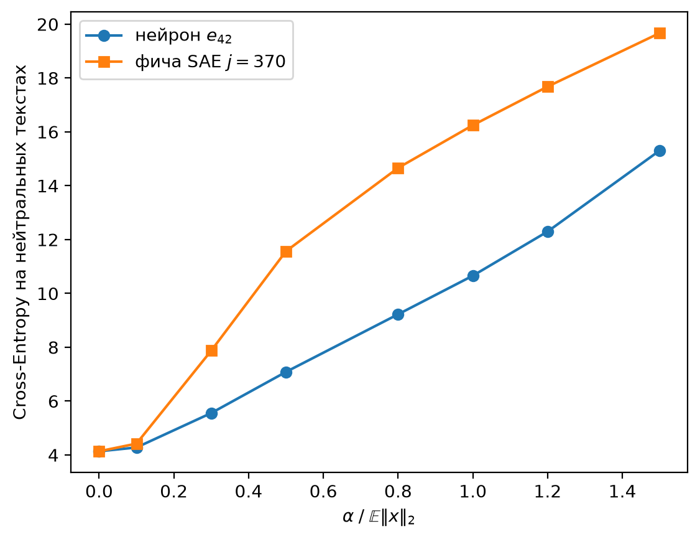

# Конспект: задание 4. Feature Steering против Neuron Steering

Код: `task3_4.py` (калибровка и Эксперимент А) и `task4.py` (Эксперименты Б, В и контрольные задания). Все числа ниже взяты из запуска `task4.py`. Зерно зафиксировано (`torch.manual_seed(69)`), поэтому при повторном запуске они совпадут.

## 1. О чём задание

Внутри языковой модели каждый токен превращается в вектор из 512 чисел. Вопрос задания: что станет с текстом, если на ходу «толкнуть» этот вектор в какую-то сторону? Сравниваем два способа:

- толкать **вдоль одного нейрона**, то есть менять одну координату из 512;
- толкать **вдоль фичи SAE**, то есть вдоль направления, которое автоэнкодер из задания 3 выделил как одно понятие.

Гипотеза из условия такая. Нейрон отвечает за смесь понятий, поэтому толчок по нему превращает текст в мусор. Фича отвечает за одно понятие, поэтому толчок по ней добавляет это понятие в текст и дольше сохраняет грамматику.

## 2. Словарь

| Термин | Простыми словами |
|---|---|
| Токен | кусок текста, с которым работает модель: слово, часть слова или знак. ` (` — отдельный токен «пробел + скобка» |
| Активация $x$ | 512 чисел, в которых модель на слое 3 хранит то, что «знает» о токене |
| Residual stream | общая «шина» трансформера: каждый слой читает вектор $x$ и прибавляет к нему свой результат |
| Нейрон $i$, вектор $e_i$ | $i$-я координата активации; $e_i$ — вектор из нулей с единицей на месте $i$ |
| Суперпозиция | понятий у модели больше, чем координат, поэтому каждое понятие записано не в одну координату, а в направление — комбинацию многих координат |
| Полисемантичный | отвечает за смесь несвязанных понятий (так ведут себя отдельные нейроны) |
| Моносемантичный | отвечает за одно понятие (так должны вести себя латенты SAE) |
| Латент (фича) SAE | один из 2048 «кирпичиков», на которые SAE раскладывает активацию; у него есть сила $f_j$ и направление в декодере |
| Стиринг | во время работы модели прибавляем к $x$ вектор $\alpha v$: $v$ — направление длины 1, $\alpha$ — сила толчка |
| Хук (hook) | функция, которую PyTorch сам вызывает, когда слой посчитал выход; через неё выход можно подменить |
| Cross-Entropy (loss) | штраф за то, насколько модель «удивилась» настоящему следующему токену; меньше — лучше |
| Перплексия | $e^{\text{loss}}$, грубо «из скольких вариантов модель в среднем выбирает» |
| LayerNorm | операция перед каждым блоком трансформера: приводит вектор к стандартной длине |

## 3. Схема эксперимента

```text
промпт "In the middle of the room there was a large table with"
        ↓
слои 0, 1, 2 модели Pythia-70m
        ↓
выход слоя 3: x (512 чисел на каждый токен)
        ↓   хук:  x ← x + α·v,   где v = e_42 или v = v_SAE
слои 4, 5
        ↓
следующий токен → дописываем к тексту и повторяем, всего 25 раз
```

Хук срабатывает на каждом шаге генерации. На первом шаге через слой проходит весь промпт (тензор `[1, 12, 512]`), дальше из-за KV-кэша только новый токен (`[1, 1, 512]`). Вектор `v` формы `[512]` прибавляется к обеим формам сам (broadcasting). Если подменить тензор один раз до `model.generate()`, изменится только первый шаг: на каждом следующем шаге модель заново считает выход слоя.

## 4. Калибровка: какой силы толкать

$\mathbb{E}\|x\|_2 = 43.4$ — средняя длина вектора активации на 16 нейтральных предложениях. Сетка: $\alpha = k \cdot 43.4$, где $k \in \{0.1, 0.3, 0.5, 0.8, 1.0, 1.2, 1.5\}$, то есть от 4.3 до 65.

Медиана длины при этом всего 14.1. Среднее раздувают два выброса в каждом предложении: у первого токена и у финальной точки длина больше 100. У обычного слова длина около 14. Поэтому уже $\alpha = 0.3 \cdot 43.4 = 13$ — добавка длиной с целый обычный токен.

## 5. Эксперимент А: нейрон 42 (сделан в `task3_4.py`)

| α / E‖x‖ | продолжение промпта |
|---:|---|
| 0 | a small table and a small table. "I'm not sure if I can do that." |
| 0.1 | a large table in it. "I was in a room with a large table in it, and I was in |
| 0.8 | gated in he he he he he he … |
| 1.5 | gatedgatedgatedgated… |

Ответы на вопросы к анализу: тему текста интерпретировать нельзя. Хаотичного переключения между темами тоже нет: модель сразу скатывается в повтор одного токена, то есть это дегенерация.

## 6. Эксперимент Б: ищем латент «скобка»

**Данные.** 30 предложений: 6 фраз с пояснением в скобках («The result (see Table 2) was …»), 8 строк кода и формул (`if (a > b) { … }`, `values = [1, 2, 3, 4, 5]`) и 16 нейтральных из калибровки. Первый токен каждого предложения выбрасываем, как при обучении SAE в задании 3: его вектор аномально длинный. Остаётся 308 токенов: 24 целевых (с открывающей скобкой) и 284 остальных.

**Энкодер.** $f(x) = \mathrm{ReLU}(W_{enc}(x - b_{dec}) + b_{enc})$, плюс Top-K: из 2048 значений оставляем 32 самых больших, остальные обнуляем. Это `sae.encode` из задания 3.

**Условия специфичности** для латента $j$:

1. средняя активация на целевых токенах $\gg 0$;
2. на остальных токенах $f_j = 0$ хотя бы в 99 % случаев.

Условие 2 прошли 1260 латентов из 2048. Из них берём тот, у кого больше всего средняя активация на скобках. Результат: **латент $j = 370$**. Средняя активация на скобках 0.58, на остальных токенах 0.00 (нулей 100 %).

**Топ-5 активаций латента 370:**

| $f_j$ | контекст |
|---:|---|
| 2.47 | Our team **(**five people in total) finished the project early. |
| 2.27 | The museum **(**opened in 1920) is free on Mondays. |
| 2.27 | She bought apples **(**red and green) at the market. |
| 2.20 | The result **(**see Table 2) was better than expected. |
| 2.04 | The meeting **(**which lasted three hours) ended at noon. |

**Вывод.** Латент моносемантичен, причём понятие у него уже, чем «скобки вообще»: это **открывающая скобка-пояснение в обычном тексте**. На скобках в коде он почти молчит, поэтому средняя по всем 24 скобкам всего 0.58, хотя на скобках-пояснениях ≈ 2.2. Самая сильная активация в реальном тексте ≈ 2.5.

**Зачем два условия.** Если взять латент с максимальной активацией на одном предложении, легко попасть на «латент пунктуации вообще» или на латент, который горит на большей части текста. Условие 2 такие отсекает: они не молчат на 99 % остальных токенов.

## 7. Эксперимент В: толкаем фичу 370

$v_{SAE} = W_{dec}[370] / \|W_{dec}[370]\|_2$. В условии это столбец $W_{dec}[:, j]$, а в нашем классе матрица хранится транспонированной ($2048 \times 512$), поэтому берём строку. Это направление, которое декодер добавляет к вектору, когда латент 370 включается. Длина $v_{SAE}$ равна 1, как у $e_{42}$, поэтому при одинаковом $\alpha$ толчки одинаковой силы и сравнение честное.

## 8. Контрольное задание 1: сравнительная таблица

| вектор | α / E‖x‖ | α | продолжение промпта |
|---|---:|---:|---|
| нет | 0 | 0 | a small table and a small table. "I'm not sure if I can do that." "I |
| нейрон $e_{42}$ | 0.1 | 4.3 | a large table in it. "I was in a room with a large table in it, and I was in |
| нейрон $e_{42}$ | 0.8 | 34.7 | gated in he he he he he he … |
| нейрон $e_{42}$ | 1.5 | 65.1 | gatedgatedgatedgated… |
| фича 370 | 0.1 | 4.3 | a small table in front. "I'm not sure if I can get the right one." "I |
| фича 370 | 0.8 | 34.7 | notsee2B2B2B2B2B… |
| фича 370 | 1.5 | 65.1 | seeseeseeseesee… |

**Как меняется смысл.**

- **Нейрон.** На слабом α текст другой, но связный. На среднем и сильном появляются токены `gated`, `he`, переносы строк. Они не связаны ни с промптом, ни друг с другом: темы нет.
- **Фича.** На слабом α текст связный, концепта не видно. На среднем и сильном тоже мусор, но тематический: `see`, цифры, `2B` — то, что пишут сразу после открывающей скобки, как в «(see Table 2)». Фича сообщает модели «здесь открылась скобка-пояснение», и модель начинает писать содержимое скобок.

Итог: под воздействием фичи тему текста можно назвать («ссылка в скобках»), под воздействием нейрона нельзя. Это и есть разница между моносемантичным и полисемантичным направлением.

## 9. Контрольное задание 2: loss от силы воздействия

Для каждого α включаем хук и считаем Cross-Entropy модели на 16 нейтральных предложениях. Пустые места в конце коротких предложений (паддинги) исключаем меткой −100.



| α / E‖x‖ | 0 | 0.1 | 0.3 | 0.5 | 0.8 | 1.0 | 1.2 | 1.5 |
|---|---:|---:|---:|---:|---:|---:|---:|---:|
| нейрон $e_{42}$ | 4.14 | 4.28 | 5.56 | 7.08 | 9.23 | 10.66 | 12.30 | 15.31 |
| фича 370 | 4.14 | 4.42 | 7.88 | 11.57 | 14.66 | 16.25 | 17.68 | 19.67 |

**Результат расходится с ожиданием условия:** при одинаковой длине добавки фича портит loss сильнее нейрона.

**Чего ожидали и почему.** Из-за суперпозиции нейрон — смесь многих признаков: толчок по нему меняет их все сразу и ломает грамматику. Фича — один признак, которым модель сама пользуется: толчок по ней меняет одно понятие, а грамматику не трогает.

**Почему у нас вышло наоборот.**

1. **Сетка начинается слишком высоко.** В реальном тексте фича 370 не бывает сильнее ≈ 2.5, а наименьшее α = 4.3, следующее 13. Мы с самого начала подаём признак в силе, которой модель никогда не видела. При α = 4.3 обе кривые ещё почти на базовом уровне: 4.28 и 4.42 при исходных 4.14.
2. **Модель «слушает» направление фичи гораздо внимательнее, чем ось 42.** Дисперсия реальных активаций вдоль $e_{42}$ — 0.17, вдоль $v_{SAE}$ — 1.98, в 12 раз больше. SAE учился на реальных активациях, поэтому его направления лежат там, где модель действительно хранит информацию и откуда её читают следующие слои. Вдоль оси 42 информации почти нет, и толчок по ней частично «пролетает мимо».
3. **Масштаб игрушечный.** Маленькая модель, SAE обучен на 64 тыс. токенов, сравниваются одна фича и один нейрон. Обобщать на большие модели нельзя.

Аналогия: в зале два микрофона. Первый (фича) слушает весь зал, второй (нейрон 42) почти никто. Если громко кричать в первый, зал быстро перестанет понимать докладчика. Крик во второй мешает меньше.

## 10. Контрольное задание 3: фазовый переход в бред

В основной сетке переход спрятан между 0.1 нормы (текст нормальный) и 0.3 нормы (мусор), поэтому смотрим мелкую сетку:

| α / E‖x‖ | α | продолжение промпта |
|---:|---:|---|
| 0.10 | 4.3 | a small table in front. "I'm not sure if I can get the right one." |
| 0.12 | 5.2 | a large table in the front. "The table is a small, but not too large, and the table is |
| 0.14 | 6.1 | a small, but not too large, and the two sides of the two sides of the two sides … |
| 0.16 | 6.9 | a large table in the front. "1.1.1.1.1.1.1.1. |
| 0.18 | 7.8 | a small, but not too large)the2.1.1.1.1.1.1.1. |
| 0.20 | 8.7 | a "1"1.2.1.1.1.1.1.1.1.1.1 |
| 0.22–0.30 | 9.5–13 | a2.2.1.1.1.1.1… → 2.2.1.1.1.1.1… |

**Порог: α\* ≈ 0.15 · E‖x‖ ≈ 7.** До него текст связный (повторы вроде «the two sides of the two sides» бывают и у базовой модели), после него петля из цифр. На самой границе проступает концепт: закрывающая скобка `)` и нумерация `2.1`, как в ссылке «(see 2.1)». Окна, где концепт уже есть, а текст ещё связный, в нашем опыте практически нет.

**Геометрия по шагам.**

1. Реальные активации занимают ограниченную область пространства. Вектор обычного токена — это среднее плюс несколько десятков признаков, каждый силой в пару единиц. Других векторов модель при обучении не видела.
2. Пока α сравнимо с естественной силой признака (у нас до ≈ 2.5), вектор остаётся в этой области. Для модели это просто «в тексте есть скобка».
3. При α ≈ 7 (почти три максимума фичи и половина длины обычного токена, медиана ≈ 14) вектор выходит из области реальных данных. LayerNorm перед каждым блоком приводит вектор к стандартной длине, поэтому чем длиннее добавка, тем меньше остаётся от исходного смысла. Добавка одинакова во всех позициях, и после нормировки векторы разных токенов становятся похожи друг на друга. Модель перестаёт различать контекст, выдаёт самые типичные для скобки токены (`1`, `.`, `)`), а дальше копирует уже написанное. Отсюда петля `1.1.1.1`.
4. При α ≈ 13 (0.3 нормы) добавка уже длиннее вектора обычного токена, и от исходного смысла почти ничего не остаётся.

Оценка на пальцах. Пусть $v$ примерно перпендикулярен $x$ и $\|x\| = 14$. Тогда вектор $x + \alpha v$ повёрнут от $x$ на угол $\arctan(\alpha / \|x\|)$, а после нормировки длины от исходного направления остаётся доля $\cos$ этого угла:

| α | угол поворота | остаётся от $x$ |
|---:|---:|---:|
| 2.5 (естественный максимум фичи) | 10° | 0.98 |
| 7 (порог) | 27° | 0.89 |
| 13 (0.3 нормы) | 43° | 0.73 |
| 65 (1.5 нормы) | 78° | 0.21 |

## 11. Что сказать на защите

1. «Силу воздействия калибрую от средней длины вектора активации: E‖x‖ = 43.4, сетка от 0.1 до 1.5 этой величины. Медиана — 14: среднее раздувают первый токен и точка.»
2. «Нейрон 42 на сильном α выдаёт повтор бессмысленного токена, темы нет: нейрон полисемантичен, а текст вырождается.»
3. «Латент SAE я искал по двум условиям на 30 предложениях: включается на скобках и молчит на 99 % остальных токенов. Нашёлся латент 370 — открывающая скобка-пояснение. Топ-5 активаций это подтверждает.»
4. «При стиринге фичей текст тоже ломается, но в нём появляется содержимое скобок: see, цифры. Значит, фича моносемантична.»
5. «По loss фича оказалась разрушительнее нейрона, не так, как ожидалось. Причины: сетка α начинается выше естественной силы фичи (4.3 против 2.5), и модель сильнее реагирует на направление фичи — данные вдоль него разбросаны в 12 раз сильнее, чем вдоль оси 42.»
6. «Порог перехода в бред — α ≈ 7, около 0.15 нормы: в три раза больше максимума фичи и половина длины обычного токена. Вектор выходит из области реальных активаций, после LayerNorm контекст теряется, и модель зацикливается.»

## 12. Самопроверка

1. Почему α задают в долях E‖x‖, а не числом вроде 50?
2. Чем $e_{42}$ отличается от $v_{SAE}$ и почему у них должна быть одинаковая длина?
3. Зачем условие «молчит на 99 % остальных токенов»? Какой латент оно отсекает?
4. Почему мы берём строку `W_dec[j]`, хотя в условии написано «столбец»?
5. Почему после стиринга фичей 370 в тексте появились `see` и цифры?
6. Почему нужен хук и что будет, если поменять тензор один раз до `model.generate()`?
7. Что останется от вектора после LayerNorm, если добавка в 5 раз длиннее самого вектора?
